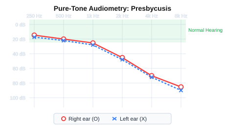
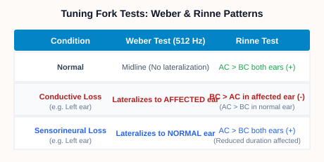
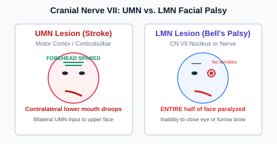
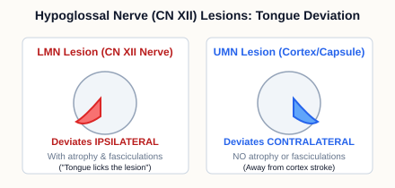
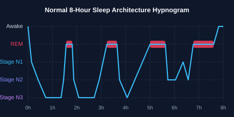

# USMLE Step 1 Review: Units 04–06 Practice Question Bank (105 MCQs)

Source: `~/Downloads/NeuroE2SHeettt_Combined.md`
- **Total Questions:** 105 (IDs 211–315)
- **Unit 04: Auditory & Vestibular Systems:** Questions 211–245 (35 Qs)
- **Unit 05: UMN / LMN Motor Pathways & Brainstem:** Questions 246–280 (35 Qs)
- **Unit 06: Sleep & Sleep Disorders:** Questions 281–315 (35 Qs)

---

### Q211: Auditory & Vestibular Systems  
*Source: Lecture File 10 Slide 7-8: Cochlear Tonotopy*

A 58-year-old metal fabrication worker presents with difficulty hearing high-pitched voices and conversational speech in noisy factory environments. Pure-tone audiometry demonstrates bilateral, symmetrical sensorineural hearing loss that is most severe in the 4,000 to 8,000 Hz range. Where along the basilar membrane of the cochlea are hair cells that detect these high-frequency sounds located, and what physical properties characterize that region?

- **A.** Within the osseous spiral lamina, where hair cells are embedded in dense mineralized bone
- **B.** At the base of the cochlea near the oval window, where the basilar membrane is narrow and stiff
- **C.** Along the middle turn of the cochlea, where the basilar membrane has equal width and tension
- **D.** Inside the endolymphatic sac, where fluid pressure fluctuations are dampened by epithelial cells
- **E.** At the apex of the cochlea near the helicotrema, where the basilar membrane is wide and flexible

Click to view Correct Answer &amp; Explanation

**Correct Answer: B**

The cochlea demonstrates exquisite tonotopic organization along its length. The basilar membrane at the base of the cochlea (near the stapes footplate and oval window) is narrow, thin, and stiff, making it resonate selectively to high-frequency sounds (high pitch). In contrast, the basilar membrane at the apex (near the helicotrema) is wide, thick, and compliant (floppy), resonating to low-frequency sounds (low pitch). High-intensity noise trauma and presbycusis preferentially damage the hair cells at the basal turn of the cochlea.

> **High-Yield Pearl:** Tonotopy: Base of cochlea = narrow & stiff -> high frequency (damaged first in noise trauma/presbycusis). Apex = wide & floppy -> low frequency.

---

### Q212: Auditory & Vestibular Systems  
*Source: Lecture File 10 Slide 8-9 & Content Q7: Inner vs. Outer Hair Cells*

The organ of Corti contains two distinct populations of sensory hair cells: inner hair cells and outer hair cells. A patient receiving high-dose intravenous gentamicin for an enterococcal infection develops auditory toxicity. Electrophysiological testing reveals selective loss of active cochlear amplification. Which statement accurately compares the primary physiological functions of inner and outer hair cells?

- **A.** Inner hair cells are stimulated by low-frequency sounds, whereas outer hair cells detect only linear gravity
- **B.** Outer hair cells generate endocochlear potential, whereas inner hair cells produce endolymph fluid
- **C.** Inner hair cells act as primary sensory transducers, whereas outer hair cells provide electromotile amplification
- **D.** Inner hair cells use the prestin motor protein to oscillate, whereas outer hair cells generate all action potentials
- **E.** Outer hair cells synapse with 95% of afferent axons, whereas inner hair cells receive only sympathetic fibers

Click to view Correct Answer &amp; Explanation

**Correct Answer: C**

Inner hair cells (IHCs, ~3,500 in a single row) are the true sensory transducers of the auditory system, forming synapses with approximately 90-95% of all type I afferent fibers of the cochlear nerve. In contrast, outer hair cells (OHCs, ~12,000 in three rows) receive predominantly efferent innervation and exhibit electromotility: their cell bodies lengthen and contract in response to membrane voltage changes via the membrane motor protein prestin. This somatic electromotility amplifies basilar membrane motion by up to 100-fold ('cochlear amplifier') and sharpens frequency tuning.

> **High-Yield Pearl:** Inner hair cells = primary sensory transducers (95% afferents). Outer hair cells = electromotile cochlear amplifiers (prestin).

---

### Q213: Auditory & Vestibular Systems  
*Source: Lecture File 10 Slide 7-9 & Content Q7: Endolymph & Stria Vascularis*

Unlike most extracellular fluids throughout the human body, the endolymph filling the scala media (cochlear duct) has a unique ionic composition that is essential for hair cell depolarization. Which tissue produces endolymph, and what are its characteristic electrolyte concentrations and electrical potential?

- **A.** Spiral ligament produces endolymph with high calcium, low chloride, and an electrically neutral potential
- **B.** Choroid plexus produces endolymph with high sodium, low potassium, and a -70 mV resting potential
- **C.** Tectorial membrane produces endolymph with isotonic sodium and potassium at a -40 mV potential
- **D.** Arachnoid villi filter endolymph from perilymph with high magnesium and zero electrical charge
- **E.** Stria vascularis produces endolymph with high potassium, low sodium, and a +80 mV positive endocochlear potential

Click to view Correct Answer &amp; Explanation

**Correct Answer: E**

The cochlea contains three compartments: scala vestibuli and scala tympani contain perilymph (similar to CSF and extracellular fluid: high Na+, low K+). The middle compartment, scala media, contains endolymph produced by the stria vascularis in its lateral wall. The stria vascularis actively pumps K+ into endolymph, creating an intracellular-like fluid composition (high K+ ~150 mM, very low Na+ ~1 mM) and generating a large positive transepithelial potential of +80 mV (the endocochlear potential). When stereocilia deflect, this electrochemical gradient drives K+ into hair cells, causing rapid depolarization.

> **High-Yield Pearl:** Endolymph (scala media): High K+, low Na+, +80 mV potential, produced by stria vascularis. Perilymph = high Na+, low K+.

---

### Q214: Auditory & Vestibular Systems  
*Source: Lecture File 10 Slide 6 & Content Q7: Acoustic Reflex & Stapedius*

A 42-year-old woman develops sudden weakness of the entire right side of her face. She is unable to close her right eye or smile, and she notes that sounds such as the clattering of dinner dishes or running water are painfully, intolerably loud in her right ear (hyperacusis). Paralysis of which muscle and cranial nerve accounts for this auditory symptom?

- **A.** Stylohyoid muscle, innervated by the glossopharyngeal nerve (cranial nerve IX)
- **B.** Levator veli palatini, innervated by the vagus nerve (cranial nerve X)
- **C.** Tensor tympani muscle, innervated by the mandibular nerve (cranial nerve V3)
- **D.** Stapedius muscle, innervated by the facial nerve (cranial nerve VII)
- **E.** Lateral pterygoid muscle, innervated by the maxillary nerve (cranial nerve V2)

Click to view Correct Answer &amp; Explanation

**Correct Answer: D**

The middle ear contains two muscles that dampen excessive acoustic vibrations. The stapedius muscle inserts onto the neck of the stapes and is innervated by the nerve to the stapedius, a branch of the facial nerve (CN VII). In response to loud sounds (>80 dB), the stapedius contracts reflexively, pulling the stapes away from the oval window to reduce sound energy transmission into the cochlea (acoustic reflex). Damage to CN VII (such as in Bell's palsy) paralyzes the stapedius, leading to hyperacusis (abnormal perception of everyday sounds as painfully loud).

> **High-Yield Pearl:** Stapedius muscle = innervated by CN VII (facial nerve); dampens stapes footplate. CN VII lesion -> stapedius paralysis -> hyperacusis.

---

### Q215: Auditory & Vestibular Systems  
*Source: Lecture File 10 Slide 6 & Content Q7: Tensor Tympani Muscle*

A patient with a skull base fracture involving the foramen ovale sustains an injury to the mandibular division of the trigeminal nerve (CN V3). In addition to weakness of the muscles of mastication, which auditory muscle is paralyzed, and where does it insert?

- **A.** Anterior auricular muscle, which attaches to the helix of the external ear
- **B.** Salpingopharyngeus muscle, which attaches to the cartilaginous Eustachian tube
- **C.** Tensor tympani muscle, which inserts onto the handle of the malleus
- **D.** Stapedius muscle, which inserts onto the head of the stapes
- **E.** Tensor veli palatini muscle, which inserts directly into the tympanic membrane

Click to view Correct Answer &amp; Explanation

**Correct Answer: C**

The tensor tympani muscle originates from the cartilaginous portion of the pharyngotympanic (Eustachian) tube and sphenoid bone, and inserts onto the handle (manubrium) of the malleus. It is innervated by the mandibular nerve (CN V3, branch of the trigeminal nerve). Contraction of the tensor tympani pulls the malleus medially, tensing the tympanic membrane to dampen internal vibrations caused by mastication (chewing).

> **High-Yield Pearl:** Tensor tympani: Innervated by CN V3 (mandibular nerve); inserts on handle of malleus; dampens chewing sounds.

---

### Q216: Auditory & Vestibular Systems  
*Source: Lecture File 10 Slide 5-20 & Content Q7: Auditory Pathway (ECOLIMA)*

Auditory signals originating in the spiral ganglion follow a well-defined sequential pathway through the brainstem to reach the cerebral cortex. Which sequence correctly traces the ascending flow of auditory information from the peripheral receptor to the primary auditory cortex?

- **A.** Vestibulocochlear nerve -> Vestibular nuclei -> Medial lemniscus -> Superior colliculus -> Lateral geniculate body -> Calcarine cortex
- **B.** Spiral ganglion -> Trapezoid body -> Red nucleus -> Medial longitudinal fasciculus -> Ventral posterior nucleus -> Postcentral gyrus
- **C.** Acoustic nerve -> Solitary nucleus -> Central tegmental tract -> Substantia nigra -> Ventral lateral nucleus -> Precentral gyrus
- **D.** Cochlear nerve -> Cochlear nuclei -> Superior olivary complex -> Lateral lemniscus -> Inferior colliculus -> Medial geniculate body -> Heschl's gyrus
- **E.** Cochlear nerve -> Inferior olivary nucleus -> Restiform body -> Deep cerebellar nuclei -> Thalamic reticular nucleus -> Cingulate gyrus

Click to view Correct Answer &amp; Explanation

**Correct Answer: D**

The ascending auditory pathway follows the classic mnemonic ECOLIMA: Ear (Cochlea & Spiral ganglion / CN VIII) -> Cochlear nuclei (dorsal & ventral in rostral medulla/caudal pons) -> Olivary complex (Superior olivary nucleus in caudal pons) -> Lateral lemniscus (pons) -> Inferior colliculus (caudal midbrain) -> Medial geniculate body (thalamus) -> Auditory cortex (Transverse temporal gyri of Heschl in Brodmann areas 41/42).

> **High-Yield Pearl:** Auditory pathway (ECOLIMA): VIIIth nerve -> Cochlear nuclei -> Superior olive -> Lateral lemniscus -> Inferior colliculus -> MGB -> Auditory cortex.

---

### Q217: Auditory & Vestibular Systems  
*Source: Lecture File 10 Slide 15-20 & Content Q7: Bilateral Representation & Unilateral Deafness*

A 62-year-old man suffers an ischemic stroke destroying the entire right lateral lemniscus and inferior colliculus in the brainstem. On formal pure-tone audiometry, how does this central unilateral brainstem lesion affect his hearing?

- **A.** He develops severe bilateral conductive hearing loss with normal bone conduction thresholds
- **B.** He has complete sensorineural deafness in his left ear with normal hearing in his right ear
- **C.** He has mild bilateral hearing impairment with impaired sound localization, but no monaural deafness in either ear
- **D.** He has complete cortical deafness with inability to comprehend all spoken and musical sounds
- **E.** He has complete sensorineural deafness in his right ear with normal hearing in his left ear

Click to view Correct Answer &amp; Explanation

**Correct Answer: C**

A foundational clinical principle of auditory neuroanatomy is bilateral representation. Auditory axons from the cochlear nuclei decussate extensively in the trapezoid body to reach both ipsilateral and contralateral superior olivary complexes. Beyond the cochlear nuclei, every central auditory structure (lateral lemniscus, inferior colliculus, MGB, and auditory cortex) receives input from BOTH ears. Consequently, a unilateral central lesion anywhere along the pathway from the mid-pons to the auditory cortex does NOT cause monaural deafness; it merely causes slight bilateral threshold shifts and difficulty localizing sound in space.

> **High-Yield Pearl:** Crucial rule: Unilateral central lesions (above cochlear nuclei) NEVER cause monaural deafness because auditory pathways are bilateral above the pons.

---

### Q218: Auditory & Vestibular Systems  
*Source: Lecture File 10 Slide 15 & Content Q7: Superior Olivary Complex & Localization*

While walking down a busy city street, a pedestrian hears a car horn sound suddenly to her left and instantly turns her head toward the vehicle. Which brainstem nucleus is the primary anatomical site responsible for processing binaural timing differences to localize sounds in the horizontal plane?

- **A.** Edinger-Westphal nucleus in the rostral midbrain
- **B.** Lateral geniculate nucleus in the posterior thalamus
- **C.** Dorsal motor nucleus of the vagus nerve in the medulla
- **D.** Subthalamic nucleus of Luys in the ventral diencephalon
- **E.** Medial superior olivary nucleus in the caudal pons

Click to view Correct Answer &amp; Explanation

**Correct Answer: E**

The superior olivary complex, located in the caudal pontine tegmentum, is the first station in the ascending auditory pathway that receives convergent input from both ears (binaural processing). It is specialized for horizontal sound localization: the Medial Superior Olive (MSO) detects interaural time differences (ITD, sub-millisecond differences in when a sound wave arrives at each ear), while the Lateral Superior Olive (LSO) detects interaural level/intensity differences (ILD, sound shadow effects).

> **High-Yield Pearl:** Superior olivary complex (caudal pons) = first site of binaural convergence; specializes in sound localization (MSO = time differences, LSO = intensity).

---

### Q219: Auditory & Vestibular Systems  
*Source: Lecture File 10 Slide 18 & Content Q7: Inferior Colliculus & Startle*

A sudden gunshot fires unexpectedly, causing an individual to reflexively flinch and turn both eyes and head toward the sound. Which caudal midbrain structure integrates ascending acoustic input with motor outputs to coordinate this acoustic startle reflex?

- **A.** Pineal gland, which releases melatonin to activate spinal alpha motor neurons
- **B.** Inferior colliculus, which projects to the superior colliculus and tectospinal tract
- **C.** Periaqueductal gray, which coordinates autonomic descending pain modulation
- **D.** Substantia nigra pars compacta, which releases dopamine into the striatum
- **E.** Red nucleus, which gives rise to the crossed lateral rubrospinal tract

Click to view Correct Answer &amp; Explanation

**Correct Answer: B**

The inferior colliculi are prominent paired dorsal elevations on the tectum of the caudal midbrain. They serve as an obligatory synaptic relay for all ascending auditory fibers. In addition to projecting rostrally via the brachium of the inferior colliculus to the medial geniculate body for conscious hearing, neurons in the inferior colliculus project to the adjacent superior colliculus. The superior colliculus then drives the tectospinal and tectobulbar tracts to execute rapid, involuntary orienting of the eyes, head, and neck toward acoustic stimuli (the acoustic startle reflex).

> **High-Yield Pearl:** Inferior colliculus (caudal midbrain) = obligatory auditory relay; projects to MGB (hearing) and superior colliculus/tectospinal tract (startle reflex).

---

### Q220: Auditory & Vestibular Systems  
*Source: Lecture File 10 Slide 21 & Content Q7: Primary Auditory Cortex (Heschl's Gyrus)*

A 70-year-old stroke patient undergoes functional neuroimaging during an auditory task. The scan demonstrates selective activation of the primary auditory cortex (Brodmann areas 41 and 42). What is the anatomical location of this cortical area?

- **A.** Parahippocampal gyrus along the medial aspect of the temporal lobe adjacent to uncus
- **B.** Transverse temporal gyri of Heschl on the superior surface of the superior temporal gyrus
- **C.** Cuneus gyrus on the medial surface of the occipital lobe above the calcarine fissure
- **D.** Orbitofrontal cortex on the inferior aspect of the frontal lobe above the cribriform plate
- **E.** Postcentral gyrus on the lateral surface of the parietal lobe posterior to central sulcus

Click to view Correct Answer &amp; Explanation

**Correct Answer: B**

The primary auditory cortex (Brodmann areas 41 and 42) is located in the transverse temporal gyri of Heschl. These gyri lie on the superior surface of the superior temporal gyrus, tucked inside the lateral (Sylvian) fissure. Like the cochlea, the primary auditory cortex is organized tonotopically (high frequencies represented posteromedially, low frequencies anterolaterally). Adjacent areas of the superior temporal gyrus form Wernicke's area (Brodmann area 22) in the dominant hemisphere for auditory language comprehension.

> **High-Yield Pearl:** Primary auditory cortex (areas 41 & 42) = Transverse temporal gyri of Heschl on superior temporal gyrus inside Sylvian fissure.

---

### Q221: Auditory & Vestibular Systems  
*Source: Case 3 & Content Q8: Presbycusis*

A 74-year-old retired university professor is brought by his daughter because he has progressive difficulty understanding conversations, particularly when dining in crowded restaurants with background noise. He denies dizziness or ear drainage. Otoscopic exam reveals clear external canals and pearly gray, mobile tympanic membranes. Audiometry shows bilateral, symmetrical high-frequency sensorineural hearing loss, as illustrated in the exhibit. What is the most common underlying cellular pathology?

- **A.** Demyelination of the lateral lemniscus within the dorsal rostral pontine tegmentum
- **B.** Sclerotic ankylosis and fixation of the stapes footplate within the annular ligament
- **C.** Calcification of the endolymphatic duct preventing absorption of endolymph fluid
- **D.** Age-related degeneration and loss of sensory hair cells at the basal turn of the cochlea
- **E.** Chronic bacterial colonization and biofilm formation on the tympanic membrane

Click to view Correct Answer &amp; Explanation

**Correct Answer: D**

Presbycusis is age-related hearing loss and the most common cause of auditory impairment in the elderly. It is characterized by progressive, bilateral, symmetrical sensorineural hearing loss predominantly affecting high frequencies, accompanied by poor speech discrimination, especially in noisy environments (the 'cocktail party effect'). The underlying pathophysiology is progressive loss of sensory hair cells and spiral ganglion neurons, most severe at the basal turn of the cochlea where high-frequency sounds are transduced.

> **High-Yield Pearl:** Presbycusis: Bilateral symmetrical high-frequency sensorineural hearing loss due to loss of hair cells at the base of the cochlea.

---

### Q222: Auditory & Vestibular Systems  
*Source: Content Q8: Otosclerosis & Carhart Notch*

A 32-year-old woman presents with progressive hearing loss in her right ear that began during her second pregnancy. She notes that she hears better in noisy environments than in quiet rooms (paracusis of Willis). Otoscopic examination is normal. Tuning fork exam shows bone conduction greater than air conduction in the right ear (negative Rinne), and the Weber test lateralizes to the right ear. Audiometry demonstrates an air-bone gap with a dip in bone conduction at 2,000 Hz (Carhart's notch). What is the underlying pathology?

- **A.** Granulomatous inflammation of the temporal bone driven by anti-neutrophil antibodies
- **B.** Abnormal bone remodeling of the otic capsule causing fixation of the stapes footplate at the oval window
- **C.** Benign schwannoma of the cochlear nerve growing within the internal acoustic canal
- **D.** Cholesteatoma formation with osteolytic destruction of the incus long process
- **E.** Fibroblastic metaplasia of the basilar membrane within the apical turn of the cochlea

Click to view Correct Answer &amp; Explanation

**Correct Answer: B**

Otosclerosis is an autosomal dominant condition with variable penetrance, commonly presenting in young Caucasian women (frequently accelerating during pregnancy). It is characterized by abnormal fibro-osseous remodeling of the otic capsule, leading to bony ankylosis and fixation of the stapes footplate against the oval window. This impairs ossicular sound transmission, producing progressive conductive hearing loss. Key features include an air-bone gap on audiometry, a characteristic bone-conduction dip at 2,000 Hz ('Carhart notch'), and paracusis of Willis.

> **High-Yield Pearl:** Otosclerosis: Young woman/pregnancy -> conductive hearing loss (stapes footplate fixation at oval window) with Carhart notch at 2 kHz.

---

### Q223: Auditory & Vestibular Systems  
*Source: Lecture File 10 Slide 6 & Content Q8: Weber & Rinne in Conductive Hearing Loss*

A 22-year-old college student presents with reduced hearing in his left ear following an episode of acute otitis media with effusion. On clinical examination, a 512 Hz vibrating tuning fork is placed on his forehead (Weber test) and on his mastoid process followed by beside his ear (Rinne test). Which set of tuning fork results is diagnostic of conductive hearing loss in his left ear?

- **A.** Weber does not lateralize; Rinne shows air conduction greater than bone conduction in both ears
- **B.** Weber lateralizes to the right ear; Rinne shows bone conduction greater than air conduction in the left ear
- **C.** Weber lateralizes to the right ear; Rinne shows air conduction greater than bone conduction in both ears
- **D.** Weber lateralizes to the left ear; Rinne shows bone conduction greater than air conduction in the left ear
- **E.** Weber lateralizes to the left ear; Rinne shows air conduction greater than bone conduction in the left ear

Click to view Correct Answer &amp; Explanation

**Correct Answer: D**

In Conductive Hearing Loss (CHL), sound transmission through the external auditory canal or middle ear is blocked. Rinne test: bone conduction bypasses the obstruction directly through the skull to the cochlea, resulting in Bone Conduction > Air Conduction (BC > AC, a 'negative' Rinne) in the affected ear. Weber test: the sound lateralizes to the AFFECTED ear because the conductive deficit blocks ambient room noise from entering that ear, and bone-conducted sound is heard louder without competitive background masking.

> **High-Yield Pearl:** Conductive Hearing Loss: Rinne = BC > AC (negative) in affected ear; Weber = lateralizes to AFFECTED ear.

---

### Q224: Auditory & Vestibular Systems  
*Source: Lecture File 10 Slide 6 & Content Q8: Weber & Rinne in Sensorineural Hearing Loss*

A 45-year-old woman with a history of head trauma presents with decreased hearing in her right ear. On examination, the Rinne test demonstrates that air conduction is greater than bone conduction in both ears. The Weber test with a 512 Hz tuning fork placed on the center of her forehead sounds significantly louder in her left ear. What type of hearing deficit does this patient have?

- **A.** Conductive hearing loss in her left ear
- **B.** Conductive hearing loss in her right ear
- **C.** Bilateral severe conductive hearing loss
- **D.** Normal auditory function in both ears
- **E.** Sensorineural hearing loss in her right ear

Click to view Correct Answer &amp; Explanation

**Correct Answer: E**

In Sensorineural Hearing Loss (SNHL), the neural apparatus (hair cells or CN VIII) is damaged. In the affected ear, both air and bone conduction are reduced, but Air Conduction remains greater than Bone Conduction (AC > BC, a 'positive' Rinne), though the total duration is shortened. On the Weber test, sound conducted through the skull is perceived louder by the ear with intact sensory machinery; therefore, the sound lateralizes to the NORMAL (unaffected) contralateral ear.

> **High-Yield Pearl:** Sensorineural Hearing Loss: Rinne = AC > BC (positive) in both ears; Weber = lateralizes to NORMAL (unaffected) ear.

---

### Q225: Auditory & Vestibular Systems  
*Source: Content Q6, 8 & Case 4: Acoustic Neuroma (Vestibular Schwannoma)*

A 52-year-old woman presents with progressive, gradual hearing loss in her left ear and persistent high-pitched left-sided tinnitus over the past 14 months. Recently, she has developed mild unsteady gait when walking in the dark and tingling around her left cheek and corner of her mouth. Physical exam reveals an absent left corneal reflex and left sensorineural hearing loss. An MRI with gadolinium reveals an enhancing mass centered at the cerebellopontine angle extending into the internal acoustic canal. Which cell type gave rise to this neoplasm?

- **A.** Oligodendrocytes originating from the central white matter of the pontine tegmentum
- **B.** Arachnoid cap cells originating from the dural meninges over the petrous ridge
- **C.** Chromaffin cells derived from the cranial neural crest of the jugular foramen
- **D.** Ependymal cells lining the lateral recess of the fourth ventricle
- **E.** Schwann cells originating from the vestibular division of cranial nerve VIII

Click to view Correct Answer &amp; Explanation

**Correct Answer: E**

Vestibular schwannomas (acoustic neuromas) are benign, slow-growing tumors arising from Schwann cells of the vestibular nerve (CN VIII), typically at the junction of central and peripheral myelin (Obersteiner-Redlich zone) within the internal acoustic meatus and cerebellopontine angle (CPA). Initial symptoms are unilateral sensorineural hearing loss, tinnitus, and vestibular unsteadiness. As the tumor expands into the CPA, it compresses adjacent cranial nerves: CN VII (facial weakness) and CN V (loss of corneal reflex and facial numbness).

> **High-Yield Pearl:** Vestibular Schwannoma: Benign Schwann cell tumor of CN VIII at cerebellopontine angle -> unilateral SNHL, tinnitus, loss of corneal reflex (CN V).

---

### Q226: Auditory & Vestibular Systems  
*Source: Content Q8: Ototoxicity Mechanisms*

A 63-year-old patient with severe sepsis is treated with intravenous amikacin and high-dose intravenous furosemide. Five days into therapy, the patient complains of constant ringing in both ears (tinnitus) and severe balance disturbance. By which distinct mechanisms do aminoglycosides and loop diuretics induce inner ear damage?

- **A.** Aminoglycosides block acetylcholine receptors in Heschl's gyrus; loop diuretics ablate the medial geniculate body
- **B.** Aminoglycosides cause toxic reactive oxygen species death of outer hair cells; loop diuretics disrupt ion transport in the stria vascularis
- **C.** Aminoglycosides calcify the tympanic membrane; loop diuretics induce aseptic osteomyelitis of the incus
- **D.** Aminoglycosides destroy Schwann cell myelin along the cochlear nerve; loop diuretics paralyze the stapedius muscle
- **E.** Aminoglycosides trigger autoimmune destruction of the cupula; loop diuretics cause otoconia detachment in the utricle

Click to view Correct Answer &amp; Explanation

**Correct Answer: B**

Aminoglycoside antibiotics (e.g., gentamicin, amikacin, tobramycin, streptomycin) generate toxic reactive oxygen species (ROS) and enter sensory hair cells via mechanotransduction channels, causing irreversible apoptotic death of hair cells (outer hair cells damaged before inner hair cells; vestibular hair cells also affected). Loop diuretics (e.g., furosemide, bumetanide, ethacrynic acid) inhibit the Na+/K+/2Cl- cotransporter (NKCC1) in the stria vascularis of the cochlea, disrupting endolymph generation and causing edema and loss of the endocochlear potential (often reversible). Co-administration produces severe synergistic ototoxicity.

> **High-Yield Pearl:** Ototoxicity: Aminoglycosides = ROS damage to outer hair cells (irreversible). Loop diuretics = inhibit NKCC1 in stria vascularis (synergistic).

---

### Q227: Auditory & Vestibular Systems  
*Source: Lecture File 11 Slide 6-9 & Content Q1: Semicircular Canal Physiology*

The vestibular labyrinth contains three semicircular canals arranged orthogonally in three perpendicular planes. What is the precise mechanical stimulus detected by the hair cells within the ampullary crest (crista ampullaris) of these canals?

- **A.** Static gravitational force acting on the body in the upright vertical posture
- **B.** Angular acceleration and rotational movements of the head in three-dimensional space
- **C.** High-frequency sound pressure waves traveling through the perilymphatic duct
- **D.** Linear horizontal acceleration during forward motion in a motor vehicle
- **E.** Changes in atmospheric barometric pressure transmitted across the round window

Click to view Correct Answer &amp; Explanation

**Correct Answer: B**

The three semicircular canals (horizontal/lateral, anterior/superior, and posterior) are arranged at right angles to one another. Each canal has a dilated end called the ampulla, which houses the crista ampullaris. Hair cells in the crista project their stereocilia into a gelatinous sail-like membrane called the cupula that spans the entire lumen. When the head undergoes angular acceleration (rotation), endolymph inertia causes fluid flow relative to the canal walls, deflecting the cupula and bending the stereocilia toward or away from the kinocilium to modulate firing rates.

> **High-Yield Pearl:** Semicircular canals (crista ampullaris & cupula): Detect ANGULAR acceleration (head rotation in 3 planes).

---

### Q228: Auditory & Vestibular Systems  
*Source: Lecture File 11 Slide 10-11 & Content Q1: Otolith Organs (Utricle & Saccule)*

Unlike the semicircular canals, the otolith organs (the utricle and saccule) detect linear acceleration and head tilt relative to gravity. How does the presence of dense calcium carbonate crystals (otoconia) enable the maculae to detect these mechanical forces in endolymph?

- **A.** Otoconia buffer potassium ions in the endolymph to prevent hair cell hyperpolarization during rapid movement
- **B.** Otoconia synthesize and secrete neurotrophin-3 to maintain survival of primary vestibular ganglion cells
- **C.** Otoconia act as acoustic resonators that amplify low-frequency sound waves entering the vestibule
- **D.** Otoconia give the otolithic membrane high mass and density, so gravity and linear inertia displace the membrane across the hair cells
- **E.** Otoconia generate piezoelectric electrical currents that activate voltage-gated calcium channels directly

Click to view Correct Answer &amp; Explanation

**Correct Answer: D**

The utricle and saccule contain sensory receptor organs called maculae. The stereocilia of macular hair cells are embedded in a gelatinous otolithic membrane topped with thousands of dense calcium carbonate stones called otoconia (otoliths). Because endolymph has a specific gravity near 1.0, a simple gelatinous membrane would be buoyant and insensitive to gravity. The dense otoconia give the membrane substantial mass and inertia: when the head tilts or undergoes linear acceleration (horizontal in utricle, vertical in saccule), the heavy otolithic membrane slides across the underlying hair cells, shearing their stereocilia.

> **High-Yield Pearl:** Otolith organs (utricle = horizontal, saccule = vertical/gravity): Dense calcium carbonate otoconia allow detection of LINEAR acceleration & head tilt.

---

### Q229: Auditory & Vestibular Systems  
*Source: Content Q14 & Case 2: Benign Paroxysmal Positional Vertigo (BPPV)*

A 66-year-old woman reports recurrent episodes of violent spinning dizziness lasting 20 to 30 seconds that occur whenever she rolls over in bed to her right side or tilts her head back to look at a high shelf. She has no hearing loss or tinnitus. Performance of the Dix-Hallpike maneuver on the right side produces intense rotational vertigo and mixed upbeat-torsional nystagmus after a 5-second latency that fatigues after 25 seconds. What is the pathophysiologic mechanism, and what is the definitive management?

- **A.** Fistulous communication between the horizontal canal and middle ear; treated with urgent tympanoplasty
- **B.** Excessive endolymph accumulation causing rupture of the membranous labyrinth; treated with intravenous acetazolamide
- **C.** Dislodged otoconia from the utricle freely floating in the posterior semicircular canal (canalithiasis); treated with the Epley maneuver
- **D.** Microvascular compression of the vestibular nerve by the anterior inferior cerebellar artery; treated with surgical decompression
- **E.** Viral demyelinating inflammation of the vestibular ganglion; treated with high-dose intravenous acyclovir and corticosteroids

Click to view Correct Answer &amp; Explanation

**Correct Answer: C**

Benign Paroxysmal Positional Vertigo (BPPV) is the most common cause of peripheral vertigo. It is caused by canalithiasis: calcium carbonate otoconia dislodge from the utricular macula and become trapped in a semicircular canal (most commonly the posterior canal, ~85-90% of cases, due to its gravity-dependent position). Head movement shifts the free-floating debris, creating abnormal endolymph currents that deflect the cupula. Hallmarks on Dix-Hallpike: latency (2-10 seconds), brief duration (<1 minute), torsional upbeat nystagmus, and fatigability upon repeated testing. Definitive treatment is the Epley canalith repositioning maneuver.

> **High-Yield Pearl:** BPPV: Posterior canal canalithiasis (dislodged otoconia from utricle). Dix-Hallpike: torsional nystagmus with latency & fatigue. Treat: Epley maneuver.

---

### Q230: Auditory & Vestibular Systems  
*Source: Content Q14 & Case 2: Meniere's Disease (Endolymphatic Hydrops)*

A 46-year-old man presents with recurrent, disabling episodes of severe spinning vertigo lasting 2 to 4 hours, accompanied by nausea, vomiting, roaring left-sided tinnitus, a feeling of 'fullness' and pressure in his left ear, and fluctuating low-frequency hearing loss. Between attacks, his hearing improves significantly. Physical examination during an episode shows horizontal nystagmus beating to the right. What is the underlying pathophysiologic mechanism?

- **A.** Erosion of the lateral horizontal semicircular canal bone by an expanding chronic middle ear cholesteatoma mass
- **B.** Mechanical displacement of otoconia into the anterior semicircular canal following sudden rotational head trauma
- **C.** Endolymphatic hydrops with excessive accumulation and distension of endolymph within the membranous labyrinth
- **D.** Autoimmune demyelinating destruction of myelin sheaths surrounding the vestibular root entry zone in the brainstem
- **E.** Atheroembolic occlusion of the terminal labyrinthine artery arising from the basilar or anterior inferior cerebellar artery

Click to view Correct Answer &amp; Explanation

**Correct Answer: C**

Meniere's disease (idiopathic endolymphatic hydrops) is caused by impaired resorption or overproduction of endolymph, resulting in progressive swelling and distension of the endolymphatic compartment of the membranous labyrinth. Increased pressure leads to periodic micro-ruptures of the membrane, exposing perilymph to high-potassium endolymph and causing episodic vestibular and cochlear dysfunction. Classic clinical tetrad: 1) Episodic spinning vertigo (lasting 20 min to several hours), 2) Fluctuating low-frequency sensorineural hearing loss, 3) Tinnitus, and 4) Aural fullness. Initial management includes dietary sodium restriction and diuretics (e.g., hydrochlorothiazide/triamterene).

> **High-Yield Pearl:** Meniere's disease: Endolymphatic hydrops. Classic tetrad: Episodic vertigo (hours) + fluctuating low-frequency SNHL + tinnitus + aural fullness. Treat: low-salt diet & diuretics.

---

### Q231: Auditory & Vestibular Systems  
*Source: Case 1 & Content Q14: Vestibular Neuritis*

A 34-year-old man presents to the emergency department with the sudden onset of severe, continuous room-spinning vertigo that began upon waking 24 hours ago. He has severe nausea, multiple bouts of vomiting, and marked unsteadiness, needing to hold onto walls to walk. He had an upper respiratory tract infection one week ago. He has no hearing loss, tinnitus, or headache. Neurological exam reveals spontaneous horizontal-torsional nystagmus with the fast phase beating to the left, which is suppressed when he fixes his gaze on an object. Pure-tone audiometry is completely normal. What is the most likely diagnosis?

- **A.** Vestibular neuritis involving acute inflammation of the right vestibular nerve
- **B.** Vertebrobasilar transient ischemic attack causing transient brainstem ischemia
- **C.** Benign paroxysmal positional vertigo affecting the right horizontal semicircular canal
- **D.** Acute labyrinthitis involving infection of the left cochlea and vestibular apparatus
- **E.** Posterior inferior cerebellar artery (PICA) territory cerebellar ischemic stroke

Click to view Correct Answer &amp; Explanation

**Correct Answer: A**

Vestibular neuritis is an acute, sustained peripheral vestibulopathy typically presumed to result from post-viral inflammation of the vestibular division of CN VIII (often the superior vestibular nerve). Patients present with acute, severe, continuous spinning vertigo lasting days, accompanied by nausea, vomiting, and gait instability. Crucially, auditory function is completely spared (no hearing loss, no tinnitus). Spontaneous unidirectional horizontal-torsional nystagmus beats AWAY from the affected side (fast phase toward the healthy ear) and is suppressed by visual fixation. A positive head impulse test confirms a peripheral deficit.

> **High-Yield Pearl:** Vestibular neuritis: Acute, continuous vertigo + nausea/vomiting + ataxia WITHOUT hearing loss (post-viral CN VIII inflammation). Labyrinthitis has hearing loss.

---

### Q232: Auditory & Vestibular Systems  
*Source: Case 1 & Content Q14: Labyrinthitis*

A 28-year-old woman recovering from an influenza infection wakes up with sudden, severe continuous vertigo, vomiting, profound left-sided hearing loss, and loud left-sided tinnitus. On examination, she has spontaneous horizontal nystagmus beating to the right and marked difficulty walking. How does labyrinthitis differ pathogenetically and clinically from vestibular neuritis?

- **A.** Labyrinthitis involves inflammation of both the cochlear and vestibular divisions, causing hearing loss in addition to vertigo
- **B.** Labyrinthitis is caused by mechanical displacement of otoconia into the anterior canal without inflammation
- **C.** Labyrinthitis is confined exclusively to the cerebellum, causing dysmetria without peripheral nystagmus
- **D.** Labyrinthitis affects only the motor division of the facial nerve, presenting with Bell's palsy
- **E.** Labyrinthitis involves autoimmune vasculitis of the anterior inferior cerebellar artery branches

Click to view Correct Answer &amp; Explanation

**Correct Answer: A**

Acute labyrinthitis involves infection or post-viral inflammatory disruption of the entire membranous labyrinth, thereby affecting both the vestibular apparatus and the cochlea (or both divisions of CN VIII). Clinically, it presents identically to vestibular neuritis with acute, incapacitating, continuous vertigo, nausea, and gait imbalance, but it is uniquely distinguished by the presence of unilateral sensorineural hearing loss and tinnitus in the affected ear.

> **High-Yield Pearl:** Labyrinthitis vs. Vestibular Neuritis: Both present with acute prolonged continuous vertigo; Labyrinthitis includes hearing loss/tinnitus; Vestibular Neuritis spares hearing.

---

### Q233: Auditory & Vestibular Systems  
*Source: Lecture File 11 Slide 23-30 & Content Q3: Vestibulo-Ocular Reflex (VOR) Arc*

The vestibulo-ocular reflex (VOR) maintains stable retinal images during rapid head movements by rotating the eyes with equal velocity in the direction opposite to head motion. When an individual rapidly turns their head to the LEFT, which neural circuit is activated to drive the compensatory conjugate eye movement to the RIGHT?

- **A.** Left horizontal canal -> Left vestibular nucleus -> Right abducens nucleus (via MLF to Left oculomotor nucleus)
- **B.** Bilateral saccules -> Pontine reticular formation -> Direct activation of both superior oblique muscles
- **C.** Right horizontal canal -> Right vestibular nucleus -> Left abducens nucleus (via MLF to Right oculomotor nucleus)
- **D.** Left anterior canal -> Right superior colliculus -> Left trochlear nucleus and medial rectus subnucleus
- **E.** Left utricle -> Left fastigial nucleus -> Bilateral trochlear nerves through the superior medullary velum

Click to view Correct Answer &amp; Explanation

**Correct Answer: A**

When the head turns to the LEFT: 1) Endolymph inertia deflects cupula stereocilia toward the kinocilium in the LEFT horizontal canal, increasing firing in the left vestibular nerve. 2) Left vestibular afferents synapse in the left vestibular nuclei. 3) Second-order axons cross the midline to activate the CONTRALATERAL (RIGHT) abducens nucleus (CN VI). 4) Right abducens motor neurons activate the right lateral rectus muscle (abducting right eye). Concurrently, right abducens internuclear neurons project across the midline via the left Medial Longitudinal Fasciculus (MLF) to the left oculomotor nucleus (CN III) to activate the left medial rectus muscle (adducting left eye). Result: smooth conjugate gaze to the RIGHT.

> **High-Yield Pearl:** VOR for Left head turn: Left horizontal canal -> Left vestibular nucleus -> Right CN VI nucleus -> Right lateral rectus + (via left MLF) Left CN III medial rectus.

---

### Q234: Auditory & Vestibular Systems  
*Source: Lecture File 11 Slide 22 & Content Q3: Vestibulospinal Tracts*

The vestibular nuclei give rise to descending spinal tracts that maintain balance and upright posture against gravity. What is the origin, course, and motor function of the Lateral Vestibulospinal Tract?

- **A.** Arises from the superior vestibular nucleus, traverses the lateral funiculus, and coordinates voluntary fine digital movements
- **B.** Arises from the inferior vestibular nucleus, projects bilaterally to the phrenic nucleus to synchronize diaphragmatic respiration
- **C.** Arises from the lateral vestibular nucleus (Deiters), descends uncrossed in the anterior funiculus, and activates extensor antigravity motor neurons
- **D.** Arises from the medial vestibular nucleus, crosses the midline, and selectively inhibits cervical flexor motor neurons
- **E.** Arises from the reticular formation, descends within the dorsal columns, and mediates visceral sensory reflexes

Click to view Correct Answer &amp; Explanation

**Correct Answer: C**

The Lateral Vestibulospinal Tract (LVST) originates predominantly from large neurons in the lateral vestibular nucleus (Deiters' nucleus) at the pontomedullary junction. It descends uncrossed (ipsilaterally) through the anterior funiculus along the entire length of the spinal cord. It makes excitatory glutamatergic synapses on alpha and gamma motor neurons that innervate axial and limb antigravity extensor muscles (quadriceps, gastrocnemius, back extensors), promoting upright posture and balance in response to linear acceleration and head tilt.

> **High-Yield Pearl:** Lateral vestibulospinal tract (LVST): From lateral vestibular nucleus (Deiters) -> uncrossed in anterior funiculus -> excites antigravity extensor muscles.

---

### Q235: Auditory & Vestibular Systems  
*Source: Content Q14: Peripheral vs. Central Vertigo*

A 68-year-old man with hypertension presents with acute dizziness and ataxia. A physician performs a detailed oculomotor examination to differentiate peripheral from central vertigo. Which examination finding is most characteristic of a CENTRAL brainstem or cerebellar lesion rather than a peripheral inner ear disorder?

- **A.** Unidirectional nystagmus with the fast phase beating consistently in the same direction across all gazes
- **B.** Severe rotational vertigo with pronounced autonomic nausea and vomiting
- **C.** A 5-second latency before the onset of nystagmus and symptoms during positional testing
- **D.** Presence of purely vertical downbeat nystagmus that does not suppress with visual fixation
- **E.** Horizontal-torsional nystagmus that is markedly suppressed when the patient fixates on a visual target

Click to view Correct Answer &amp; Explanation

**Correct Answer: D**

Central vertigo (arising from brainstem or cerebellar pathology such as stroke or demyelination) is distinguished by: 1) Non-suppression of nystagmus by visual fixation (fixation suppresses peripheral nystagmus), 2) Purely vertical (downbeat or upbeat) or purely torsional nystagmus (peripheral nystagmus is almost always mixed horizontal-torsional), 3) Direction-changing nystagmus on lateral gaze, 4) Mild nausea relative to severe gait ataxia (patients often cannot stand unassisted), and 5) Absence of latency or fatigability on positional testing.

> **High-Yield Pearl:** Central vertigo: Pure vertical nystagmus, direction-changing, NOT suppressed by visual fixation, severe ataxia. Peripheral: suppressed by fixation, fatigable.

---

### Q236: Auditory & Vestibular Systems  
*Source: Content Q6: Cerebellopontine Angle (CPA) Anatomy & Syndrome*

A 55-year-old man has a large meningioma occupying the right cerebellopontine angle (CPA). The mass compresses the lateral pontomedullary junction and neighboring structures. Which constellation of neurological signs corresponds to compression of the anatomical structures traversing this specific cistern?

- **A.** Bilateral bitemporal hemianopia, galactorrhea, hypogonadism, and frontal headache
- **B.** Paralysis of upward vertical gaze, light-near pupillary dissociation, and convergence-retraction nystagmus
- **C.** Right sensorineural hearing loss, right peripheral facial weakness, diminished right corneal sensation, and right limb ataxia
- **D.** Right ptosis, right miosis, right anhidrosis, and hoarseness due to right vocal cord paralysis
- **E.** Left spastic hemiplegia, left homonymous hemianopia, expressive motor aphasia, and right gaze preference

Click to view Correct Answer &amp; Explanation

**Correct Answer: C**

The cerebellopontine angle (CPA) is an anatomical cistern between the cerebellum, pons, and petrous temporal bone. Structures passing through or bordering the CPA include: CN VIII (vestibulocochlear: hearing loss, tinnitus, vertigo), CN VII (facial: peripheral ipsilateral facial weakness, loss of anterior tongue taste), CN V (trigeminal: loss of ipsilateral corneal reflex and facial sensation), and the middle/inferior cerebellar peduncles (ipsilateral limb and gait ataxia). A mass in this space (e.g., vestibular schwannoma or meningioma) produces this classic CPA syndrome.

> **High-Yield Pearl:** Cerebellopontine angle (CPA) syndrome: CN VIII (deafness/vertigo) + CN VII (facial palsy) + CN V (loss of corneal reflex) + Cerebellum (ipsilateral ataxia).

---

### Q237: Auditory & Vestibular Systems  
*Source: Lecture File 11 Slide 30: Caloric Testing & Oculocephalic Reflex*

Caloric irrigation testing is used to evaluate the integrity of the vestibulo-ocular pathway in an unconscious patient with suspected brainstem injury. When cold water (30 C) is irrigated into the right external auditory canal of a patient in a coma with an intact, functional brainstem, what ocular response is expected?

- **A.** Immediate conjugate upward elevation of both globes accompanied by bilateral upper eyelid retraction and spasm
- **B.** Rapid oscillatory convergence-retraction nystagmus combined with bilateral extraocular muscle abduction failure
- **C.** Complete pupillary dilation of the right eye accompanied by total loss of the consensual pupillary light reflex
- **D.** Rapid vigorous horizontal nystagmus with the fast corrective phase beating continuously toward the right ear
- **E.** Slow conjugate tonic deviation of both eyes toward the irrigated right ear with absence of fast corrective saccades

Click to view Correct Answer &amp; Explanation

**Correct Answer: E**

Caloric testing stimulates the horizontal semicircular canal via convection currents: cold water cools endolymph, causing it to sink and creating fluid currents away from the ampulla (inhibiting the horizontal canal, mimicking head turn to the opposite side). In an awake, conscious patient, cold water in the right ear produces slow drift toward the right, followed by a fast corrective saccade to the opposite side (COWS: Cold Opposite, Warm Same for the fast phase). In a comatose patient with an INTACT brainstem, cortical saccadic mechanisms are lost; therefore, only the brainstem-mediated slow phase occurs: slow tonic conjugate deviation of both eyes TOWARD the cold-irrigated ear.

> **High-Yield Pearl:** Caloric testing: Conscious = COWS (fast saccades to Cold Opposite, Warm Same). Comatose with intact brainstem = slow tonic deviation TOWARD cold ear.

---

### Q238: Auditory & Vestibular Systems  
*Source: Content Q8: Superior Semicircular Canal Dehiscence*

A 41-year-old woman presents with episodes of brief vertigo and oscillopsia triggered whenever she hears loud musical notes at church or when she blows her nose forcefully (Tullio phenomenon). She also complains of hearing her own voice unusually loud and echoing in her right ear (autophony) and can even hear her own footsteps and heartbeat. High-resolution temporal bone CT confirms an absent bony roof over the right superior semicircular canal. What is the physical mechanism causing these symptoms?

- **A.** A 'third mobile window' in the otic capsule allowing acoustic sound pressure waves to directly deflect the cupula
- **B.** An abnormal fistulous communication between the petrous internal carotid artery and the facial nerve canal
- **C.** Excessive accumulation of dense calcium carbonate otoconia within the lateral horizontal semicircular canal
- **D.** Infiltration and erosion of the round window membrane by chronic destructive cholesteatoma granulation tissue
- **E.** Congenital absence of the stapedius muscle causing unprotected acoustic shock and excessive ossicular vibration

Click to view Correct Answer &amp; Explanation

**Correct Answer: A**

Superior canal dehiscence syndrome (SCDS) is caused by an abnormal opening (dehiscence) in the bony roof of the superior semicircular canal into the middle cranial fossa, creating an abnormal 'third mobile window' into the inner ear (in addition to the normal oval and round windows). Acoustic pressure waves or intracranial pressure changes (coughing, straining, Valsalva) dissipate across this dehiscent window, causing abnormal fluid displacement that deflects the cupula of the superior canal. This produces Tullio phenomenon (vertigo/oscillopsia induced by loud sounds), Hennebert sign (vertigo induced by pressure changes in EAC), and autophony.

> **High-Yield Pearl:** Superior canal dehiscence: 'Third mobile window' over superior canal -> Tullio phenomenon (sound-induced vertigo) & autophony (hearing heartbeat/voice loudly).

---

### Q239: Auditory & Vestibular Systems  
*Source: Content Q8: Perilymphatic Fistula*

A 29-year-old scuba diver experiences sudden, severe right ear pain and popping while making an emergency rapid ascent from 90 feet. Immediately upon surfacing, he develops acute vertigo, nausea, vomiting, and right-sided hearing loss. In the emergency department, applying positive pneumatic pressure into his right external auditory canal with an otoscope elicits sudden vertigo and conjugate eye deviation (positive Hennebert sign). What is the diagnosis?

- **A.** Acute bacterial labyrinthitis spreading from a pre-existing chronic otitis media
- **B.** Benign paroxysmal positional vertigo secondary to concussion-induced canalithiasis
- **C.** Meniere's disease triggered by rapid changes in hydrostatic ambient pressure
- **D.** Perilymphatic fistula caused by barotraumatic rupture of the round or oval window membrane
- **E.** Air embolism occluding the anterior inferior cerebellar artery in the posterior fossa

Click to view Correct Answer &amp; Explanation

**Correct Answer: D**

A perilymphatic fistula is an abnormal leakage of perilymph from the inner ear into the middle ear, most frequently caused by a tear in the thin membrane of the round window or the annular ligament of the oval window. Common etiologies include barotrauma (scuba diving, blast injury, rapid flight descents), direct blunt head trauma, or vigorous straining. Clinical presentation is acute sensorineural hearing loss and episodic vertigo exacerbated by activities that increase middle ear pressure (pneumatic otoscopy: positive Hennebert sign) or intracranial pressure (coughing, sneezing, straining).

> **High-Yield Pearl:** Perilymphatic fistula: Tear in round or oval window (barotrauma/diving/straining) -> perilymph leak into middle ear -> pressure-induced vertigo (Hennebert sign).

---

### Q240: Auditory & Vestibular Systems  
*Source: Content Q3: Head Impulse Test (Halmagyi-Curthoys)*

A physician evaluates a patient with acute persistent vertigo to determine whether a stroke or vestibular neuritis is present. The physician performs the horizontal Head Impulse Test (HIT): the patient fixates on the examiner's nose while the examiner rapidly turns the patient's head approximately 15 degrees to the right. The patient's eyes slide off the target to the right, followed immediately by a rapid, visible corrective catch-up saccade back to the examiner's nose. What does this positive catch-up saccade indicate?

- **A.** An acute ischemic stroke confined to the left paramedian pontine reticular formation
- **B.** Normal, completely intact bilateral peripheral vestibular ocular reflex pathways
- **C.** A central internuclear ophthalmoplegia affecting the right medial longitudinal fasciculus
- **D.** Complete destruction of the cerebellar vermis by a primary glioblastoma multiforme
- **E.** A peripheral vestibular deficit in the right horizontal semicircular canal or vestibular nerve

Click to view Correct Answer &amp; Explanation

**Correct Answer: E**

The Head Impulse Test (HIT) is a critical component of the HINTS exam (Head Impulse, Nystagmus, Test of Skew) used to differentiate peripheral from central acute vestibular syndromes. When the head is thrust rapidly toward a healthy ear, the intact VOR drives the eyes smoothly in the opposite direction, keeping fixation locked on the examiner's nose. If the peripheral VOR is damaged (e.g., right vestibular neuritis), turning the head to the right fails to rotate the eyes fast enough; the eyes move with the head off the target, requiring a visible, rapid 'catch-up saccade' back to the target. Thus, a refixation saccade toward one side indicates a PERIPHERAL vestibular lesion on that side.

> **High-Yield Pearl:** Positive Head Impulse Test: Catch-up saccade when thrusting head toward affected ear -> confirms PERIPHERAL vestibular loss (e.g. vestibular neuritis).

---

### Q241: Auditory & Vestibular Systems  
*Source: Lecture File 11 Slide 21 & Content Q3: Motion Sickness Neurobiology*

A 24-year-old medical student feels nauseated, cold, pale, and diaphoretic while reading lecture notes in the back seat of a moving car on a winding mountain road. What sensory neurobiological mechanism produces motion sickness, and what is the first-line pharmacologic agent for its prevention?

- **A.** Excessive activation of cochlear inner hair cells by engine noise; prevented with oral high-dose gabapentin
- **B.** Sensory mismatch between visual inputs and vestibular otolith/canal signals; prevented with transdermal scopolamine
- **C.** Direct bacterial enterotoxin release into the area postrema; prevented with oral broad-spectrum metronidazole
- **D.** Acute endolymphatic hydrops driven by elevated sympathetic tone; prevented with intravenous furosemide
- **E.** Ischemia of the vestibular nuclei due to vertebral artery kinking; prevented with therapeutic heparin anticoagulation

Click to view Correct Answer &amp; Explanation

**Correct Answer: B**

Motion sickness (kinetosis) results from a sensory conflict (mismatch) between different sensory modalities conveying spatial orientation: while the vestibular apparatus (semicircular canals and otoliths) detects motion and acceleration, the visual system (reading stationary text inside the car) reports that the body is stationary. This conflicting sensory input is relayed from vestibular nuclei to the chemoreceptor trigger zone (area postrema) and solitary tract, activating emetic and autonomic circuits. First-line prophylaxis is transdermal scopolamine (a centrally acting competitive muscarinic receptor antagonist) or H1-antihistamines (e.g., dimenhydrinate, meclizine).

> **High-Yield Pearl:** Motion sickness: Sensory conflict between vestibular (detecting motion) and visual (detecting stillness) inputs. Prophylaxis: Scopolamine (antimuscarinic).

---

### Q242: Auditory & Vestibular Systems  
*Source: Content Q14: Mal de Débarquement Syndrome*

A 48-year-old woman returns from a 7-day Caribbean cruise. Upon stepping off the ship, she notes a continuous, distressing illusion of rocking, swaying, and bobbing, as if she were still on a ship deck at sea. Her hearing is normal, and brain MRI is unremarkable. Surprisingly, when she drives her car, her sensation of rocking completely disappears, only to return immediately once she stops. What condition does this patient have?

- **A.** Vertebrobasilar dolichoectasia compressing the root exit zone of the vestibulocochlear nerve
- **B.** Late-stage Meniere's disease with permanent distension of the endolymphatic duct
- **C.** Acute bilateral vestibular schwannomas associated with neurofibromatosis type 2
- **D.** Benign paroxysmal positional vertigo of both anterior and posterior semicircular canals
- **E.** Mal de débarquement syndrome caused by maladaptive central vestibular neuroplastic adaptation

Click to view Correct Answer &amp; Explanation

**Correct Answer: E**

Mal de débarquement syndrome (MdDS) is a neurological disorder typically triggered by prolonged exposure to passive rhythmic motion (such as ocean travel on a cruise ship, flight, or train). While most travelers experience transient rocking for a few hours after disembarking ('land sickness'), patients with MdDS fail to readapt, suffering persistent illusions of self-motion (rocking, swaying, bobbing) that can last months to years. A unique, pathognomonic hallmark is that symptoms are temporarily relieved by re-exposure to passive motion (such as riding in an automobile).

> **High-Yield Pearl:** Mal de débarquement syndrome: Persistent rocking/swaying after cruise/travel; uniquely improves during passive vehicular motion.

---

### Q243: Auditory & Vestibular Systems  
*Source: Content Q6: Vestibular Schwannoma Surgical Complications*

A 49-year-old man undergoes translabyrinthine surgical resection of a 3.5-cm vestibular schwannoma at the cerebellopontine angle. Immediately postoperatively, he is noted to have complete flaccid paralysis of the ipsilateral upper and lower facial muscles, inability to close his eye, and loss of the corneal blink reflex on that side. Which anatomical nerve was damaged during the tumor removal?

- **A.** Facial nerve (cranial nerve VII), which runs intimately alongside the vestibulocochlear nerve in the internal acoustic meatus
- **B.** Abducens nerve (cranial nerve VI), which ascends through Dorello's canal
- **C.** Trigeminal nerve (cranial nerve V), which enters the brainstem at the mid-pons level
- **D.** Accessory nerve (cranial nerve XI), which ascends through the foramen magnum
- **E.** Glossopharyngeal nerve (cranial nerve IX), which traverses the pars nervosa of the jugular foramen

Click to view Correct Answer &amp; Explanation

**Correct Answer: A**

Cranial nerve VII (facial nerve) and cranial nerve VIII (vestibulocochlear nerve) exit the brainstem at the cerebellopontine angle and travel together into the internal acoustic meatus (IAM) through the petrous temporal bone. Vestibular schwannomas arise from the vestibular nerve within the IAM and expand into the CPA, intimately draping and compressing the facial nerve over the tumor capsule. Resection of large tumors carries a high surgical risk of stretching or transecting CN VII, leading to complete ipsilateral lower motor neuron facial paralysis.

> **High-Yield Pearl:** Vestibular schwannoma surgery: CN VII and CN VIII travel together in the internal acoustic meatus -> high risk of CN VII injury & facial paralysis.

---

### Q244: Auditory & Vestibular Systems  
*Source: Content Q8: Ramsay Hunt Syndrome (Herpes Zoster Oticus)*

A 62-year-old man presents with severe burning pain deep inside his right ear, followed 3 days later by the appearance of painful, grouped vesicular eruptions on his right pinna and external auditory canal. He then develops acute flaccid paralysis of his entire right face (inability to furrow brow or close right eye), marked vertigo with nausea, and right-sided sensorineural hearing loss. Where was the latent pathogen located prior to reactivation?

- **A.** Geniculate ganglion of cranial nerve VII with secondary involvement of adjacent cranial nerve VIII
- **B.** Dorsal root ganglion of the second cervical spinal nerve
- **C.** Inferior ganglion of the glossopharyngeal nerve within the jugular fossa
- **D.** Superior cervical sympathetic ganglion situated anterior to the C2-C3 transverse processes
- **E.** Trigeminal (Gasserian) ganglion of cranial nerve V within Meckel's cave

Click to view Correct Answer &amp; Explanation

**Correct Answer: A**

Ramsay Hunt syndrome (Herpes zoster oticus) is caused by reactivation of latent varicella-zoster virus (VZV) in the geniculate ganglion of the facial nerve (CN VII). The classic triad consists of: 1) Severe otalgia, 2) Vesicular lesions on the external ear (pinna, tragus, external auditory canal), and 3) Acute peripheral facial nerve paralysis (LMN CN VII palsy). Because CN VII and CN VIII travel intimately together within the facial canal and internal acoustic meatus, viral spread commonly causes cochleovestibular symptoms including sensorineural hearing loss, tinnitus, and severe vertigo.

> **High-Yield Pearl:** Ramsay Hunt syndrome: VZV reactivation in geniculate ganglion (CN VII) -> ear vesicles + LMN facial palsy + vertigo/SNHL (CN VIII).

---

### Q245: Auditory & Vestibular Systems  
*Source: Case 3-4 & Content Q14: Multisensory Dizziness in Elderly*

An 82-year-old woman is brought to clinic by her family because she feels progressively 'unsteady on her feet' and has fallen twice in the past 6 months. She describes her sensation not as true spinning vertigo, but as a vague, floating unsteadiness that worsens in dim lighting and when walking on uneven grassy surfaces. Neurological examination reveals bilateral mild high-frequency hearing loss, reduced vibration and position sense in both feet (distal peripheral neuropathy), and visual acuity of 20/70 due to cataracts. What is the diagnosis and primary management?

- **A.** Multisensory dizziness of aging (presbyastasis); managed with physical therapy and vestibular balance rehabilitation
- **B.** Meniere's disease; treated with bilateral surgical labyrinthectomy and vestibular neurectomy
- **C.** Acute basilar artery thrombosis; treated with urgent catheter-directed intra-arterial thrombolysis
- **D.** Idiopathic normal pressure hydrocephalus; treated with urgent ventriculoperitoneal shunting
- **E.** Bilateral acute labyrinthitis; treated with high-dose intravenous corticosteroid therapy

Click to view Correct Answer &amp; Explanation

**Correct Answer: A**

Multisensory dizziness (presbyastasis) is a common, multifactorial cause of chronic dysequilibrium in elderly individuals. Upright balance depends on the brain integrating inputs from three sensory systems: vestibular, visual, and somatosensory (proprioception). Age-related degeneration in two or more of these systems (e.g., loss of vestibular hair cells, cataractous visual decline, and diabetic or sensory peripheral neuropathy) leaves the patient unable to compensate when challenged by poor lighting or uneven surfaces. The condition is managed with fall-prevention measures, assistive devices, cataract extraction, and vestibular rehabilitation therapy.

> **High-Yield Pearl:** Presbyastasis: Multifactorial dysequilibrium in elderly from concurrent deficits in vestibular, visual, and proprioceptive systems. Managed with vestibular rehab.

---

### Q246: UMN / LMN Motor Pathways  
*Source: Lecture File 14 Slide 19-21 & Content Q8: Internal Capsule Somatotopy*

A 64-year-old hypertensive woman has an ischemic stroke involving the posterior limb of the internal capsule. In addition to knowing that corticospinal fibers pass through this structure, the neurologist explains the precise somatotopic arrangement of descending motor fibers from anterior to posterior. In which sequence are body parts represented as the motor fibers travel through the posterior limb of the internal capsule?

- **A.** Lower extremity in the genu, followed by the trunk, upper extremity, and face posteriorly
- **B.** Face in the genu, followed by the upper extremity, trunk, and lower extremity in the posterior limb
- **C.** Face, arm, trunk, and leg mixed randomly throughout the entire anterior limb
- **D.** Trunk in the genu, followed by the face, lower extremity, and upper extremity posteriorly
- **E.** Sensory fibers only in the posterior limb with all motor fibers passing through the anterior limb

Click to view Correct Answer &amp; Explanation

**Correct Answer: B**

The internal capsule demonstrates precise somatotopic organization: Corticobulbar fibers (which control the cranial nerve motor nuclei of the head and face) travel through the GENU. Immediately posterior to the genu, within the anterior half of the POSTERIOR LIMB, corticospinal fibers descend in a strict anterior-to-posterior somatotopic order: Upper Extremity (arm/hand) $\rightarrow$ Trunk $\rightarrow$ Lower Extremity (leg/foot). Farther posterior lie somatosensory thalamocortical fibers from VPL/VPM, followed by optic radiations in the retrolenticular part.

> **High-Yield Pearl:** Internal capsule motor somatotopy: Face/cranial nerves in GENU $\rightarrow$ Arm $\rightarrow$ Trunk $\rightarrow$ Leg in POSTERIOR LIMB.

---

### Q247: UMN / LMN Motor Pathways  
*Source: Lecture File 14 Slide 20 & Content Q8: Cerebral Peduncle Midbrain*

On a transverse histological cross-section through the rostral midbrain, the cerebral peduncles (crus cerebri) form prominent ventral fiber bundles. Where within the crus cerebri do the descending corticospinal and corticobulbar tracts travel, and what fiber tracts flank them medially and laterally?

- **A.** Middle three-fifths of the crus cerebri, flanked medially by frontopontine and laterally by parietotemporopontine fibers
- **B.** Tegmentum between the red nucleus and substantia nigra, surrounded by reticular formation
- **C.** Lateral one-fifth exclusively, flanked medially by the central tegmental tract and rubrospinal fibers
- **D.** Medial one-fifth exclusively, flanked laterally by the spinothalamic tract and medial lemniscus
- **E.** Periaqueductal gray region, flanked dorsally by the superior colliculi and trochlear nucleus

Click to view Correct Answer &amp; Explanation

**Correct Answer: A**

The crus cerebri (basis pedunculi) constitutes the massive ventral portion of the cerebral peduncles in the midbrain. The descending corticospinal and corticobulbar fibers occupy the middle three-fifths of the crus cerebri. They are flanked medially by frontopontine fibers (Arnold's bundle, medial 1/5) originating in the frontal lobe, and flanked laterally by parietopontine, temporopontine, and occipitopontine fibers (Türck's bundle, lateral 1/5). The substantia nigra lies directly dorsal to these descending peduncular tracts.

> **High-Yield Pearl:** Cerebral peduncle (midbrain): Corticospinal and corticobulbar tracts occupy the MIDDLE 3/5 of the crus cerebri.

---

### Q248: UMN / LMN Motor Pathways  
*Source: Lecture File 14 Slide 24-25 & Content Q8: Pyramidal Decussation*

At the cervicomedullary junction (caudal medulla), the descending corticospinal fibers undergo pyramidal decussation. What percentage of fibers cross the midline, where do the crossed fibers descend in the spinal cord, and what motor tasks do they control?

- **A.** 10% cross to form the tectospinal tract in the anterior funiculus, coordinating autonomic respiration
- **B.** 50% cross to form the dorsal column tract, controlling proximal postural axial tone
- **C.** All fibers remain uncrossed in the anterior funiculus to innervate ipsilateral intercostal muscles
- **D.** 100% cross to form the rubrospinal tract, controlling rhythmic stepping patterns during locomotion
- **E.** 85% to 90% cross to form the lateral corticospinal tract in the lateral funiculus, controlling distal skilled limb movements

Click to view Correct Answer &amp; Explanation

**Correct Answer: E**

At the pyramidal decussation in the caudal medulla, approximately 85% to 90% of corticospinal axons cross the midline to the contralateral side and descend in the lateral funiculus of the spinal cord as the Lateral Corticospinal Tract. This tract terminates predominantly on lateral motor neuron pools in the cervical and lumbosacral enlargements to control distal, fractionated, skilled voluntary movements (especially fine finger and hand dexterity). The remaining 10% to 15% of fibers continue uncrossed as the Anterior Corticospinal Tract in the anterior funiculus, projecting bilaterally to medial motor neuron pools controlling axial and proximal girdle muscles for posture.

> **High-Yield Pearl:** Pyramidal decussation: 85-90% cross $\rightarrow$ Lateral Corticospinal Tract (lateral funiculus) $\rightarrow$ distal skilled movements. 10-15% uncrossed $\rightarrow$ Anterior tract (axial/posture).

---

### Q249: UMN / LMN Motor Pathways  
*Source: Lecture File 14 Slide 30-32 & Content Q4: UMN vs. LMN Signs Comparison*

A 56-year-old man presents with progressive weakness in his left arm and leg. Physical examination reveals spastic hypertonia, 4+ hyperactive biceps and patellar reflexes, ankle clonus, and a positive extensor plantar response (Babinski sign). In contrast, another patient in the clinic with a peripheral nerve transection exhibits flaccid weakness, areflexia, marked muscle wasting, and visible fasciculations. Which statement correctly categorizes and contrasts these findings?

- **A.** Fasciculations and spasticity reflect UMN lesions, whereas hyperreflexia and Babinski sign reflect LMN lesions
- **B.** Flaccidity and hyperreflexia reflect UMN lesions, whereas spasticity and muscle wasting reflect LMN lesions
- **C.** Both sets of findings represent progressive stages of lower motor neuron degeneration without central involvement
- **D.** Hyperreflexia, spasticity, and Babinski sign reflect UMN lesions, whereas flaccidity, fasciculations, and muscle atrophy reflect LMN lesions
- **E.** Spasticity and fasciculations are pathognomonic of cerebellar hemisphere infarcts rather than motor pathway disease

Click to view Correct Answer &amp; Explanation

**Correct Answer: D**

Upper Motor Neuron (UMN) lesions (affecting the motor cortex or corticospinal tract) produce 'positive' signs of motor disinhibition: spasticity (velocity-dependent resistance to passive stretch), hyperactive deep tendon reflexes, sustained clonus, clasp-knife rigidity, and a positive Babinski sign (extensor plantar response), with minimal disuse atrophy. Lower Motor Neuron (LMN) lesions (affecting the anterior horn cells, motor roots, or peripheral nerves) disrupt the final common pathway, producing 'negative' signs: flaccid paralysis/hypotonia, hyporeflexia or areflexia, severe neurogenic muscle wasting/atrophy, fasciculations (spontaneous visible motor unit twitches), and fibrillations on EMG.

> **High-Yield Pearl:** UMN lesion: Spasticity, hyperreflexia, clonus, +Babinski. LMN lesion: Flaccid paralysis, areflexia, muscle atrophy, fasciculations.

---

### Q250: UMN / LMN Motor Pathways  
*Source: Lecture File 14 Slide 29-31 & Content Q4: Mechanism of UMN Spasticity*

Following an ischemic stroke affecting the primary motor cortex, a patient initially demonstrates flaccid paralysis that gradually evolves over several weeks into marked velocity-dependent spasticity, clasp-knife resistance, and hyperreflexia. What is the fundamental neurophysiological mechanism responsible for these 'positive' UMN symptoms?

- **A.** Upregulation of nicotinic acetylcholine receptors across denervated skeletal muscle sarcolemma
- **B.** Direct electrical ephaptic transmission between adjacent demyelinated peripheral axons
- **C.** Autoimmune destruction of GABAergic interneurons within the dorsal root ganglion
- **D.** Loss of descending cortical and reticulospinal inhibition, resulting in uninhibited hyperactivity of spinal reflex arcs
- **E.** Selective degeneration of primary group Ia sensory afferent fibers within the muscle spindles

Click to view Correct Answer &amp; Explanation

**Correct Answer: D**

In the intact nervous system, descending projections from the motor cortex and dorsal reticulospinal tracts exert tonic, continuous inhibitory control over spinal segmental reflex arcs (via GABAergic and glycinergic spinal interneurons like Renshaw cells). Following a chronic UMN lesion, this descending inhibitory control is lost. As spinal circuits undergo synaptic remodeling and hypersensitivity, segmental stretch reflexes become uninhibited and hyperactive, causing hyperreflexia, clonus, and velocity-dependent spasticity (resistance increases as passive stretching velocity increases).

> **High-Yield Pearl:** UMN spasticity/hyperreflexia mechanism: Loss of descending inhibitory control from cortex/reticulospinal tracts $\rightarrow$ uninhibited spinal stretch reflexes.

---

### Q251: UMN / LMN Motor Pathways  
*Source: Lecture File 14 Slide 11, 32 & Content Q4: Fasciculations vs. Fibrillations*

A 48-year-old mechanic with a traumatic brachial plexus injury develops profound muscle weakness in his right shoulder and arm. On examination, the physician observes fine, spontaneous, involuntary flickering twitches beneath the skin of the deltoid and biceps muscles. Needle electromyography (EMG) confirms both fasciculation potentials and fibrillation potentials. How do fasciculations and fibrillations differ in their cellular origins and clinical visibility?

- **A.** Fasciculations originate in the primary motor cortex; fibrillations originate in the sensory dorsal root ganglion
- **B.** Fasciculations indicate acute upper motor neuron injury; fibrillations indicate chronic cerebellar Purkinje cell loss
- **C.** Both represent synchronized action potentials in the posterior columns with no relationship to lower motor neurons
- **D.** Fasciculations are spontaneous discharges of an entire motor unit visible to the naked eye; fibrillations are contractions of single muscle fibers visible only on EMG
- **E.** Fibrillations are visible to the naked eye through the skin; fasciculations are detectable only on microscopic muscle biopsy

Click to view Correct Answer &amp; Explanation

**Correct Answer: D**

Fasciculations and fibrillations are cardinal electrophysiological hallmarks of lower motor neuron denervation. A fasciculation is the spontaneous, involuntary firing of a sick or dying anterior horn cell or its axon, which causes synchronous contraction of all muscle fibers in that entire motor unit; because an entire motor unit contracts, fasciculations are visible beneath the skin to the naked eye. In contrast, a fibrillation potential is the spontaneous, rhythmic action potential of a single, denervated muscle fiber (due to denervation acetylcholine hypersensitivity); single muscle fiber contractions generate too little force to be visible through the skin and can be detected only as electrical potentials on needle EMG.

> **High-Yield Pearl:** Fasciculations = whole motor unit discharge, visible to naked eye. Fibrillations = single denervated muscle fiber contraction, seen only on EMG.

---

### Q252: UMN / LMN Motor Pathways  
*Source: Lecture File 14 Slide 30, 32 & Content Q7: Babinski Reflex Physiology*

When a clinician strokes the lateral plantar surface of a normal adult foot from the heel forward to the ball of the foot with a blunt probe, the normal response is plantar flexion (curling downward) of all toes. However, in a patient with a spinal cord compression, the great toe extends upward (dorsiflexes) and the other toes fan outward (positive Babinski sign). What is the physiological basis of this extensor plantar response?

- **A.** Overactivation of the Golgi tendon organ reflex within the gastrocnemius tendon
- **B.** Acute rupture of the flexor digitorum brevis tendon along the plantar aponeurosis
- **C.** Irritation of the cutaneous mechanoreceptors supplied by the saphenous nerve
- **D.** Sympathetic vasoconstriction of the dorsal digital arteries causing muscle ischemia
- **E.** Loss of descending corticospinal suppression unmasks a primitive spinal flexion withdrawal reflex

Click to view Correct Answer &amp; Explanation

**Correct Answer: E**

The Babinski sign (extensor plantar response) is a pathognomonic indicator of corticospinal (UMN) tract damage. In healthy adults, intact descending corticospinal tracts tonically suppress primitive cutaneous withdrawal reflexes, ensuring that plantar stimulation elicits toe flexion. When corticospinal fibers are damaged, this central suppression is abolished, unmasking the primitive spinal nociceptive flexion reflex (extensor hallucis longus activation $\rightarrow$ great toe dorsiflexion and fanning of lesser toes). The Babinski reflex is physiologically normal in neonates and infants up to 12-24 months of age because corticospinal myelination is not yet complete.

> **High-Yield Pearl:** Babinski sign (+ extensor plantar response): Corticospinal (UMN) lesion unmasks primitive flexion withdrawal reflex $\rightarrow$ great toe dorsiflexes, toes fan out. Normal in infants <2yo.

---

### Q253: UMN / LMN Motor Pathways  
*Source: Lecture File 14 Slide 44-48 & Content Q8: Corticobulbar Tract Anatomy*

The corticobulbar (corticonuclear) tract conveys voluntary motor commands from the cerebral cortex to the motor cranial nerve nuclei in the brainstem. What is the precise origin, internal capsule trajectory, and termination of these upper motor neurons?

- **A.** Originates in the postcentral gyrus, descends through the retrolenticular capsule, and terminates in the lateral geniculate body
- **B.** Originates in the supplementary motor area, descends through the anterior limb of the internal capsule, and terminates in the substantia nigra
- **C.** Originates in the face region of the precentral gyrus, descends through the genu of the internal capsule, and terminates on brainstem motor cranial nerve nuclei
- **D.** Originates in the frontal eye fields, descends through the posterior limb of the internal capsule, and terminates in the cuneate nucleus
- **E.** Originates in the cerebellar vermis, descends through the superior cerebellar peduncle, and terminates in the red nucleus

Click to view Correct Answer &amp; Explanation

**Correct Answer: C**

The corticobulbar tract consists of upper motor neurons that arise from the ventral 'face and tongue' representation of the primary motor cortex (inferior precentral gyrus) and adjacent premotor cortex. These fibers converge through the corona radiata to pass specifically through the GENU of the internal capsule (flanked by frontopontine fibers in the anterior limb and corticospinal fibers in the posterior limb). They descend into the brainstem tegmentum to synapse upon motor nuclei of cranial nerves: CN V (mastication), CN VII (facial expression), CN IX/X (nucleus ambiguus: swallowing/speech), CN XI (sternocleidomastoid/trapezius), and CN XII (tongue).

> **High-Yield Pearl:** Corticobulbar tract: Precentral gyrus face area $\rightarrow$ GENU of internal capsule $\rightarrow$ motor cranial nerve nuclei in brainstem.

---

### Q254: UMN / LMN Motor Pathways  
*Source: Lecture File 14 Slide 48, 55 & Content Q8, 9: Bilateral Corticobulbar Innervation*

A 72-year-old man suffers a severe ischemic stroke in the left precentral gyrus. On neurological examination, jaw movements and chewing are completely symmetrical, swallowing is normal, and both sides of the soft palate elevate symmetrically on phonation. Which neuroanatomical principle explains why mastication and palatal function remain intact despite a unilateral motor cortex destruction?

- **A.** The left motor cortex sends inhibitory fibers, so a stroke leads to spastic muscle contraction
- **B.** Mastication and deglutition are driven solely by cerebellar purkinje cell pacemakers
- **C.** The motor nucleus of CN V and the nucleus ambiguus (CN IX/X) receive bilateral corticobulbar innervation
- **D.** The corticobulbar tract completely decussates in the midbrain to provide exclusive contralateral supply
- **E.** These cranial nerve motor nuclei are entirely autonomous and receive no cortical projections

Click to view Correct Answer &amp; Explanation

**Correct Answer: C**

Most motor cranial nerve nuclei receive BILATERAL corticobulbar projections from both cerebral hemispheres. These include: the motor nucleus of CN V (muscles of mastication), the nucleus ambiguus (CN IX and X, pharyngeal and laryngeal muscles for swallowing and vocal cords), and the upper face subnucleus of CN VII. Therefore, a unilateral UMN lesion (such as a stroke in one motor cortex or internal capsule) produces NO significant weakness in the jaw, palate, or vocal cords, because the intact contralateral hemisphere continues to provide motor drive to both sides of these nuclei.

> **High-Yield Pearl:** Bilateral corticobulbar innervation: CN V (mastication), CN IX/X (nucleus ambiguus, palate/swallow) $\rightarrow$ unilateral UMN stroke causes NO deficit.

---

### Q255: UMN / LMN Motor Pathways  
*Source: Lecture File 14 Slide 49-54 & Content Q10: CN VII UMN vs. LMN Lesion (Forehead Sparing)*

A 67-year-old man with hypertension and atrial fibrillation presents to the emergency department with acute weakness of the right side of his face. On examination, when asked to smile, the right corner of his mouth droops and he cannot puff out his right cheek. However, when asked to raise his eyebrows and wrinkle his forehead, both sides of his forehead wrinkle symmetrically, and he can close both eyes tightly. Where is the lesion located, and why is his upper face spared?

- **A.** Right geniculate ganglion within the temporal bone; the upper facial branch recovers faster from viral inflammation
- **B.** Right facial motor nucleus in the caudal pons (LMN lesion); the frontalis muscle is protected by collateral motor axons from CN VI
- **C.** Left oculomotor nucleus in the rostral midbrain; levator palpebrae superioris compensates for frontalis paralysis
- **D.** Right facial nerve in the stylomastoid foramen (LMN lesion); the forehead muscles are innervated by the trigeminal nerve
- **E.** Left motor cortex or corticobulbar tract (UMN lesion); the upper face motor nucleus of CN VII receives bilateral corticobulbar input

Click to view Correct Answer &amp; Explanation

**Correct Answer: E**

The facial motor nucleus (CN VII) in the caudal pons is anatomically divided into two subnuclei: 1) The dorsal subnucleus, which innervates muscles of the UPPER face (frontalis and orbicularis oculi), receives BILATERAL corticobulbar innervation. 2) The ventral subnucleus, which innervates muscles of the LOWER face, receives ONLY CONTRALATERAL corticobulbar innervation. In a unilateral UMN lesion (e.g., left MCA stroke or internal capsule infarct), the left upper face subnucleus still receives input from the intact right hemisphere, sparing the right forehead. In contrast, an LMN lesion (Bell's palsy or CN VII nucleus lesion) destroys the final common pathway, causing complete flaccid paralysis of the entire ipsilateral face (both upper forehead and lower mouth).

> **High-Yield Pearl:** CN VII UMN lesion (stroke): Contralateral lower face droops, FOREHEAD SPARED (bilateral UMN input). CN VII LMN lesion (Bell's palsy): ENTIRE ipsilateral face paralyzed.

---

### Q256: UMN / LMN Motor Pathways  
*Source: Lecture File 14 Slide 43, 58 & Content Q10: CN XII Tongue Deviation (UMN vs. LMN)*

Two patients present with tongue deviation on protrusion. Patient A has an ischemic stroke of the right precentral gyrus (UMN lesion). Patient B has a traumatic transection of the right hypoglossal nerve in the neck (LMN lesion). To which side does the tongue deviate in each patient, and what associated findings differentiate them?

- **A.** Patient A's tongue deviates to the left (contralateral) without atrophy; Patient B's tongue deviates to the right (ipsilateral) with atrophy and fasciculations
- **B.** Patient A's tongue remains strictly midline; Patient B's tongue deviates bilaterally with loss of sensation
- **C.** Both patients' tongues deviate to the right with prominent fasciculations and loss of taste on the anterior two-thirds
- **D.** Both patients' tongues deviate to the left with bilateral hyperreflexia of the masseter stretch reflex
- **E.** Patient A's tongue deviates to the right with fasciculations; Patient B's tongue deviates to the left without atrophy

Click to view Correct Answer &amp; Explanation

**Correct Answer: A**

The genioglossus muscle protrudes the tongue by pushing it forward and toward the opposite (contralateral) side. In normal health, both genioglossi push equally, keeping the tongue in the midline. The hypoglossal motor nucleus receives predominantly contralateral corticobulbar input. In Patient A (UMN lesion of right motor cortex): the left genioglossus is paretic; when the patient protrudes the tongue, the intact right genioglossus pushes unopposed, causing the tongue to deviate to the CONTRALATERAL (LEFT) side, without muscle wasting. In Patient B (LMN lesion of right CN XII): the right genioglossus is paralyzed and atrophic; the intact left genioglossus pushes unopposed, causing the tongue to deviate toward the IPSILATERAL (RIGHT / damaged) side, with marked muscle atrophy and fasciculations ('licks the lesion').

> **High-Yield Pearl:** Hypoglossal lesion: LMN (CN XII) = deviates IPSILATERAL (toward lesion) with atrophy/fasciculations. UMN (cortex/capsule) = deviates CONTRALATERAL (away from lesion) without atrophy.

---

### Q257: UMN / LMN Motor Pathways  
*Source: Lecture File 14 Slide 42-43 & Content Q9: CN XI (Accessory Nerve) Examination*

A 24-year-old man undergoes lymph node biopsy in the posterior triangle of the neck. Postoperatively, he has difficulty elevating his right arm above the horizontal plane and complains of a drooping right shoulder. When asked to turn his head forcefully to the left against resistance, the contraction of his right sternocleidomastoid muscle is markedly weakened. Which cranial nerve was injured, and what is its peripheral course?

- **A.** Hypoglossal nerve (cranial nerve XII), which crosses the carotid triangle superficial to the hyoglossus muscle
- **B.** Accessory nerve (cranial nerve XI), which emerges from cervical cord segments C1-C5 and traverses the posterior triangle of the neck
- **C.** Phrenic nerve, which descends along the anterior surface of the scalenus anterior muscle in the neck
- **D.** Glossopharyngeal nerve (cranial nerve IX), which passes through the jugular foramen and courses around the stylopharyngeus
- **E.** Ansa cervicalis, which loops around the internal jugular vein to supply the infrahyoid strap muscles

Click to view Correct Answer &amp; Explanation

**Correct Answer: B**

The spinal accessory nerve (CN XI) arises from lower motor neurons located in the anterior horn of cervical spinal cord segments C1 through C5. Its rootlets ascend through the foramen magnum, join the cranial rootlets briefly, exit the skull via the jugular foramen, and course superficial to the levator scapulae in the posterior triangle of the neck. It innervates the sternocleidomastoid (SCM) and trapezius muscles. Contraction of the right SCM turns the head to the CONTRALATERAL (left) side. The trapezius elevates the shoulder. Its superficial location in the posterior cervical triangle makes CN XI vulnerable to injury during lymph node biopsies, resulting in shoulder drop, winging of the scapula, and impaired contralateral head rotation.

> **High-Yield Pearl:** CN XI (Accessory nerve): Innervates SCM (turns head to opposite side) & Trapezius (elevates shoulder). Vulnerable in posterior triangle of neck.

---

### Q258: UMN / LMN Motor Pathways  
*Source: Content Q11 & Case 3: Medial Medullary Syndrome (Dejerine)*

A 63-year-old man with uncontrolled hypertension collapses at work. Examination reveals: 1) Flaccid paralysis and fasciculations of the right half of his tongue, with deviation to the right on protrusion; 2) Spastic hemiplegia of his left arm and leg with hyperreflexia and a positive left Babinski sign; 3) Loss of vibration and proprioception (joint position sense) in his left arm and leg with spared pain and temperature sensation. Occlusion of which artery caused this brainstem stroke?

- **A.** Posterior cerebral artery (PCA), causing paramedian midbrain infarction
- **B.** Posterior inferior cerebellar artery (PICA), causing lateral medullary syndrome
- **C.** Superior cerebellar artery (SCA), causing dorsal midbrain syndrome
- **D.** Anterior spinal artery or paramedian branches of the vertebral artery, causing medial medullary syndrome
- **E.** Anterior inferior cerebellar artery (AICA), causing lateral pontine syndrome

Click to view Correct Answer &amp; Explanation

**Correct Answer: D**

Medial Medullary Syndrome (Dejerine syndrome) results from infarction of the medial medulla due to occlusion of the anterior spinal artery (ASA) or vertebral artery paramedian branches. The ischemic territory damages three key longitudinal structures: 1) Hypoglossal nerve rootlets (CN XII) $\rightarrow$ ipsilateral LMN tongue weakness, atrophy, and deviation to the right. 2) Corticospinal tract in the medullary pyramid (prior to decussation) $\rightarrow$ contralateral spastic hemiplegia (left hemiparesis, +Babinski). 3) Medial lemniscus $\rightarrow$ contralateral loss of proprioception and vibration sense (left side). The spinothalamic tract is lateral and spared, preserving pain and temperature.

> **High-Yield Pearl:** Medial medullary syndrome (ASA occlusion): Ipsilateral tongue deviation (CN XII) + Contralateral spastic hemiplegia (pyramid) + Contralateral loss of proprioception/vibration (medial lemniscus).

---

### Q259: UMN / LMN Motor Pathways  
*Source: Content Q11: Lateral Medullary Syndrome (Wallenberg)*

A 58-year-old man presents with sudden vertigo, nausea, vomiting, intractable hiccups, and difficulty swallowing (dysphagia) with a hoarse voice. Examination shows: loss of the gag reflex on the right, deviation of the uvula to the left, right Horner syndrome (ptosis, miosis, anhidrosis), right-sided limb ataxia with dysmetria, loss of pain and temperature over the right side of the face, and loss of pain and temperature over the left arm, trunk, and leg. Muscle strength in all four limbs is completely normal (5/5). Occlusion of which vessel accounts for this stroke?

- **A.** Labyrinthine artery, causing isolated cochleovestibular ischemia with peripheral deafness and nystagmus
- **B.** Anterior spinal artery (ASA), causing medial medullary syndrome with crossed hemiplegia and CN XII palsy
- **C.** Posterior inferior cerebellar artery (PICA), causing lateral medullary syndrome (Wallenberg syndrome)
- **D.** Middle cerebral artery (MCA), causing contralateral hemiplegia and sensory loss across the upper body
- **E.** Basilar artery perforating branches, causing paramedian caudal pontine infarction and hemiparesis

Click to view Correct Answer &amp; Explanation

**Correct Answer: C**

Lateral Medullary Syndrome (Wallenberg syndrome) is caused by occlusion of the Posterior Inferior Cerebellar Artery (PICA) or vertebral artery. Key involved structures include: 1) Nucleus ambiguus (CN IX/X) $\rightarrow$ dysphagia, hoarseness, absent right gag reflex, uvula deviates to the left (opposite side). 2) Vestibular nuclei $\rightarrow$ severe vertigo, nystagmus, vomiting. 3) Inferior cerebellar peduncle $\rightarrow$ ipsilateral limb ataxia. 4) Spinal trigeminal nucleus/tract $\rightarrow$ loss of facial pain and temperature on the IPSILATERAL (right) side. 5) Spinothalamic tract $\rightarrow$ loss of body pain and temperature on the CONTRALATERAL (left) side ('crossed' sensory loss). 6) Descending sympathetic tract $\rightarrow$ ipsilateral Horner syndrome. Crucially, the motor pyramid is in the medial medulla and is spared; motor strength is normal.

> **High-Yield Pearl:** Lateral medullary syndrome (PICA stroke): Nucleus ambiguus (dysphagia/hoarseness) + Vertigo + Ipsilateral face / Contralateral body pain/temp loss + Horner syndrome. NO MOTOR WEAKNESS.

---

### Q260: UMN / LMN Motor Pathways  
*Source: Content Q11: Weber Syndrome (Paramedian Midbrain)*

A 70-year-old diabetic man develops sudden diplopia and left-sided hemiplegia. Examination reveals that his right eye is turned 'down and out', with severe ptosis of the right upper eyelid and a widely dilated right pupil that is non-reactive to light. The left arm and left leg demonstrate 1/5 muscle strength with spastic hypertonia, hyperactive deep tendon reflexes, and an extensor plantar response. Where is the infarct located, and which two anatomical structures are involved?

- **A.** Dorsal rostral midbrain (Parinaud syndrome), involving the pretectal area and posterior commissure
- **B.** Caudal pontine tegmentum (Foville syndrome), involving the abducens nucleus and facial motor nucleus
- **C.** Ventral medial medulla (Dejerine syndrome), involving the pyramid and hypoglossal nerve fibers
- **D.** Ventral midbrain (Weber syndrome), involving the fascicles of CN III and the corticospinal tract in the crus cerebri
- **E.** Lateral medulla (Wallenberg syndrome), involving the spinothalamic tract and inferior cerebellar peduncle

Click to view Correct Answer &amp; Explanation

**Correct Answer: D**

Weber syndrome (superior alternating hemiplegia) is a classical vascular brainstem syndrome caused by occlusion of the paramedian branches of the posterior cerebral artery (PCA) or basilar bifurcation, infarcting the ventral midbrain. The lesion damages: 1) Oculomotor nerve (CN III) fascicles exiting through the tegmentum $\rightarrow$ ipsilateral CN III palsy (ptosis, 'down and out' eye position, non-reactive mydriasis). 2) Corticospinal and corticobulbar tracts descending in the middle three-fifths of the crus cerebri (cerebral peduncle) $\rightarrow$ contralateral spastic hemiplegia (left hemiparesis with UMN signs).

> **High-Yield Pearl:** Weber syndrome (ventral midbrain, PCA branch): Ipsilateral CN III palsy (down & out, blown pupil) + Contralateral spastic hemiplegia (cerebral peduncle).

---

### Q261: UMN / LMN Motor Pathways  
*Source: Content Q11: Millard-Gubler Syndrome (Caudal Pons)*

A 61-year-old man has a stroke in the caudal ventral pons. On examination, he is unable to abduct his right eye past the midline on horizontal gaze (right internal strabismus). He has complete flaccid paralysis of the entire right side of his face, including inability to wrinkle his right forehead or close his right eye. In addition, he has spastic hemiparesis and hyperreflexia of his left arm and left leg. Which three structures are damaged in this Millard-Gubler syndrome?

- **A.** Abducens nerve (CN VI), facial nerve (CN VII), and the corticospinal tract in the ventral caudal pons
- **B.** Vestibulocochlear nerve (CN VIII), glossopharyngeal nerve (CN IX), and dorsal column nuclei
- **C.** Oculomotor nerve (CN III), red nucleus, and the medial lemniscus in the dorsal tegmentum
- **D.** Hypoglossal nerve (CN XII), medial longitudinal fasciculus, and the sympathetic tract
- **E.** Trochlear nerve (CN IV), trigeminal nerve (CN V), and the spinothalamic tract in the midbrain

Click to view Correct Answer &amp; Explanation

**Correct Answer: A**

Millard-Gubler syndrome (ventral caudal pontine syndrome) is typically caused by occlusion of circumferential branches of the basilar artery or anterior inferior cerebellar artery (AICA). The lesion damages three structures passing through the ventral caudal pons: 1) Abducens nerve (CN VI) fibers $\rightarrow$ ipsilateral lateral rectus paralysis (inability to abduct the right eye). 2) Facial nerve (CN VII) fibers $\rightarrow$ complete ipsilateral peripheral (LMN) facial paralysis involving both forehead and lower mouth. 3) Uncrossed corticospinal tract fibers $\rightarrow$ contralateral spastic hemiplegia of the left arm and leg.

> **High-Yield Pearl:** Millard-Gubler syndrome (ventral caudal pons): Ipsilateral CN VI palsy + Ipsilateral CN VII palsy (entire face) + Contralateral hemiplegia (corticospinal).

---

### Q262: UMN / LMN Motor Pathways  
*Source: Content Q11: Foville Syndrome (Dorsal Caudal Pons)*

A patient presents with acute horizontal conjugate gaze paralysis: when asked to look to the right, neither eye can move past the midline to the right, although leftward horizontal gaze is intact. In addition, the patient exhibits complete right-sided peripheral facial paralysis (involving upper and lower face) and left spastic hemiparesis. What additional structure is involved in this Foville syndrome compared to Millard-Gubler?

- **A.** Trochlear nucleus, causing vertical diplopia and compensatory head tilting
- **B.** Superior colliculus, causing vertical upward gaze paralysis and lid retraction
- **C.** Medial longitudinal fasciculus alone, causing internuclear ophthalmoplegia on contralateral gaze
- **D.** Paramedian pontine reticular formation (PPRF) or abducens nucleus, causing conjugate lateral gaze palsy toward the lesion
- **E.** Frontal eye field in the contralateral cerebral cortex, causing eyes to look toward the hemiplegia

Click to view Correct Answer &amp; Explanation

**Correct Answer: D**

Foville syndrome is a dorsal caudal pontine tegmental syndrome. While Millard-Gubler involves the exiting nerve root of CN VI (causing isolated ipsilateral lateral rectus palsy), Foville syndrome involves the abducens nucleus itself or the adjacent Paramedian Pontine Reticular Formation (PPRF). Because the abducens nucleus contains internuclear neurons that project to the contralateral medial rectus via the MLF, a nuclear/PPRF lesion paralyzes CONJUGATE horizontal gaze toward the side of the lesion (conjugate lateral gaze palsy). Associated damage to the adjacent CN VII fascicle produces ipsilateral peripheral facial palsy, and damage to the underlying corticospinal tract produces contralateral hemiparesis.

> **High-Yield Pearl:** Foville syndrome: Caudal pontine tegmentum involving PPRF/CN VI nucleus + CN VII + corticospinal $\rightarrow$ Conjugate gaze palsy toward lesion + facial palsy + hemiplegia.

---

### Q263: UMN / LMN Motor Pathways  
*Source: Content Q11: Raymond Syndrome*

A 65-year-old woman with small-vessel vascular disease presents with acute double vision and left-sided body weakness. Physical examination reveals an isolated inability to abduct the right eye on right lateral gaze, with normal vertical eye movements and normal adduction of both eyes. The facial muscles are completely symmetrical and normal. Muscle testing shows spastic weakness of the left arm and leg with an upgoing toe. Which structures are infarcted in this Raymond syndrome?

- **A.** Cervical spinal cord involving the anterior horn cells and dorsal columns
- **B.** Lateral medulla involving the inferior olivary nucleus and solitary tract
- **C.** Ventral midbrain involving CN III fascicles and the substantia nigra
- **D.** Dorsal rostral pons involving the medial lemniscus and superior cerebellar peduncle
- **E.** Ventral medial pons involving ipsilateral CN VI fascicles and the corticospinal tract, with sparing of CN VII

Click to view Correct Answer &amp; Explanation

**Correct Answer: E**

Raymond syndrome is a ventral medial caudal pontine syndrome. It is caused by an infarct of the paramedian branches of the basilar artery that damages the exiting fascicles of the abducens nerve (CN VI) and the descending corticospinal tract, but is small and medial enough to spare the more laterally positioned facial nerve (CN VII) fibers. Consequently, it presents with an ipsilateral lateral rectus palsy (inability to abduct the ipsilateral eye) and contralateral hemiparesis, but WITHOUT facial paralysis.

> **High-Yield Pearl:** Raymond syndrome (ventral medial pons): Ipsilateral CN VI palsy + Contralateral hemiparesis (spares CN VII).

---

### Q264: UMN / LMN Motor Pathways  
*Source: Content Q11: Claude vs. Benedikt Syndrome*

Two patients present with midbrain infarctions. Both have an ipsilateral oculomotor nerve (CN III) palsy. Patient 1 additionally exhibits contralateral cerebellar ataxia and intention tremor. Patient 2 exhibits contralateral involuntary, slow, writhing movements (choreoathetosis) and coarse resting tremor in addition to ataxia. Which deep midbrain nuclei are involved in Claude syndrome (Patient 1) versus Benedikt syndrome (Patient 2)?

- **A.** Claude involves CN III and the pyramidal tract; Benedikt involves CN III and the medial longitudinal fasciculus
- **B.** Claude involves CN III and the locus coeruleus; Benedikt involves CN III and the periaqueductal gray
- **C.** Claude involves CN III and the red nucleus; Benedikt involves CN III, red nucleus, and the substantia nigra
- **D.** Claude involves CN III and the superior colliculus; Benedikt involves CN III and the Edinger-Westphal nucleus
- **E.** Claude involves CN III and the abducens nucleus; Benedikt involves CN III and the vestibular nuclei

Click to view Correct Answer &amp; Explanation

**Correct Answer: C**

Claude and Benedikt syndromes are midbrain tegmental syndromes affecting CN III fascicles plus adjacent midbrain structures. In Claude syndrome, the lesion involves CN III fascicles plus the red nucleus and superior cerebellar peduncle, producing ipsilateral CN III palsy combined with contralateral cerebellar ataxia, dysmetria, and intention tremor. In Benedikt syndrome (paramedian midbrain syndrome), the infarct extends deeper and more ventrally to involve CN III fascicles, the red nucleus, and the substantia nigra (and striatonigral fibers), producing ipsilateral CN III palsy combined with contralateral ataxia PLUS hyperkinetic movement disorders (choreoathetosis, resting tremor, and rigidity).

> **High-Yield Pearl:** Midbrain syndromes: Weber = CN III + Crus cerebri (hemiplegia). Claude = CN III + Red nucleus (ataxia). Benedikt = CN III + Red nucleus + Substantia nigra (chorea/athetosis).

---

### Q265: UMN / LMN Motor Pathways  
*Source: Content Q12: Pseudobulbar vs. Bulbar Palsy*

A 72-year-old woman with extensive bilateral subcortical lacunar strokes presents with progressive slurred speech and swallowing difficulty. Examination reveals a spastic, contracted tongue that cannot be protruded quickly, an exaggerated hyperactive jaw jerk reflex, a hyperactive gag reflex, and episodes of uncontrollable, involuntary crying when greeted. In contrast, a patient with ALS and bulbar palsy exhibits a flaccid, severely wasted tongue with prominent fasciculations and an absent gag reflex. What is the fundamental anatomical distinction between pseudobulbar palsy and bulbar palsy?

- **A.** Pseudobulbar palsy is a unilateral cortical hemisphere deficit; bulbar palsy requires total transection of the midbrain tectum
- **B.** Pseudobulbar palsy is confined to the vagus nerve alone; bulbar palsy affects only the trigeminal and abducens nerves
- **C.** Pseudobulbar palsy is caused by bilateral UMN lesions of the corticobulbar tracts; bulbar palsy is caused by LMN lesions of the lower cranial nerve nuclei
- **D.** Pseudobulbar palsy is an autoimmune disorder of the neuromuscular junction; bulbar palsy is caused by cerebellar vermis atrophy
- **E.** Pseudobulbar palsy involves primary degeneration of muscle fibers; bulbar palsy is caused by sensory peripheral polyneuropathy

Click to view Correct Answer &amp; Explanation

**Correct Answer: C**

Bulbar palsy is a Lower Motor Neuron (LMN) disorder caused by bilateral damage to the lower cranial nerve motor nuclei (CN IX, X, XI, XII) in the medulla ('the bulb') or their peripheral nerves. Findings are flaccid: wasted atrophic tongue with fasciculations, absent gag reflex, dysphagia, and nasal dysarthria. Pseudobulbar palsy is an Upper Motor Neuron (UMN) disorder caused by bilateral disruption of the descending corticobulbar tracts (e.g., bilateral lacunar strokes, MS, or ALS). Findings are spastic: a spastic, stiff tongue without wasting, hyperactive jaw jerk reflex (masseter reflex), hyperactive gag reflex, spastic dysarthria ('Donald Duck' voice), and pseudobulbar affect (pathological emotional lability: inappropriate laughter or crying unlinked to mood).

> **High-Yield Pearl:** Pseudobulbar palsy = Bilateral UMN corticobulbar lesion (spastic tongue, hyperactive jaw jerk, emotional lability). Bulbar palsy = Bilateral LMN lesion (atrophic tongue, fasciculations, absent gag).

---

### Q266: UMN / LMN Motor Pathways  
*Source: Content Q8: Pure Motor Lacunar Stroke*

A 59-year-old man with a 15-year history of poorly controlled hypertension awakens with complete paralysis of the left side of his body. Examination demonstrates 0/5 strength in the left lower face, left arm, and left leg, with hyperreflexia and an upgoing left toe. Sensations of touch, pinprick, vibration, and joint position are completely normal and symmetrical in all four limbs. He has no visual field defects, no dysarthria, and no hemineglect. What is the underlying vascular pathology and precise neuroanatomical localization?

- **A.** Rupture of a berry aneurysm at the anterior communicating artery bifurcation with subarachnoid hemorrhage
- **B.** Embolic occlusion of the main trunk of the anterior cerebral artery causing cortical paracentral lobule infarction
- **C.** Atherosclerotic stenosis of the basilar artery compromising circumferential pontine branches
- **D.** Lipohyalinosis and microatheroma of lenticulostriate arteries occluding the posterior limb of the internal capsule
- **E.** Thrombosis of the anterior spinal artery in the anterior median fissure of the cervical spinal cord

Click to view Correct Answer &amp; Explanation

**Correct Answer: D**

Pure Motor Stroke (Pure Motor Hemiparesis) is the most common lacunar stroke syndrome (accounting for ~50% of lacunar infarcts). It is caused by lipohyalinosis, microatheroma, or microthrombi involving the small, penetrating lenticulostriate arteries (branches of the MCA). The resulting small (<1.5 cm) infarct damages descending corticospinal and corticobulbar fibers tightly packed within the posterior limb of the internal capsule (or ventral basilar pons). Because sensory pathways (VPL/thalamus) and cortical association areas are spared, the patient exhibits dense contralateral hemiparesis affecting face, arm, and leg equally WITHOUT sensory loss, visual field cuts, aphasia, or neglect.

> **High-Yield Pearl:** Pure motor stroke: Hypertensive lipohyalinosis of lenticulostriate arteries $\rightarrow$ lacunar infarct in posterior limb of internal capsule $\rightarrow$ dense hemiparesis WITHOUT sensory loss or aphasia.

---

### Q267: UMN / LMN Motor Pathways  
*Source: Content Q5: Spinal Shock Physiology*

A 22-year-old motorcyclist sustains a traumatic fracture-dislocation of the T4 vertebra with complete anatomical transection of the spinal cord. In the emergency department 2 hours after the injury, examination below T4 reveals complete flaccid paralysis of both legs, total absence of patellar and Achilles reflexes (0/4), an absent bulbocavernosus reflex, and a flaccid, atonic urinary bladder. Four weeks later, the patient's legs become hypertonic and spastic, with brisk 4+ tendon reflexes, sustained ankle clonus, and bilateral extensor plantar responses. What phenomenon explains the initial temporary absence of reflexes?

- **A.** Irreversible rupture of the anterior spinal artery causing anterior horn cell apoptosis
- **B.** Spinal shock characterized by sudden loss of descending supraspinal tonic facilitation to spinal reflex arcs
- **C.** Transient autoimmune blockade of voltage-gated potassium channels along peripheral nerves
- **D.** Acute hypocalcemic tetany secondary to traumatic parathyroid gland devascularization
- **E.** Permanent ischemic necrosis of all lower motor neuron cell bodies in the lumbosacral cord

Click to view Correct Answer &amp; Explanation

**Correct Answer: B**

Spinal shock is the transient, temporary physiological cessation of all spinal cord function below the level of an acute spinal cord injury. Although chronic UMN lesions cause hyperreflexia and spasticity, acute transection immediately deprives spinal reflex arcs of tonic descending supraspinal facilitation (from corticospinal and reticulospinal tracts). During this initial phase (lasting days to several weeks), the isolated spinal cord segments are quiescent: muscles are flaccid, all somatic and autonomic deep tendon and visceral reflexes are absent (areflexia, atonic bladder, loss of bulbocavernosus reflex), and sympathectomy causes vasodilation. As spinal circuits undergo denervation supersensitivity and collateral sprouting over weeks, the classic UMN signs (spasticity, hyperreflexia, clonus, Babinski) emerge.

> **High-Yield Pearl:** Spinal shock: Acute phase after cord injury $\rightarrow$ flaccidity and areflexia due to sudden loss of descending facilitation; evolves weeks later into spasticity & hyperreflexia.

---

### Q268: UMN / LMN Motor Pathways  
*Source: Case 5 & Content Q13: Brown-Séquard Syndrome (Spinal Hemisection)*

A 20-year-old man is stabbed in the back outside a nightclub. Neurological exam reveals a functional hemisection of the left thoracic spinal cord at the T8 level (Brown-Séquard syndrome). Which constellation of neurological deficits will be observed below the T8 level?

- **A.** Bilateral flaccid paralysis of both legs with selective sparing of proprioception and light touch
- **B.** Ipsilateral spastic paresis, ipsilateral loss of vibration/proprioception, and contralateral loss of pain/temperature
- **C.** Ipsilateral loss of pain/temperature sensation with complete preservation of voluntary motor power bilaterally
- **D.** Contralateral spastic paresis, contralateral loss of vibration, and ipsilateral loss of pain/temperature
- **E.** Bilateral loss of motor function and bilateral loss of all sensory modalities in both lower extremities

Click to view Correct Answer &amp; Explanation

**Correct Answer: B**

Brown-Séquard syndrome results from hemisection (damage to one lateral half) of the spinal cord. The anatomical tracts involved and their crossing patterns dictate the clinical picture below the lesion: 1) Lateral Corticospinal Tract (crossed in medulla) $\rightarrow$ IPSILATERAL spastic hemiparesis/paralysis below the lesion (+Babinski). 2) Dorsal Columns (fasciculus gracilis/cuneatus, uncrossed in cord) $\rightarrow$ IPSILATERAL loss of vibration, joint position sense (proprioception), and fine touch below the lesion. 3) Lateral Spinothalamic Tract (crossed in spinal cord 1-2 segments above entry via anterior white commissure) $\rightarrow$ CONTRALATERAL loss of pain and temperature sensation starting 1 to 2 segments below the level of the lesion. At the level of the lesion, damage to anterior horn cells causes ipsilateral LMN flaccid weakness.

> **High-Yield Pearl:** Brown-Séquard (cord hemisection): Ipsilateral spastic paresis (corticospinal) + Ipsilateral loss of vibration/proprioception (dorsal column) + Contralateral loss of pain/temp (spinothalamic).

---

### Q269: UMN / LMN Motor Pathways  
*Source: Content Q13: Anterior Spinal Artery Syndrome*

A 68-year-old man undergoes surgical repair of a descending thoracoabdominal aortic aneurysm. Postoperatively, he has complete flaccid paraplegia of both lower extremities and total loss of pain and temperature sensation below the T10 dermatome, along with acute urinary retention. Remarkably, testing of vibration sense with a 128 Hz tuning fork and joint position sense in both great toes is completely normal and intact. Which vascular territory is infarcted, and why are vibration and proprioception spared?

- **A.** Anterior spinal artery territory infarcted; posterior columns are spared because they are supplied by the posterior spinal arteries
- **B.** Deep cervical artery territory infarcted; corticospinal tracts are spared due to retrograde anterior radicular filling
- **C.** Great radicular artery of Adamkiewicz infarcted; dorsal roots are spared because they lack oxidative metabolic demands
- **D.** Sulcocommissural artery territory infarcted; spinothalamic tracts are spared because they receive direct venous perfusion
- **E.** Posterior spinal artery territory infarcted; anterior horns are spared by collateral flow from the internal vertebral plexus

Click to view Correct Answer &amp; Explanation

**Correct Answer: A**

The spinal cord receives its blood supply from a single Anterior Spinal Artery (ASA) supplying the anterior two-thirds of the cord, and paired Posterior Spinal Arteries (PSAs) supplying the posterior one-third. The artery of Adamkiewicz (great anterior radicular artery, typically arising from a left intercostal artery between T9-T12) provides crucial supply to the lumbosacral ASA. Interruption during aortic surgery causes Anterior Spinal Artery Syndrome: infarction of the anterior two-thirds of the cord destroys the lateral corticospinal tracts (bilateral paraplegia), anterior horn cells (areflexia), and lateral spinothalamic tracts (bilateral loss of pain and temperature). In contrast, the dorsal columns (fasciculus gracilis) lie in the posterior third and are perfused by the intact posterior spinal arteries, completely preserving vibration, proprioception, and light touch.

> **High-Yield Pearl:** Anterior spinal artery syndrome: Bilateral paralysis (corticospinal) + Bilateral loss of pain/temp (spinothalamic). DORSAL COLUMNS SPARED (vibration/proprioception intact).

---

### Q270: UMN / LMN Motor Pathways  
*Source: Content Q13: Central Cord Syndrome (Syringomyelia / Hyperextension)*

A 72-year-old man with cervical spinal stenosis sustains a hyperextension injury to his neck in a motor vehicle collision. On examination, he has marked, severe flaccid weakness (1/5) and wasting in his hands and forearms, whereas muscle strength in his hips, knees, and ankles is remarkably preserved (4/5). He also exhibits bilateral 'cape-like' loss of pain and temperature across his shoulders and upper arms. What is the diagnosis, and why are his arms weaker than his legs?

- **A.** Guillain-Barré syndrome; peripheral motor nerves to the upper extremity possess higher myelin lipid density
- **B.** Central cord syndrome; cervical corticospinal fibers controlling the arms lie medially in the lateral corticospinal tract
- **C.** Amyotrophic lateral sclerosis; Betz cells controlling the hands have higher mitochondrial calcium sensitivity
- **D.** Anterior spinal artery thrombosis; the lumbar enlargement receives primary perfusion from the cervical plexus
- **E.** Brown-Séquard syndrome; lumbosacral fibers cross the anterior white commissure before cervical fibers

Click to view Correct Answer &amp; Explanation

**Correct Answer: B**

Central Cord Syndrome is the most common incomplete spinal cord injury, typically occurring in elderly patients with pre-existing cervical spondylosis following neck hyperextension (or from an expanding syringomyelia). Because the center of the cervical cord is damaged, two findings occur: 1) Disruption of decussating spinothalamic fibers in the anterior white commissure $\rightarrow$ bilateral 'cape-like' loss of pain and temperature across the shoulders and arms. 2) Damage to the medial aspect of the lateral corticospinal tracts. In the lateral corticospinal tract, fibers are laminated somatotopically: cervical fibers (arm/hand) lie medially, while lumbosacral fibers (leg/foot) lie laterally on the periphery. Therefore, a central lesion injures medial cervical fibers preferentially, causing profound weakness in the upper extremities while relatively sparing the lower extremities ('arms weaker than legs').

> **High-Yield Pearl:** Central cord syndrome (hyperextension / syrinx): Upper extremity weakness > Lower extremity weakness (cervical fibers lie medially in corticospinal tract) + cape-like pain/temp loss.

---

### Q271: UMN / LMN Motor Pathways  
*Source: Content Q13: Subacute Combined Degeneration (Vitamin B12 Deficiency)*

A 58-year-old woman with a history of Hashimoto thyroiditis and autoimmune gastritis presents with progressive numbness and tingling in both feet, unsteady gait, and leg stiffness over 6 months. Physical exam reveals: absent vibration sense up to the iliac crests, impaired joint position sense, a positive Romberg sign (sways and falls when eyes are closed), 4+ hyperactive knee jerks, bilateral ankle clonus, and bilateral extensor plantar responses (Babinski sign). Laboratory evaluation demonstrates macrocytic anemia and elevated serum methylmalonic acid. Which tracts in the spinal cord are demyelinated in Subacute Combined Degeneration?

- **A.** Dorsal columns (sensory ataxia) and lateral corticospinal tracts (spastic paraparesis)
- **B.** Anterior white commissure and anterior corticospinal tracts exclusively
- **C.** Spinothalamic tracts and anterior horn motor neurons exclusively
- **D.** Rubrospinal tracts and tectospinal tracts in the brainstem tegmentum
- **E.** Spinocerebellar tracts and sympathetic intermediolateral cell columns exclusively

Click to view Correct Answer &amp; Explanation

**Correct Answer: A**

Subacute Combined Degeneration (SCD) of the spinal cord is caused by vitamin B12 (cobalamin) deficiency (often secondary to pernicious anemia / autoimmune destruction of gastric parietal cells producing intrinsic factor). Vitamin B12 is an essential cofactor for methylmalonyl-CoA mutase; its deficiency causes accumulation of methylmalonic acid, leading to defective myelin synthesis and vacuolar degeneration. The classic histological pattern is bilateral demyelination of: 1) Dorsal columns (fasciculus gracilis and cuneatus) $\rightarrow$ loss of proprioception, vibration sense, and sensory ataxia with a positive Romberg sign. 2) Lateral corticospinal tracts $\rightarrow$ spastic paraparesis, hyperreflexia, and bilateral Babinski signs. Associated peripheral neuropathy produces 'glove-and-stocking' paresthesias.

> **High-Yield Pearl:** Subacute Combined Degeneration (B12 deficiency): Demyelination of Dorsal Columns (proprioception/vibration loss, +Romberg) + Lateral Corticospinal Tracts (spastic weakness, +Babinski).

---

### Q272: UMN / LMN Motor Pathways  
*Source: Content Q13: Poliomyelitis (Anterior Horn Cell LMN Disease)*

A 4-year-old unimmunized child from an endemic region presents with fever, headache, stiff neck, and vomiting. Three days later, the child develops acute flaccid paralysis of the right leg. Examination shows marked hypotonia and complete absence of the right patellar and Achilles reflexes, with normal sensation to pinprick and light touch across the entire body. Lumbar puncture demonstrates a lymphocytic pleocytosis. Which cellular structure is selectively destroyed by this enteroviral infection?

- **A.** Postganglionic sympathetic neurons within the paravertebral chain
- **B.** Alpha motor neurons in the anterior (ventral) horns of the spinal cord
- **C.** Pseudounipolar sensory neurons in the lumbar dorsal root ganglia
- **D.** Oligodendrocytes within the lateral funiculus of the thoracic spinal cord
- **E.** Astrocytic foot processes forming the blood-brain barrier interface

Click to view Correct Answer &amp; Explanation

**Correct Answer: B**

Poliomyelitis is caused by the poliovirus (a single-stranded positive-sense RNA enterovirus of the Picornaviridae family). The virus spreads hematogenously to the central nervous system, where it exhibits selective tropism for lower motor neuron cell bodies in the anterior (ventral) horn of the spinal cord (and motor cranial nerve nuclei in bulbar polio). Destruction of anterior horn cells produces pure Lower Motor Neuron (LMN) deficits: asymmetric flaccid paralysis, severe muscle weakness, hypotonia, hyporeflexia/areflexia, and subsequent muscle atrophy. Sensation is completely spared because dorsal root ganglia and sensory tracts are untouched.

> **High-Yield Pearl:** Poliomyelitis: Enterovirus destroys anterior horn cells $\rightarrow$ asymmetric pure LMN flaccid paralysis, areflexia, and atrophy with PRESERVED sensation.

---

### Q273: UMN / LMN Motor Pathways  
*Source: Content Q13: Spinal Muscular Atrophy (SMA)*

A 3-month-old infant boy is evaluated for severe generalized hypotonia and muscle weakness ('floppy baby'). His mother reports that he has a weak cry, breathes with paradoxical bell-shaped abdominal movements, and has difficulty breastfeeding. On examination, the infant cannot lift his head, has absent deep tendon reflexes, and demonstrates fine, continuous fasciculations of the tongue. Molecular genetic testing confirms a homozygous deletion of the SMN1 gene on chromosome 5q. What is the pathological mechanism of this disorder?

- **A.** Failure of lysosomal glucocerebrosidase activity leading to histiocytic lipid storage
- **B.** Accumulation of phytanic acid within peripheral nerve myelin sheaths
- **C.** Autoimmune antibody-mediated destruction of postsynaptic muscle acetylcholine receptors
- **D.** Defective dystrophin cytoskeletal anchoring leading to progressive sarcolemmal tearing
- **E.** Degeneration and loss of anterior horn lower motor neurons due to survival motor neuron protein deficiency

Click to view Correct Answer &amp; Explanation

**Correct Answer: E**

Spinal Muscular Atrophy (SMA, Werdnig-Hoffmann disease / Type 1 SMA) is an autosomal recessive neurodegenerative disorder caused by homozygous mutations or deletions in the SMN1 (survival motor neuron 1) gene on chromosome 5q13. SMN protein is critical for snRNP assembly in the spliceosome; its deficiency leads to selective apoptosis and progressive loss of anterior horn lower motor neurons in the spinal cord and brainstem. Infants present within the first 6 months of life with severe progressive hypotonia ('floppy infant'), symmetric proximal flaccid weakness, areflexia, bell-shaped chest due to intercostal weakness with diaphragmatic breathing, and pathognomonic tongue fasciculations.

> **High-Yield Pearl:** Spinal Muscular Atrophy (SMA, SMN1 mutation on 5q): Degeneration of anterior horn cells $\rightarrow$ 'floppy baby' with hypotonia, areflexia, and tongue fasciculations.

---

### Q274: UMN / LMN Motor Pathways  
*Source: Content Q13: Amyotrophic Lateral Sclerosis (ALS)*

A 58-year-old man presents with progressive weakness and muscle stiffness that began in his right hand and has now spread to his left arm and both legs over the past 9 months. Neurological examination reveals: severe atrophy and visible fasciculations in the intrinsic hand muscles and tongue (LMN signs), combined with bilateral hyperactive 4+ patellar reflexes, sustained ankle clonus, and bilateral extensor plantar responses (UMN signs). Sensation, eye movements, and bowel/bladder control are completely normal. What is the diagnosis, and which neuroprotective medication prolongs survival by inhibiting glutamate release?

- **A.** Amyotrophic lateral sclerosis (ALS); treated with riluzole, which reduces excitotoxic glutamate neurotransmission
- **B.** Myasthenia gravis; treated with pyridostigmine, which inhibits acetylcholinesterase at the motor endplate
- **C.** Parkinson disease; treated with carbidopa-levodopa to replace striatal dopamine deficiency
- **D.** Guillain-Barré syndrome; treated with intravenous immunoglobulin to neutralize anti-ganglioside antibodies
- **E.** Multiple sclerosis; treated with natalizumab, which blocks alpha-4 integrin leukocyte extravasation

Click to view Correct Answer &amp; Explanation

**Correct Answer: A**

Amyotrophic Lateral Sclerosis (ALS, Lou Gehrig's disease) is a fatal neurodegenerative disorder characterized by combined Upper Motor Neuron (UMN) and Lower Motor Neuron (LMN) degeneration: 1) LMN signs: muscle wasting/atrophy, weakness, fasciculations, and fibrillations. 2) UMN signs: spasticity, hyperactive reflexes, clonus, and positive Babinski signs. Pathognomonic clinical hallmark: co-existence of UMN and LMN signs in the same limb or myotome (e.g., hyperactive reflexes in a wasted, fasciculating limb). Sensation, bowel/bladder sphincters, and extraocular muscles (CN III, IV, VI) are characteristically spared. First-line therapy is riluzole (a glutamate antagonist that decreases glutamate release and excitotoxicity, extending survival by several months) and edaravone (a free radical scavenger).

> **High-Yield Pearl:** ALS: Combined UMN (spasticity, +Babinski, hyperreflexia) + LMN (atrophy, fasciculations) signs with normal sensation. Treat: Riluzole (decreases glutamate excitotoxicity).

---

### Q275: UMN / LMN Motor Pathways  
*Source: Content Q13: Tabes Dorsalis (Neurosyphilis)*

A 63-year-old man presents with severe, shooting, 'lightning-like' pains in his lower limbs, difficulty walking in the dark, and progressive urinary incontinence. Physical exam reveals a wide-based, stomping 'steppage' gait and a positive Romberg sign. Bilateral patellar and Achilles reflexes are completely absent. Testing reveals total loss of vibration and joint position sense in both lower extremities, with intact pinprick sensation. Both pupils are small and constrict briskly to accommodation but do not react to direct light (Argyll Robertson pupils). Which spinal cord structure is destroyed in this patient's tabes dorsalis?

- **A.** Ventral white commissure and spinothalamic tracts due to central cavitary syringomyelia
- **B.** Pyramidal decussation in the caudal medulla due to atherothrombotic basilar artery disease
- **C.** Dorsal roots and dorsal columns (fasciculus gracilis and cuneatus) due to tertiary Treponema pallidum infection
- **D.** Anterior horn motor neurons and lateral corticospinal tracts due to enteroviral neurotropism
- **E.** Lateral spinothalamic tracts and descending autonomic sympathetic fibers in the brainstem

Click to view Correct Answer &amp; Explanation

**Correct Answer: C**

Tabes dorsalis is a late manifestation of tertiary neurosyphilis caused by Treponema pallidum spirochetal infection. It involves chronic progressive inflammatory degeneration of the dorsal root ganglia and demyelination of the dorsal columns (fasciculus gracilis and cuneatus) in the spinal cord. Clinical hallmarks: 1) Loss of proprioception and vibration sense $\rightarrow$ sensory ataxia, wide-based stomping gait, and a positive Romberg sign (swaying/falling with eyes closed). 2) Severe, paroxysmal, lancinating ('lightning') pains in legs and abdomen. 3) Areflexia (loss of sensory limb of stretch reflex). 4) Neurotrophic joint destruction (Charcot joints). 5) Bilateral Argyll Robertson pupils ('prostitute's pupils': Accommodate but do Not React to light).

> **High-Yield Pearl:** Tabes dorsalis (neurosyphilis): Demyelination of dorsal roots & dorsal columns $\rightarrow$ sensory ataxia, +Romberg, loss of proprioception/reflexes + Argyll Robertson pupils.

---

### Q276: UMN / LMN Motor Pathways  
*Source: Content Q13: Cauda Equina vs. Conus Medullaris Syndrome*

A 45-year-old construction worker with a massive acute central disc herniation at the L4-L5 level presents with severe lower back pain radiating down both legs. Examination reveals asymmetric flaccid weakness of foot dorsiflexion and plantarflexion, absent Achilles reflexes bilaterally, patchy 'saddle anesthesia' over the perineum and buttocks, and urinary retention with overflow incontinence. How does this Cauda Equina Syndrome fundamentally differ from Conus Medullaris Syndrome?

- **A.** Cauda equina syndrome involves LMN compression of lumbosacral nerve roots below the conus (L2), producing asymmetric flaccid deficits
- **B.** Cauda equina syndrome causes isolated loss of upper extremity reflexes while sparing the lower extremities entirely
- **C.** Cauda equina syndrome is characterized by early, prominent symmetric perianal sensory loss and early bowel incontinence
- **D.** Cauda equina syndrome is an emergency caused by thrombosis of the superior sagittal venous sinus
- **E.** Cauda equina syndrome involves pure UMN compression of the terminal spinal cord at T10, producing hyperreflexia

Click to view Correct Answer &amp; Explanation

**Correct Answer: A**

The spinal cord terminates as the conus medullaris at the L1-L2 vertebral level in adults; below L2, the lumbar cistern contains the lumbosacral nerve roots (the cauda equina). Cauda Equina Syndrome results from compression of these nerve roots (L3-S5) below the conus (commonly massive central disc herniation at L4-L5 or L5-S1). Because nerve roots are peripheral nerves, it is a Lower Motor Neuron (LMN) disorder: asymmetric, patchy flaccid leg weakness, hyporeflexia/areflexia, asymmetric saddle anesthesia, severe radicular pain, and later-onset bowel/bladder dysfunction. In contrast, Conus Medullaris Syndrome (lesion at L1-L2 vertebra) damages the terminal spinal cord directly: it presents with symmetric perineal numbness, early and prominent urinary/fecal incontinence, symmetric mild leg weakness, and mixed UMN/LMN signs.

> **High-Yield Pearl:** Cauda equina syndrome: LMN lesion below L2 (nerve roots) $\rightarrow$ ASYMMETRIC flaccid weakness, areflexia, saddle anesthesia, severe pain, late incontinence. Emergency decompression.

---

### Q277: UMN / LMN Motor Pathways  
*Source: Lecture File 14 Slide 9, 31 & Content Q1: Muscle Spindles vs. Golgi Tendon Organs*

During clinical reflex testing, two specialized sensory receptors monitor muscle mechanics: muscle spindles and Golgi tendon organs (GTOs). Which statement accurately compares their anatomical arrangement, primary mechanical stimulus, and functional reflex role?

- **A.** Muscle spindles detect changes in chemical ATP concentration; Golgi tendon organs detect extracellular potassium ion accumulation
- **B.** Muscle spindles inhibit alpha motor neurons during maximal load; Golgi tendon organs stimulate gamma motor neurons during rapid stretch
- **C.** Muscle spindles are arranged in parallel with muscle fibers to detect stretch; Golgi tendon organs are arranged in series to detect tension
- **D.** Muscle spindles are in series within the tendon to detect contraction force; Golgi tendon organs are in parallel within the belly to detect length
- **E.** Muscle spindles are innervated by group Ib afferents; Golgi tendon organs are innervated exclusively by group Ia afferents

Click to view Correct Answer &amp; Explanation

**Correct Answer: C**

Muscle spindles and Golgi tendon organs (GTOs) serve complementary proprioceptive functions: 1) Muscle spindles are located within the fleshy belly of skeletal muscle and are arranged IN PARALLEL with extrafusal muscle fibers. They are innervated by group Ia and II afferent fibers (and gamma motor efferents). They detect changes in muscle LENGTH and rate of change of length (stretch). Stretching the muscle activates spindles, triggering the monosynaptic myotatic stretch reflex (alpha motor neuron activation $\rightarrow$ muscle contraction). 2) Golgi tendon organs are encapsulated sensory receptors located at the musculotendinous junction, arranged IN SERIES with muscle fibers. They are innervated by group Ib sensory afferents and detect muscle TENSION (contractile force). Excessive tension stimulates GTOs, activating inhibitory spinal interneurons that relax the contracting muscle (inverse myotatic reflex / autogenic inhibition, protecting the tendon from tearing).

> **High-Yield Pearl:** Muscle spindles = in PARALLEL, detect length/stretch (Ia afferents $\rightarrow$ stretch reflex). Golgi tendon organs = in SERIES, detect tension/force (Ib afferents $\rightarrow$ autogenic inhibition).

---

### Q278: UMN / LMN Motor Pathways  
*Source: Lecture File 14 Slide 30-31 & Content Q2: Clonus Neurophysiology*

During a physical examination of a stroke patient with spastic hemiparesis, the neurologist rapidly dorsiflexes the patient's foot at the ankle and holds it under gentle sustained pressure. The foot responds with rhythmic, alternating, involuntary contractions at a frequency of 5 to 7 Hz that persist as long as the foot is held dorsiflexed (sustained ankle clonus). What is the neurophysiological origin of this clinical sign?

- **A.** Spontaneous activation of the Golgi tendon organ Ib afferent fibers within the Achilles tendon
- **B.** Periodic obstruction of venous blood flow through the deep calf veins causing muscle ischemia
- **C.** Rhythmic pacemaking activity originating in the ischemic cerebellar dentate nucleus
- **D.** Continuous electrical discharge from denervated muscle fibers due to acetylcholine supersensitivity
- **E.** A self-perpetuating, disinhibited stretch reflex cycle driven by uninhibited spinal hyperreflexia

Click to view Correct Answer &amp; Explanation

**Correct Answer: E**

Clonus is a series of involuntary, rhythmic, oscillatory muscle contractions and relaxations (typically 5 to 7 Hz) elicited by sudden, sustained passive stretching of a muscle-tendon unit (most readily elicited at the ankle by rapid dorsiflexion, or at the patella). In a healthy individual, descending supraspinal tracts inhibit reflex oscillations after 1 or 2 beats. In a patient with an Upper Motor Neuron (UMN) lesion, loss of descending cortical and reticulospinal inhibition causes profound spinal hyperreflexia: the initial stretch elicits a reflex contraction, which relaxes and immediately restretches the spindle, triggering an autonomous, self-re-exciting loop of rhythmic contractions that continues as long as the stretch is maintained. Sustained clonus ($\ge$5 beats) is always pathological.

> **High-Yield Pearl:** Clonus: Sustained rhythmic oscillatory contractions elicited by sudden passive stretch $\rightarrow$ pathognomonic UMN sign caused by disinhibited self-perpetuating stretch reflex arcs.

---

### Q279: UMN / LMN Motor Pathways  
*Source: Lecture File 14 Slide 16-18 & Content Q8: Premotor Cortex vs. Supplementary Motor Area*

The motor planning areas in the frontal lobe (Brodmann area 6) are divided into the lateral premotor cortex and the medial supplementary motor area (SMA). A neuroscientist records single-unit activity in a non-human primate executing different motor paradigms. Which functional distinction differentiates the roles of the premotor cortex and the supplementary motor area?

- **A.** Premotor cortex innervates cranial nerve motor nuclei; the supplementary motor area innervates only the sacral parasympathetic nucleus
- **B.** Premotor cortex coordinates motor acts guided by external sensory cues; the supplementary motor area plans internally generated complex sequences
- **C.** Premotor cortex is active only during sleep; the supplementary motor area is active only during intense awake concentration
- **D.** Premotor cortex generates the cardiac rhythm; the supplementary motor area controls involuntary smooth muscle peristalsis
- **E.** Premotor cortex is dedicated exclusively to sensory perception; the supplementary motor area executes all involuntary vegetative reflexes

Click to view Correct Answer &amp; Explanation

**Correct Answer: B**

Both the lateral premotor cortex (PMA) and the medial supplementary motor area (SMA) occupy Brodmann area 6 anterior to the primary motor cortex (area 4) and project to area 4 and the corticospinal tract. 1) Premotor cortex (lateral area 6): Specialized for planning, preparing, and guiding movements that are triggered or guided by EXTERNAL sensory cues (e.g., reaching for a visually presented red cup, or stopping a car in response to a red traffic light). 2) Supplementary motor area (medial area 6): Specialized for planning and initiating INTERNALLY generated movements, memorized motor routines, and complex bimanual coordination (e.g., mentally rehearsing or executing a memorized piano sequence without external cues).

> **High-Yield Pearl:** Premotor cortex (lateral area 6) = movements guided by EXTERNAL sensory cues. Supplementary motor area (medial area 6) = INTERNALLY generated complex sequences.

---

### Q280: UMN / LMN Motor Pathways  
*Source: Lecture File 14 Slide 13-14 & Content Q8: Motor Cortex Vascular Supply & Homunculus*

A 74-year-old man with carotid artery stenosis suffers an acute ischemic stroke. Examination reveals severe spastic hemiparesis affecting his right face, tongue, and right arm, whereas motor strength in his right leg and foot is completely preserved (5/5). He also exhibits expressive Broca's aphasia. Which cerebral artery was occluded, and which specific territory of the primary motor cortex homunculus did it perfuse?

- **A.** Left anterior cerebral artery (ACA), which perfuses the medial surface of the precentral gyrus representing the leg and foot
- **B.** Basilar artery trunk, which perfuses the paramedian tegmentum of the rostral pons and midbrain
- **C.** Left posterior cerebral artery (PCA), which perfuses the occipital pole and ventral parahippocampal gyrus
- **D.** Left anterior choroidal artery, which perfuses the entire hippocampus and lateral geniculate nucleus
- **E.** Left middle cerebral artery (MCA), which perfuses the lateral convexity of the precentral gyrus representing the face and arm

Click to view Correct Answer &amp; Explanation

**Correct Answer: E**

The primary motor cortex (precentral gyrus, Brodmann area 4) has an inverted somatotopic 'motor homunculus' that is divided into two distinct arterial vascular territories: 1) The lateral convexity of the precentral gyrus represents the face, tongue, larynx, hand, arm, and trunk; it is supplied by the Middle Cerebral Artery (MCA). Occlusion of the superior division of the left MCA produces contralateral weakness of the face and arm with sparing of the leg, along with Broca's expressive aphasia. 2) The medial surface of the hemisphere (within the longitudinal fissure) and the paracentral lobule represent the lower extremity (hip, leg, foot, and perineum); it is supplied by the Anterior Cerebral Artery (ACA). Occlusion of the ACA produces contralateral motor and sensory loss confined to the leg and foot, with sparing of the face and arm.

> **High-Yield Pearl:** Motor homunculus vascular territories: MCA supplies lateral convexity (Face & Arm). ACA supplies medial cortex / paracentral lobule (Leg & Foot).

---

### Q281: Sleep & Sleep Disorders  
*Source: Lecture File 17 Slide 2 & Content Q1: Wakefulness EEG*

A healthy 25-year-old medical student participates in an electroencephalography (EEG) laboratory exercise. When she sits alert and attentive with her eyes open reading a textbook, the EEG demonstrates high-frequency, low-amplitude desynchronized beta waves. When she is instructed to close her eyes, relax, and remain awake, a distinct synchronous rhythm appears over the posterior occipital scalp. Which waveform characterizes this relaxed, eyes-closed wakeful state?

- **A.** Delta waves with a frequency of less than 4 Hz and high amplitude voltage
- **B.** Sawtooth waves with a frequency of 2 to 6 Hz synchronized with conjugate eye bursts
- **C.** Sleep spindles with a frequency of 12 to 14 Hz bursting every few seconds
- **D.** Alpha waves with a frequency of 8 to 13 Hz, predominantly localized to the occipital leads
- **E.** Theta waves with a frequency of 4 to 7 Hz accompanied by vertex sharp waves

Click to view Correct Answer &amp; Explanation

**Correct Answer: D**

Electroencephalography of wakefulness demonstrates two distinct physiologic states: 1) Active, alert wakefulness with eyes open: characterized by Beta waves (high frequency >13 Hz [typically 13-30 Hz], low voltage, desynchronized rhythm), reflecting active cortical processing. 2) Relaxed wakefulness with eyes closed: characterized by Alpha waves (frequency of 8 to 13 Hz, synchronous, moderate amplitude), which are most prominent over the posterior occipital and parietal regions (the posterior dominant rhythm). Opening the eyes produces immediate alpha block (attenuation of alpha waves replaced by beta waves).

> **High-Yield Pearl:** Wakefulness EEG: Eyes open/alert = Beta waves (>13 Hz, desynchronized). Eyes closed/relaxed = Alpha waves (8-13 Hz, occipital dominant).

---

### Q282: Sleep & Sleep Disorders  
*Source: Lecture File 17 Slide 2 & Content Q1: Stage N1 Sleep*

During an overnight polysomnogram, a patient begins to drift from wakefulness into the lightest stage of Non-REM sleep (Stage N1). The alpha rhythm disappears from the occipital leads. What replaces the alpha rhythm on the EEG, and which characteristic eye movements and somatic phenomena are typically observed during Stage N1 sleep?

- **A.** Sleep spindles (12 to 14 Hz), absence of eye movements, and sustained alveolar hyperventilation
- **B.** Sawtooth waves, complete pupillary dilation, and continuous rhythmic teeth grinding
- **C.** High-voltage spikes, sustained ankle clonus, and paroxysmal nocturnal vocalizations
- **D.** Theta waves (4 to 7 Hz), slow rolling conjugate eye movements, and occasional hypnic jerks
- **E.** Delta waves (< 4 Hz), rapid saccadic eye movements, and generalized skeletal muscle atonia

Click to view Correct Answer &amp; Explanation

**Correct Answer: D**

Stage N1 (light transition sleep) accounts for approximately 4% to 5% of total sleep time. As the patient transitions from wakefulness into N1 sleep, the background alpha rhythm attenuates and is replaced by low-amplitude, mixed-frequency Theta waves (4 to 7 Hz). Polysomnography demonstrates slow, rolling conjugate eye movements on electrooculography (EOG) and mild reduction in submental muscle tone. Individuals frequently experience hypnic jerks (sleep starts, sudden involuntary myoclonic twitches of the limbs or body often accompanied by a sensation of falling) and vertex sharp waves near the end of N1.

> **High-Yield Pearl:** Stage N1 Sleep: Lightest sleep (~5%). EEG = Theta waves (4-7 Hz). Features: Slow rolling eye movements & hypnic jerks.

---

### Q283: Sleep & Sleep Disorders  
*Source: Lecture File 17 Slide 2 & Content Q1: Stage N2 Sleep*

A 40-year-old man undergoes overnight diagnostic polysomnography. The sleep technician observes that the patient spends the largest proportion of the night in a specific Non-REM sleep stage characterized on the EEG by intermittent bursts of 12 to 14 Hz sinusoidal waves and high-voltage, biphasic sharp waves. Which stage of sleep is this, which EEG features define it, and what thalamic structure generates these bursts?

- **A.** Stage REM sleep, defined by ponto-geniculo-occipital spikes generated by the dorsal raphe nucleus
- **B.** Stage N3 sleep, defined by synchronized delta waves generated by the anterior hypothalamus
- **C.** Stage N2 sleep, defined by sleep spindles generated by the reticular thalamic nucleus and K-complexes
- **D.** Stage N1 sleep, defined by vertex sharp transients generated by the cerebellar dentate nucleus
- **E.** Awake state, defined by mu rhythms generated by the primary motor cortex hand representation

Click to view Correct Answer &amp; Explanation

**Correct Answer: C**

Stage N2 sleep comprises the largest proportion of normal adult sleep (approximately 45% to 55% of total sleep time). It is electrophysiologically defined by two signature waveforms: 1) Sleep spindles: brief, 0.5- to 1.5-second bursts of 12 to 14 Hz sinusoidal activity generated by rhythmic burst-firing of GABAergic neurons in the reticular nucleus of the thalamus, which functionally disconnects the cerebral cortex from sensory inputs. 2) K-complexes: isolated, high-voltage biphasic waves ($\ge$0.5 seconds duration) with an initial negative sharp deflection followed by a positive component. Bruxism (teeth grinding) typically occurs in Stage N2.

> **High-Yield Pearl:** Stage N2 Sleep: Largest percentage of sleep (~50%). Hallmarks: Sleep spindles (12-14 Hz, thalamic reticular nucleus) & K-complexes. Bruxism occurs here.

---

### Q284: Sleep & Sleep Disorders  
*Source: Lecture File 17 Slide 2 & Content Q1: Stage N3 Sleep (Slow-Wave Sleep)*

During the first third of the night, a healthy 18-year-old athlete enters deep, slow-wave sleep (Stage N3). A hypnogram illustrates this stage with high-amplitude, low-frequency waveforms. Which physiological endocrine and neurological characteristics define Stage N3 sleep?

- **A.** Desynchronized EEG, continuous penile tumescence, and rapid saccadic eye movements
- **B.** Delta waves (< 4 Hz), peak secretion of growth hormone and prolactin, and the occurrence of sleep terrors and sleepwalking
- **C.** Beta waves (> 13 Hz), maximal cerebral oxygen consumption, and voluntary limb locomotion
- **D.** Theta waves (4 to 7 Hz), selective release of cortisol and glucagon, and dream mentation with muscle atonia
- **E.** Sleep spindles, suppression of all pituitary hormones, and episodic Cheyne-Stokes breathing

Click to view Correct Answer &amp; Explanation

**Correct Answer: B**

Stage N3 (Slow-Wave Sleep / Deep Sleep) comprises approximately 15% to 20% of total sleep time and occurs predominantly during the first third of the night. On EEG, it is defined by synchronized Delta waves (frequency <4 Hz, high voltage >75 $\mu$V) occupying $\ge$20% of the epoch. Physiological hallmarks: peak pulsatile secretion of growth hormone (GH) and prolactin, lowest cerebral metabolic rate, lowest blood pressure, and lowest heart rate. Awakening from N3 causes severe grogginess ('sleep inertia'). Crucially, N3 is the stage where Non-REM parasomnias occur: sleepwalking (somnambulism), sleep terrors (night terrors), and nocturnal enuresis.

> **High-Yield Pearl:** Stage N3 (Slow-Wave Sleep): Delta waves (<4 Hz). First 1/3 of night. Peak Growth Hormone & Prolactin release. Site of sleepwalking & night terrors.

---

### Q285: Sleep & Sleep Disorders  
*Source: Lecture File 17 Slide 2 & Content Q1: REM Sleep Physiology*

During Stage REM (Rapid Eye Movement) sleep, the brain exhibits a paradoxically active metabolic and electrical profile despite the individual being in a state of profound behavioral sleep. Which constellation of neurophysiological features defines normal REM sleep?

- **A.** Prominent alpha rhythm, slow rolling eye movements, shivering thermogenesis, and sleep terrors
- **B.** Continuous sleep spindles, unilateral pupillary dilation, active leg locomotion, and growth hormone secretion
- **C.** Isoelectric flatline EEG, fixed non-reactive pupils, Cheyne-Stokes breathing, and bruxism
- **D.** High-voltage synchronized delta waves, absent eye movements, skeletal muscle hypertonia, and no dreams
- **E.** Desynchronized mixed-frequency EEG with sawtooth waves, conjugate rapid eye movements, generalized muscle atonia, and dreaming

Click to view Correct Answer &amp; Explanation

**Correct Answer: E**

Stage REM (Rapid Eye Movement sleep, or 'paradoxical sleep') constitutes approximately 20% to 25% of total sleep time, recurring in 90- to 120-minute cycles that become progressively longer toward morning. Characteristics: 1) EEG: desynchronized, low-voltage, mixed-frequency background with characteristic triangular 'sawtooth waves' (2 to 6 Hz). 2) EOG: rapid, irregular, conjugate eye movements (driven by PPRF and superior colliculus). 3) EMG: profound generalized skeletal muscle atonia (paralysis), which prevents acting out dreams. 4) Mentation: vivid, narrative, emotional dreaming. 5) Autonomic instability: fluctuating heart rate, blood pressure, and respiratory rate; penile or clitoral tumescence; elevated brain oxygen consumption and cerebral blood flow.

> **High-Yield Pearl:** Stage REM Sleep: 'Paradoxical sleep' (~25%). Desynchronized EEG + sawtooth waves, rapid eye movements, muscle ATONIA, vivid dreams, penile tumescence.

---

### Q286: Sleep & Sleep Disorders  
*Source: Lecture File 17 Slide 2 & Content Q1: REM Sleep Atonia Circuitry*

During normal REM sleep, skeletal muscles throughout the body are completely paralyzed (atonia), with two crucial exceptions: the extraocular muscles and the diaphragm. Which brainstem nucleus and neurotransmitters are responsible for generating this motor atonia during REM sleep?

- **A.** Edinger-Westphal nucleus releasing acetylcholine to contract the ciliary muscle continuously
- **B.** Sublaterodorsal nucleus in the pons activating glycinergic and GABAergic premotor neurons that inhibit spinal alpha motor neurons
- **C.** Locus coeruleus releasing norepinephrine to hyperpolarize primary muscle spindle afferents
- **D.** Substantia nigra pars reticulata releasing dopamine directly onto neuromuscular junction nicotinic receptors
- **E.** Dorsal raphe nucleus releasing serotonin to block voltage-gated sodium channels in the corticospinal tract

Click to view Correct Answer &amp; Explanation

**Correct Answer: B**

Skeletal muscle atonia during REM sleep is mediated by an active brainstem inhibitory circuit: Cholinergic/glutamatergic neurons in the pontine tegmentum (specifically the sublaterodorsal nucleus, SLD, or nucleus pontis oralis) project to premotor inhibitory neurons in the ventromedial medulla and spinal cord. These inhibitory interneurons release the neurotransmitters glycine and GABA onto somatic alpha motor neurons, profoundly hyperpolarizing their membranes and producing postsynaptic flaccid atonia. This prevents motor execution of dream mentation. Sparing of somatic motor neurons to the diaphragm (phrenic C3-C5) and extraocular muscles (CN III, IV, VI) permits continuous breathing and rapid eye movements.

> **High-Yield Pearl:** REM atonia circuit: Pontine sublaterodorsal nucleus $\rightarrow$ ventromedial medulla $\rightarrow$ Glycine and GABA release inhibits spinal alpha motor neurons (spares diaphragm & EOM).

---

### Q287: Sleep & Sleep Disorders  
*Source: Lecture File 17 Slide 2 & Content Q1: Sleep Changes with Aging*

An 80-year-old woman reports that she wakes up frequently during the night, feels sleepy earlier in the evening, and wakes up wide awake at 4:30 AM every morning. Polysomnography confirms age-related changes in her sleep architecture. Which alterations in sleep stages characteristically occur as a normal consequence of healthy aging?

- **A.** Marked decrease or near-absence of Stage N3 slow-wave sleep, decreased REM sleep, and increased sleep fragmentation
- **B.** Development of continuous generalized muscle atonia throughout all Non-REM sleep cycles
- **C.** Selective abolition of Stage N1 sleep with normal duration of all other Non-REM sleep stages
- **D.** Dramatic increase in Stage N3 slow-wave sleep, complete absence of Stage N2 sleep, and total sleep time of 12 hours
- **E.** Prolongation of the initial REM period to three hours with total suppression of sleep spindles

Click to view Correct Answer &amp; Explanation

**Correct Answer: A**

Normal aging is accompanied by substantial, predictable changes in sleep architecture: 1) Marked reduction in deep, slow-wave sleep: Stage N3 sleep declines significantly and may be completely absent in elderly adults. 2) Mild decrease in total REM sleep percentage. 3) Increase in light sleep: Stages N1 and N2 increase proportionally. 4) Increased sleep fragmentation: frequent nighttime awakenings (wake after sleep onset / WASO) due to nocturia, pain, or decreased sleep efficiency. 5) Advanced sleep phase: shift toward earlier sleep-onset times (falling asleep by 7-9 PM) and early morning awakenings (waking at 3-5 AM). 6) Decreased total nocturnal sleep duration with compensatory daytime napping.

> **High-Yield Pearl:** Sleep in elderly: Marked decrease in Stage N3 (slow-wave sleep), decreased REM sleep, increased wakefulness/fragmentation, earlier sleep phase.

---

### Q288: Sleep & Sleep Disorders  
*Source: Lecture File 17 Slide 3 & Content Q2: Suprachiasmatic Nucleus (SCN)*

The 24-hour circadian rhythm of the human sleep-wake cycle is coordinated by a master pacemaker in the brain that synchronizes internal physiology with external environmental light-dark cycles. Which hypothalamic nucleus serves as this master circadian clock, and via which dedicated pathway does it receive photic entrainment?

- **A.** Suprachiasmatic nucleus in the anterior hypothalamus, receiving input from melanopsin retinal ganglion cells via the retinohypothalamic tract
- **B.** Lateral hypothalamic area in the posterior zone, receiving gustatory sensory input from solitary tract nuclei to drive appetite stimulation
- **C.** Ventromedial nucleus in the middle hypothalamus, receiving auditory signals from cochlear pathways to regulate satiety and food intake
- **D.** Mammillary body in the posterior hypothalamus, receiving limbic memory projections through the fornix to consolidate episodic recollections
- **E.** Arcuate nucleus in the tuberal hypothalamus, receiving visceral spinothalamic sensations to regulate neuroendocrine pituitary secretions

Click to view Correct Answer &amp; Explanation

**Correct Answer: A**

The Suprachiasmatic Nucleus (SCN), located in the anterior hypothalamus immediately superior to the optic chiasm, is the master circadian pacemaker in mammals. It contains an intrinsic autonomous molecular clock driven by autoregulatory transcriptional feedback loops (CLOCK, BMAL1, PER, and CRY genes). To entrain this ~24.2-hour endogenous rhythm to the solar 24-hour day, the SCN receives direct photic input via the retinohypothalamic tract from intrinsically photosensitive retinal ganglion cells (ipRGCs) that contain the photopigment melanopsin, independent of rod and cone conscious vision.

> **High-Yield Pearl:** Master circadian pacemaker = Suprachiasmatic Nucleus (SCN) of anterior hypothalamus. Entrained by light via retinohypothalamic tract (melanopsin ipRGCs).

---

### Q289: Sleep & Sleep Disorders  
*Source: Lecture File 17 Slide 3 & Content Q2: Pineal Gland & Melatonin Circuit*

Melatonin is a hormone synthesized by the pineal gland that promotes sleepiness and circadian phase shifts. During daylight, light reaching the retina suppresses melatonin production; in darkness, melatonin synthesis surges. Which multi-synaptic sympathetic pathway connects the master circadian clock to the pineal gland to control melatonin secretion?

- **A.** SCN -> Optic tract -> Edinger-Westphal nucleus -> Ciliary ganglion -> Pineal gland
- **B.** SCN -> Stria terminalis -> Medial amygdala -> Submandibular ganglion -> Pineal gland
- **C.** SCN -> Medial forebrain bundle -> Ventral tegmental area -> Otic ganglion -> Pineal gland
- **D.** SCN -> Dorsal longitudinal fasciculus -> Dorsal vagal motor nucleus -> Celiac ganglion -> Pineal gland
- **E.** SCN -> Paraventricular nucleus -> Intermediolateral cell column (C8-T2) -> Superior cervical ganglion -> Pineal gland

Click to view Correct Answer &amp; Explanation

**Correct Answer: E**

The neural pathway regulating melatonin synthesis is multi-synaptic: 1) Light activates ipRGCs in the retina $\rightarrow$ retinohypothalamic tract $\rightarrow$ Suprachiasmatic Nucleus (SCN). 2) SCN GABAergic neurons project to the paraventricular nucleus (PVN) of the hypothalamus, inhibiting its output during daylight. 3) In darkness, SCN inhibition ceases, allowing the PVN to stimulate preganglionic sympathetic neurons in the intermediolateral cell column (IML) of the upper thoracic spinal cord (C8-T2). 4) Sympathetic preganglionics project to the Superior Cervical Ganglion (SCG). 5) Postganglionic noradrenergic sympathetic fibers ascend along blood vessels to innervate pinealocytes in the pineal gland. Norepinephrine acts on beta-1 adrenergic receptors to activate arylalkylamine N-acetyltransferase (AANAT), converting serotonin to melatonin.

> **High-Yield Pearl:** Melatonin pathway: Light inhibits SCN $\rightarrow$ darkness disinhibits PVN $\rightarrow$ IML (C8-T2) $\rightarrow$ Superior Cervical Ganglion $\rightarrow$ Pineal gland releases melatonin.

---

### Q290: Sleep & Sleep Disorders  
*Source: Lecture File 17 Slide 3 & Content Q2: Ventrolateral Preoptic Nucleus (VLPO)*

A 52-year-old man sustains an ischemic stroke affecting the anterior hypothalamus. Following the stroke, he develops profound, severe insomnia, sleeping less than two hours per 24-hour period. Destruction of which specific hypothalamic 'sleep switch' center explains his inability to initiate and maintain sleep?

- **A.** Lateral hypothalamic area, which uses orexin to stimulate the locus coeruleus and raphe
- **B.** Posterior hypothalamic nucleus, which uses dopamine to maintain conscious wakefulness
- **C.** Ventrolateral preoptic nucleus (VLPO), which uses GABA and galanin to inhibit wake-promoting arousal centers
- **D.** Supraoptic nucleus, which secretes oxytocin and vasopressin into the systemic circulation
- **E.** Tuberomammillary nucleus, which uses histamine to excite the thalamic reticular nucleus

Click to view Correct Answer &amp; Explanation

**Correct Answer: C**

The Ventrolateral Preoptic Nucleus (VLPO), located in the anterior hypothalamus, is the primary sleep-promoting center ('sleep switch') in the brain. VLPO neurons are 'sleep-active': they increase their firing rate during Non-REM and REM sleep. They send inhibitory projections containing the neurotransmitters GABA and galanin to all major components of the Ascending Reticular Activating System (ARAS) wake-promoting centers (including the locus coeruleus [NE], dorsal raphe [5-HT], tuberomammillary nucleus [histamine], and PPT/LDT [ACh]). Destruction of the VLPO abolishes this physiological sleep drive, resulting in profound, intractable insomnia.

> **High-Yield Pearl:** VLPO (anterior hypothalamus) = Main sleep-promoting center ('sleep switch'). Releases GABA & galanin to inhibit ARAS wake centers.

---

### Q291: Sleep & Sleep Disorders  
*Source: Lecture File 17 Slide 3 & Content Q2: ARAS & Antihistamine Sedation*

A 28-year-old woman takes diphenhydramine (an over-the-counter first-generation H1 receptor antihistamine) for seasonal allergic rhinitis. Within 45 minutes, she experiences intense, overwhelming drowsiness and falls asleep on the couch. Which component of the Ascending Reticular Activating System (ARAS) is inhibited by this medication to cause sedation?

- **A.** Pedunculopontine tegmental nucleus, which provides wake-promoting cholinergic projections
- **B.** Substantia nigra pars compacta, which provides wake-promoting dopaminergic projections
- **C.** Tuberomammillary nucleus of the posterior hypothalamus, which provides wake-promoting histaminergic projections
- **D.** Dorsal raphe nucleus in the rostral midbrain, which provides wake-promoting serotonergic projections
- **E.** Locus coeruleus in the dorsal pons, which provides wake-promoting noradrenergic projections

Click to view Correct Answer &amp; Explanation

**Correct Answer: C**

The Ascending Reticular Activating System (ARAS) maintains conscious cortical arousal via several distinct monoaminergic and cholinergic projections: 1) Locus coeruleus: Norepinephrine (NE). 2) Dorsal raphe nuclei: Serotonin (5-HT). 3) Tuberomammillary nucleus (TMN) of the posterior hypothalamus: Histamine. 4) Pedunculopontine (PPT) and laterodorsal tegmental (LDT) nuclei & basal forebrain: Acetylcholine (ACh). First-generation H1 antihistamines (e.g., diphenhydramine, chlorpheniramine, hydroxyzine) are lipophilic and cross the blood-brain barrier to competitively block central H1 receptors in the cortex and thalamus, suppressing TMN histaminergic arousal and causing marked sedation. Second-generation antihistamines (e.g., loratadine, cetirizine) do not cross the blood-brain barrier and are non-sedating.

> **High-Yield Pearl:** ARAS histaminergic center = Tuberomammillary nucleus (TMN) of posterior hypothalamus. 1st-gen antihistamines cross BBB $\rightarrow$ block H1 $\rightarrow$ sedation.

---

### Q292: Sleep & Sleep Disorders  
*Source: Lecture File 17 Slide 3 & Content Q2: Orexin (Hypocretin) Neurobiology*

Orexin-A and orexin-B (also known as hypocretin-1 and hypocretin-2) are excitatory neuropeptides synthesized exclusively by a discrete cluster of neurons in the lateral hypothalamic area. What is the fundamental neurobiological role of the orexin system in the control of sleep and wakefulness?

- **A.** Inducing skeletal muscle atonia during Stage N2 sleep by releasing glycine onto motor neurons
- **B.** Stabilizing the sleep-wake flip-flop switch by exciting monoaminergic arousal centers to maintain sustained wakefulness
- **C.** Stimulating pinealocytes to synthesize melatonin during daytime exposure to solar ultraviolet light
- **D.** Clearing toxic amyloid-beta oligomers from the cerebral interstitial space during deep sleep
- **E.** Directly inhibiting the ventrolateral preoptic nucleus to initiate deep Stage N3 slow-wave sleep

Click to view Correct Answer &amp; Explanation

**Correct Answer: B**

The orexin (hypocretin) system is essential for maintaining sustained, consolidated wakefulness and stabilizing the 'flip-flop switch' between wakefulness and sleep. Orexin neurons in the lateral hypothalamic area project broadly to and powerfully excite all components of the ARAS (locus coeruleus, dorsal raphe, tuberomammillary nucleus, and cholinergic basal forebrain). By keeping these wake-promoting nuclei tonically active during the day, orexin prevents inappropriate, sudden transitions into Non-REM or REM sleep. Loss of orexin leads to behavioral state instability (narcolepsy).

> **High-Yield Pearl:** Orexin / Hypocretin (lateral hypothalamus): Excites monoaminergic ARAS centers to stabilize the sleep-wake switch $\rightarrow$ maintains consolidated wakefulness.

---

### Q293: Sleep & Sleep Disorders  
*Source: Lecture File 17 Slide 4 & Case 1: Narcolepsy Type 1 Pathophysiology*

An 18-year-old female presents with severe, unyielding daytime sleepiness, falling asleep in the middle of conversations and during examinations. She undergoes genetic testing and diagnostic lumbar puncture. Testing reveals the HLA-DQB1*06:02 allele and a cerebrospinal fluid hypocretin-1 (orexin-A) concentration of less than 40 pg/mL (normal: >200 pg/mL). What is the underlying neuropathological mechanism of Narcolepsy Type 1?

- **A.** Diffuse demyelinating plaques centered on the bilateral internal capsules
- **B.** Selective autoimmune destruction of orexin-producing neurons in the lateral hypothalamic area
- **C.** Bilateral ischemic infarction of the ventral anterior thalamic relay nuclei
- **D.** Chronic enteroviral infection of cholinergic motor neurons in the spinal cord
- **E.** Prion-mediated vacuolar degeneration of the suprachiasmatic nucleus

Click to view Correct Answer &amp; Explanation

**Correct Answer: B**

Narcolepsy Type 1 (narcolepsy with cataplexy) is an autoimmune neurodegenerative disorder. In genetically predisposed individuals (strongly associated with the HLA-DQB1*06:02 allele, present in >98% of patients, and often triggered by seasonal influenza or Streptococcus pyogenes infection), autoreactive CD4+ and CD8+ T lymphocytes selectively destroy the ~70,000 orexin/hypocretin-synthesizing neurons located in the lateral hypothalamic area. Loss of orexinergic stabilization produces hallmark CSF hypocretin-1 levels <110 pg/mL (or <1/3 normal mean) and destabilizes the sleep-wake switch.

> **High-Yield Pearl:** Narcolepsy Type 1: Autoimmune destruction of orexin/hypocretin neurons in lateral hypothalamus (HLA-DQB1*06:02). CSF hypocretin-1 < 110 pg/mL.

---

### Q294: Sleep & Sleep Disorders  
*Source: Lecture File 17 Slide 4 & Case 1: Narcolepsy Clinical Tetrad*

A 20-year-old college student presents with excessive daytime sleepiness despite sleeping 8 hours every night. While telling a humorous joke to friends, his knees suddenly buckle, his head drops forward, and he collapses to the floor for 30 seconds; throughout this episode, he remains fully conscious and aware of his surroundings. He also reports terrifying episodes where he sees shadowy intruders at the foot of his bed just as he falls asleep, accompanied by an inability to move any of his limbs for 1 to 2 minutes upon waking. What clinical tetrad defines this disorder?

- **A.** Violent acting out of dreams, visual hallucinations, parkinsonian resting tremor, and dementia
- **B.** Bilateral aching leg dysesthesias, nocturnal teeth grinding, sleep enuresis, and weight loss
- **C.** Loud snoring, daytime hypercapnia, secondary erythrocytosis, and morning headaches
- **D.** Excessive daytime sleepiness, cataplexy, hypnagogic/hypnopompic hallucinations, and sleep paralysis
- **E.** Insomnia, night terrors, sleepwalking, and morning confusional arousals

Click to view Correct Answer &amp; Explanation

**Correct Answer: D**

The classic clinical tetrad of Narcolepsy consists of: 1) Excessive Daytime Sleepiness (EDS): unavoidable 'sleep attacks' that occur during sedentary or active situations (mandatory feature). 2) Cataplexy: sudden, brief (seconds to minutes) loss of bilateral muscle tone triggered by strong, typically positive emotions (laughter, joking, excitement, surprise); consciousness is completely preserved. 3) Hypnagogic (upon falling asleep) or hypnopompic (upon awakening) hallucinations: vivid, frightening, dream-like auditory/visual perceptions. 4) Sleep paralysis: temporary inability to execute voluntary movements or speak for seconds to minutes immediately upon awakening or falling asleep.

> **High-Yield Pearl:** Narcolepsy tetrad: Excessive daytime sleepiness + Cataplexy (emotion-triggered tone loss, intact awareness) + Hypnagogic hallucinations + Sleep paralysis.

---

### Q295: Sleep & Sleep Disorders  
*Source: Lecture File 17 Slide 4 & Case 1: Narcolepsy MSLT Diagnosis*

A young patient with suspected narcolepsy undergoes diagnostic sleep laboratory testing consisting of overnight polysomnography followed the next day by the Multiple Sleep Latency Test (MSLT). The MSLT measures the patient's propensity to fall asleep across five scheduled 20-minute nap opportunities spaced 2 hours apart. Which quantitative findings on the MSLT confirm the diagnosis of narcolepsy?

- **A.** A mean sleep latency greater than 15 minutes and total absence of all REM sleep epochs
- **B.** A mean sleep latency of less than or equal to 8 minutes and two or more sleep-onset REM periods (SOREMPs)
- **C.** Presence of alpha rhythm intrusion during slow-wave sleep on all nocturnal montages
- **D.** An Apnea-Hypopnea Index greater than 30 events per hour with oxygen desaturations below 80%
- **E.** Continuous high-voltage delta wave activity during every nap opportunity without sleep spindles

Click to view Correct Answer &amp; Explanation

**Correct Answer: B**

Diagnostic confirmation of narcolepsy requires an overnight polysomnogram (PSG, to rule out alternative sleep disorders such as sleep apnea and ensure at least 6-7 hours of baseline sleep) followed immediately the next day by the Multiple Sleep Latency Test (MSLT). Normal individuals take 10 to 15 minutes to fall asleep in a nap setting and enter REM sleep only after 80 to 100 minutes. In patients with narcolepsy, MSLT demonstrates: 1) Pathological sleepiness: a mean sleep latency $\le$ 8 minutes. 2) Sleep-onset REM periods (SOREMPs): $\ge$2 SOREMPs (REM sleep occurring within 15 minutes of sleep onset) across the 5 nap opportunities (or 1 SOREMP on MSLT plus a SOREMP on the preceding night's PSG).

> **High-Yield Pearl:** Narcolepsy MSLT criteria: Mean sleep latency $\le$ 8 minutes + $\ge$ 2 Sleep-Onset REM Periods (SOREMPs).

---

### Q296: Sleep & Sleep Disorders  
*Source: Lecture File 17 Slide 4 & Case 1: Narcolepsy Pharmacology*

A 22-year-old woman is diagnosed with Narcolepsy Type 1. Her treatment plan must address both her severe daytime somnolence and her frequent, disabling cataplectic attacks triggered by laughter. Which combination of pharmacotherapies is standard first-line management for these two distinct symptom domains?

- **A.** Oral haloperidol for daytime sleepiness, and oral bromocriptine for cataplexy
- **B.** High-dose oral diazepam for daytime sleepiness, and intravenous levetiracetam for cataplexy
- **C.** Modafinil (or solriamfetol) for daytime sleepiness, and sodium oxybate (or venlafaxine) for cataplexy
- **D.** Subcutaneous insulin for daytime sleepiness, and oral hydrochlorothiazide for cataplexy
- **E.** Topical melatonin patches for daytime sleepiness, and oral diphenhydramine for cataplexy

Click to view Correct Answer &amp; Explanation

**Correct Answer: C**

Management of Narcolepsy addresses two distinct clinical targets: 1) Excessive Daytime Sleepiness (EDS): First-line agents are non-amphetamine wake-promoting stimulants such as modafinil or armodafinil (dopamine reuptake inhibitors with low abuse potential), or solriamfetol (dopamine and norepinephrine reuptake inhibitor), followed by traditional stimulants (methylphenidate, amphetamines) or pitolisant (histamine H3 receptor antagonist/inverse agonist). 2) Cataplexy: First-line therapy is Sodium Oxybate (gamma-hydroxybutyrate / GHB, administered at bedtime to enhance slow-wave sleep and suppress daytime cataplexy) or REM-suppressing antidepressants such as SNRIs (venlafaxine), SSRIs (fluoxetine), or TCAs (clomipramine), which increase noradrenergic and serotonergic tone to suppress cataplexy.

> **High-Yield Pearl:** Narcolepsy treatment: Daytime sleepiness = Modafinil / Solriamfetol. Cataplexy = Sodium oxybate (GHB) or SNRIs (venlafaxine).

---

### Q297: Sleep & Sleep Disorders  
*Source: Lecture File 17 Slide 4 & Case 1: Cataplexy Neurophysiological Mechanism*

During an episode of cataplexy in a narcoleptic patient, the patient's knees buckle while laughing, resulting in a gentle collapse to the floor. What neurophysiological mechanism accounts for this sudden, transient motor paralysis?

- **A.** Acute profound hypokalemic metabolic shifts impairing peripheral motor axon action potential conduction across limbs
- **B.** Transient generalized paroxysmal epileptic seizure discharges originating bilaterally from mesial temporal lobe structures
- **C.** Emotional activation of the amygdala drives aberrant daytime recruitment of the brainstem REM sleep muscle atonia circuit
- **D.** Sudden autoimmune autoantibody binding to neuromuscular junction nicotinic receptors inducing flaccid muscle weakness
- **E.** Acute bilateral ischemic stroke involving corticospinal tract axons traversing the posterior limbs of internal capsules

Click to view Correct Answer &amp; Explanation

**Correct Answer: C**

Cataplexy represents the intrusion of REM sleep muscle atonia into awake consciousness. Under normal conditions, orexinergic projections from the lateral hypothalamus stabilize brainstem motor circuits against emotional disinhibition. In narcoleptic patients who lack orexin, strong emotions (processed in the limbic system, particularly the amygdala and medial prefrontal cortex) send aberrant excitatory projections to the sublaterodorsal (SLD) nucleus in the pons. The SLD immediately activates glycinergic and GABAergic inhibitory interneurons in the ventromedial medulla, hyperpolarizing spinal alpha motor neurons and producing sudden, flaccid skeletal muscle paralysis identical to normal REM sleep atonia, while cortical consciousness remains fully intact.

> **High-Yield Pearl:** Cataplexy mechanism: Emotional limbic (amygdala) stimulation triggers REM-sleep muscle atonia (SLD glycinergic pathway) during wakefulness due to lack of orexin.

---

### Q298: Sleep & Sleep Disorders  
*Source: Lecture File 17 Slide 5 & Case 2, 6: REM Sleep Behavior Disorder (RBD)*

A 68-year-old retired naval officer is brought to the sleep clinic by his wife because of violent nighttime behavior. For the past two years, he thrashs, shouts obscenities, punches the air, and kicks violently in his sleep. Last week, he leaped out of bed and tackled a dresser, believing in his dream that he was defending himself against hostile intruders. When awakened, he is instantly alert and vividly recounts the combative dream. Polysomnography during REM sleep shows prominent, sustained skeletal muscle tone on the submental EMG. What is the diagnosis?

- **A.** Sleep terror disorder (night terrors) occurring during Stage N3 Non-REM slow-wave sleep
- **B.** Confusional arousals resulting from severe sleep deprivation and obstructive sleep apnea
- **C.** Nocturnal frontal lobe epilepsy causing hypermotor seizures during wake-sleep transitions
- **D.** Dissociative fugue state triggered by underlying post-traumatic stress disorder
- **E.** REM sleep behavior disorder (RBD) caused by degeneration of brainstem pathways that mediate REM muscle atonia

Click to view Correct Answer &amp; Explanation

**Correct Answer: E**

REM Sleep Behavior Disorder (RBD) is a parasomnia characterized by the loss of normal skeletal muscle atonia (paralysis) during REM sleep, allowing patients to physically 'act out' their dreams (often vivid, unpleasant, action-filled, or violent dreams involving being attacked or pursued). Patients exhibit complex motor behaviors: punching, flailing, kicking, shouting, and leaping from bed, frequently causing significant traumatic injury to themselves or their bed partner. Unlike Non-REM sleep terrors, when awakened from RBD, the patient is immediately alert, coherent, oriented, and can vividly recall the dream scenario.

> **High-Yield Pearl:** REM Sleep Behavior Disorder (RBD): Loss of REM atonia $\rightarrow$ patients act out violent dreams. Immediately alert when woken with vivid dream recall.

---

### Q299: Sleep & Sleep Disorders  
*Source: Lecture File 17 Slide 5 & Case 6: RBD & Alpha-Synucleinopathies*

A 70-year-old man diagnosed with REM sleep behavior disorder (RBD) is counseled regarding the long-term prognosis of his condition. The physician explains that RBD is a powerful, highly specific prodromal marker for a particular category of neurodegenerative diseases. Which group of disorders is this patient at exceptionally high risk of developing over the next 10 to 15 years, and what is the first-line medication for symptom management?

- **A.** Prion protein diseases (Creutzfeldt-Jakob disease and Kuru); managed with high-dose intravenous amantadine
- **B.** Trinucleotide repeat expansion disorders (Huntington disease and spinocerebellar ataxias); managed with tetrabenazine
- **C.** Tauopathies (Alzheimer disease and Frontotemporal lobar degeneration); managed with donepezil
- **D.** Alpha-synucleinopathies (Parkinson disease, Dementia with Lewy Bodies, Multiple System Atrophy); managed with low-dose clonazepam or melatonin
- **E.** Motor neuron diseases (Amyotrophic lateral sclerosis and spinal muscular atrophy); managed with riluzole

Click to view Correct Answer &amp; Explanation

**Correct Answer: D**

REM Sleep Behavior Disorder (RBD) is the strongest known clinical prodromal marker for the $\alpha$-synucleinopathies: Parkinson's Disease (PD), Dementia with Lewy Bodies (DLB), and Multiple System Atrophy (MSA). Longitudinal studies demonstrate that over 80% of patients with idiopathic RBD eventually phenoconvert to an overt $\alpha$-synuclein neurodegenerative disorder within 10 to 15 years. The underlying pathology is early Lewy body / $\alpha$-synuclein deposition in the lower brainstem tegmentum (specifically the sublaterodorsal nucleus and pedunculopontine area) prior to nigrostriatal or cortical involvement. First-line pharmacotherapy for RBD is bedtime low-dose clonazepam (a long-acting benzodiazepine) or high-dose melatonin, along with environmental bedroom safety modifications.

> **High-Yield Pearl:** RBD is a prodromal marker for $\alpha$-synucleinopathies (Parkinson's, Lewy Body Dementia, MSA) in >80% of cases. Treat: Clonazepam or Melatonin + bedroom safety.

---

### Q300: Sleep & Sleep Disorders  
*Source: Lecture File 17 Slide 5 & Case 3, 5: Sleep Terrors vs. Nightmares*

A 6-year-old boy is brought by his parents because of terrifying nighttime episodes. Approximately 90 minutes after falling asleep, he abruptly sits bolt upright in bed screaming incoherently, with wide eyes, sweating, dilated pupils, and a heart rate of 140 bpm. His parents are unable to comfort or awaken him. After 10 minutes, he lies back down and falls asleep. The next morning, he has complete amnesia for the episode. In contrast, an 8-year-old girl wakes up at 5:00 AM crying from a scary dream about a monster, runs to her parents' bedroom, is fully alert, and vividly describes the dream. Which sleep stages do these two conditions represent?

- **A.** Sleep terrors occur during relaxed wakefulness; nightmares occur during Stage N2 Non-REM sleep
- **B.** Sleep terrors occur during active REM sleep; nightmares occur during Stage N2 sleep spindles
- **C.** Both conditions occur exclusively during Stage N3 sleep but represent different degrees of emotional maturity
- **D.** Sleep terrors occur during Stage N3 Non-REM slow-wave sleep; nightmares occur during Stage REM sleep
- **E.** Sleep terrors occur during Stage REM sleep; nightmares occur during Stage N1 Non-REM sleep

Click to view Correct Answer &amp; Explanation

**Correct Answer: D**

Sleep Terrors (Night Terrors) and Nightmares are classic pediatric parasomnias distinguished by sleep stage and clinical features: 1) Sleep Terrors: Non-REM parasomnia occurring during Stage N3 Slow-Wave Sleep, typically during the first third of the night. Features: abrupt awakening with a piercing scream, intense autonomic arousal (tachycardia, diaphoresis, tachypnea, mydriasis), child is inconsolable and unresponsive to comforting, and has COMPLETE AMNESIA for the event upon waking in the morning. Reassurance is primary. 2) Nightmare Disorder: REM parasomnia occurring during Stage REM sleep, typically in the second half or last third of the night. Features: vivid, frightening dream content; upon waking, the child is immediately fully alert, oriented, easily consoled, and VIVIDLY RECALLS the dream.

> **High-Yield Pearl:** Sleep Terrors = Stage N3 Non-REM (first 1/3 of night, scream, autonomic arousal, inconsolable, AMNESIA). Nightmares = Stage REM (late night, alert, REMEMBERS dream).

---

### Q301: Sleep & Sleep Disorders  
*Source: Lecture File 17 Slide 5 & Case 5: Sleepwalking (Somnambulism)*

A 10-year-old boy is found by his parents walking downstairs in the middle of the night 2 hours after bedtime. His eyes are open with a glassy, blank stare. When spoken to, he mumbles unintelligibly, walks into the kitchen, opens the refrigerator, and then allows himself to be guided back to bed without waking up. The next morning, he has no recollection of the event. During which sleep stage did this episode originate, and what is the primary management recommendation?

- **A.** Stage N3 Non-REM slow-wave sleep; managed primarily with environmental safety precautions and avoiding sleep deprivation
- **B.** Stage REM sleep; managed first-line with immediate initiation of long-term scheduled high-dose antiepileptic medications
- **C.** Stage N1 light sleep; managed with urgent stereotactic neurosurgical ablation of hyperactive mesial temporal amygdaloid nuclei
- **D.** Stage N2 sleep spindles; managed with continuous positive airway pressure mask ventilation and supplemental nocturnal oxygenation
- **E.** Wake-sleep transition state; managed with high-dose dopamine receptor antagonist medications and daytime psychostimulant therapy

Click to view Correct Answer &amp; Explanation

**Correct Answer: A**

Sleepwalking (somnambulism) is a Non-REM arousal parasomnia that arises from Stage N3 Slow-Wave Sleep, most commonly occurring during the first third of the night when N3 sleep is most abundant. It involves complex, semi-purposeful motor behaviors (such as sitting up, walking around the house, dressing, or eating) executed during deep sleep. Patients have open eyes with a blank stare, impaired responsiveness, and difficulty being awakened; they exhibit complete morning amnesia. Precipitating factors include sleep deprivation, fever, stress, and obstructive sleep apnea. Primary management is environmental safety (locking doors and windows, removing bedroom obstacles/cords, gate at stairs) and reassurance, as most children outgrow it by adolescence.

> **High-Yield Pearl:** Sleepwalking (Somnambulism): Stage N3 Non-REM parasomnia (first 1/3 of night). Blank stare, unarousable, morning amnesia. Management = bedroom safety & sleep hygiene.

---

### Q302: Sleep & Sleep Disorders  
*Source: Lecture File 17 Slide 2, 5 & Content Q1: Nocturnal Enuresis*

A 7-year-old boy has primary nocturnal enuresis (bedwetting at least 3 nights per week without ever achieving 6 continuous months of nighttime dryness). Physical examination and urinalysis are normal. During which sleep stage does enuresis most commonly occur, and what is the most effective first-line behavioral and pharmacologic treatment strategy?

- **A.** Stage N3 Non-REM slow-wave sleep; managed first-line with an enuresis moisture alarm, followed by oral desmopressin if needed
- **B.** Stage N1 light sleep; managed first-line with central nervous system psychostimulants like oral methylphenidate taken at bedtime
- **C.** Stage REM sleep; managed first-line with continuous positive airway pressure mask ventilation and supplemental nighttime oxygen
- **D.** Awake quiet rest; managed first-line with high-dose loop diuretics like oral furosemide administered immediately before sleep
- **E.** Stage N2 sleep spindles; managed first-line with bilateral sacral nerve root surgical rhizotomy to denervate the detrusor muscle

Click to view Correct Answer &amp; Explanation

**Correct Answer: A**

Nocturnal enuresis (bedwetting) is involuntary urination during sleep in a child $\ge$5 years of age. It most frequently occurs during Stage N3 Non-REM slow-wave sleep (and N2), reflecting a mismatch between nocturnal urine production, bladder functional capacity, and central arousal mechanisms (the child fails to wake up to bladder stretch signals). Management: 1) First-line behavioral therapy: motivational therapy and an enuresis moisture alarm (the most effective long-term therapy with the lowest relapse rate; conditions the child to wake to bladder fullness). 2) First-line pharmacotherapy (for rapid, short-term relief, e.g., for camp or sleepovers): Desmopressin (DDAVP, a synthetic V2 vasopressin agonist that increases water reabsorption in renal collecting ducts, reducing nocturnal urine volume).

> **High-Yield Pearl:** Nocturnal Enuresis: Stage N3 Non-REM sleep. First-line behavioral = Enuresis alarm. First-line medication = Desmopressin (DDAVP, V2 agonist).

---

### Q303: Sleep & Sleep Disorders  
*Source: Lecture File 17 Slide 4 & Case 4: Obstructive Sleep Apnea (OSA)*

A 52-year-old obese man (BMI 36 kg/m2, neck circumference 18.5 inches) presents with severe daytime fatigue, morning headaches, and dry mouth. His wife reports that he snores loudly and periodically stops breathing during sleep for 20 to 30 seconds, followed by a loud, gasping snort that wakes her up. Laboratory testing reveals polycythemia (hematocrit 56%) and systemic hypertension (155/95 mmHg). What is the fundamental anatomical and physiological mechanism of this disorder?

- **A.** Transient cessation of central medullary rhythmic respiratory drive resulting from bilateral phrenic motor neuron demyelination and axonal atrophy
- **B.** Severe episodic bronchospasm and dynamic expiratory small airway collapse mediated by massive inflammatory leukotriene hypersecretion in lung airways
- **C.** Chronic restrictive alveolar hypoventilation caused by severe advanced ankylosing spondylitis fusion across all thoracic costovertebral facet joints
- **D.** Autoimmune antibody destruction targeting carotid body peripheral oxygen chemoreceptor glomus cells, abolishing central hypoxic ventilatory drives
- **E.** Repetitive collapse and occlusion of the upper pharyngeal airway during sleep due to loss of dilator muscle tone against negative inspiratory pressure

Click to view Correct Answer &amp; Explanation

**Correct Answer: E**

Obstructive Sleep Apnea (OSA) is characterized by repetitive episodes of partial (hypopnea) or complete (apnea) collapse of the upper pharyngeal airway during sleep. Factors predisposing to collapse include excess pharyngeal adipose tissue (obesity, thick neck), craniofacial retrognathia, enlarged tonsils, and the physiological relaxation of pharyngeal dilator muscles (particularly the genioglossus, innervated by CN XII) during sleep onset. Inspiratory negative intrathoracic pressure sucks the floppy airway walls shut, causing airflow cessation despite persistent, vigorous thoracic and abdominal respiratory efforts. The resulting nocturnal hypoxemia and hypercapnia trigger autonomic sympathetic surges (causing hypertension) and stimulate renal erythropoietin secretion (causing secondary polycythemia).

> **High-Yield Pearl:** Obstructive Sleep Apnea (OSA): Pharyngeal airway collapse despite persistent respiratory effort $\rightarrow$ hypoxia, micro-arousals, daytime somnolence, hypertension, polycythemia.

---

### Q304: Sleep & Sleep Disorders  
*Source: Lecture File 17 Slide 4 & Case 4: OSA Polysomnography & CPAP*

A patient with loud snoring, daytime hypersomnolence, and witnessed apneas undergoes an overnight polysomnogram. The study calculates the Apnea-Hypopnea Index (AHI). Which threshold confirms the diagnosis of obstructive sleep apnea, and what is the gold-standard, first-line therapy that pneumatically splints the pharynx open?

- **A.** An AHI of $\ge$ 5 events per hour with symptoms (or $\ge$ 15 without); treated first-line with Continuous Positive Airway Pressure (CPAP)
- **B.** An AHI of $\ge$ 1 event per hour regardless of daytime manifestations; treated first-line with emergency bilateral permanent tracheostomy
- **C.** An AHI of $\ge$ 100 events per hour during Stage REM sleep; treated first-line with high-dose respiratory stimulants such as oral theophylline
- **D.** An AHI of $\ge$ 50 events per hour on polysomnography; treated first-line with radical surgical uvulopalatopharyngoplasty in all adult patients
- **E.** An AHI of $\ge$ 30 events per hour with severe arterial desaturation; treated first-line with nocturnal low-flow supplemental nasal oxygen alone

Click to view Correct Answer &amp; Explanation

**Correct Answer: A**

The diagnosis of OSA is confirmed by overnight polysomnography demonstrating an elevated Apnea-Hypopnea Index (AHI, the average number of apneas and hypopneas per hour of sleep). Diagnostic criteria: AHI $\ge$ 5 events/hr in the presence of symptoms (daytime somnolence, fatigue, snoring, witnessed apneas, hypertension), or AHI $\ge$ 15 events/hr regardless of symptoms. (Severity: mild 5-14, moderate 15-29, severe $\ge$30). The gold-standard first-line treatment is Continuous Positive Airway Pressure (CPAP). CPAP delivers a continuous column of pressurized room air via a nasal or full-face mask, acting as a 'pneumatic stent' that prevents the soft palate, tongue, and lateral pharyngeal walls from collapsing during inspiration.

> **High-Yield Pearl:** OSA diagnosis: AHI $\ge$ 5/hr with symptoms (or $\ge$ 15/hr). Gold standard treatment = Continuous Positive Airway Pressure (CPAP).

---

### Q305: Sleep & Sleep Disorders  
*Source: Lecture File 17 Slide 4: Central Sleep Apnea & Cheyne-Stokes*

A 72-year-old man with severe ischemic cardiomyopathy (ejection fraction 22%) undergoes polysomnography for daytime fatigue. The study demonstrates cyclical episodes characterized by a gradual crescendo-decrescendo pattern of tidal breathing separated by 25-second periods of complete airflow cessation during which there is NO thoracic or abdominal respiratory effort. What type of sleep-disordered breathing does this patient have, and what mechanism drives it?

- **A.** Sleep-related hypoventilation syndrome caused by progressive bilateral diaphragmatic paralysis secondary to motor neuron anterior horn degeneration
- **B.** Central sleep apnea with Cheyne-Stokes breathing, driven by delayed circulatory time and heightened chemoreceptor sensitivity to carbon dioxide
- **C.** Obstructive sleep apnea with pharyngeal airway soft tissue collapse occurring despite persistent, vigorous thoracoabdominal diaphragmatic efforts
- **D.** Severe inspiratory stridor caused by bilateral vocal cord adductor paralysis secondary to surgical recurrent laryngeal nerve traumatic transections
- **E.** Catathrenia characterized by prolonged, monotonic expiratory vocal cord groaning accompanied by bradypnea during deep Stage REM sleep cycles

Click to view Correct Answer &amp; Explanation

**Correct Answer: B**

Central Sleep Apnea (CSA) is characterized by temporary cessation of respiratory effort due to loss of central ventilatory drive from the medullary respiratory centers (unlike OSA, there is NO respiratory effort during the apnea). Cheyne-Stokes respiration is a unique form of CSA classically seen in severe congestive heart failure (and stroke): prolonged circulation time (due to low cardiac output) delays the transport of arterial blood gases from the lungs to the central chemoreceptors. When PaCO2 rises, hyper-responsive chemoreceptors trigger severe hyperventilation (crescendo); this drives PaCO2 below the 'apneic threshold', causing central cessation of all respiratory drive (apnea, decrescendo) until PaCO2 re-accumulates, repeating the cycle.

> **High-Yield Pearl:** Central Sleep Apnea / Cheyne-Stokes: NO respiratory effort during apnea. Crescendo-decrescendo breathing in heart failure (delayed circulation time + chemoreceptor overshooting).

---

### Q306: Sleep & Sleep Disorders  
*Source: Lecture File 17 Slide 4: Obesity Hypoventilation Syndrome*

A 56-year-old man with extreme obesity (BMI 44 kg/m2) is evaluated for chronic dyspnea, somnolence, and ankle edema. An arterial blood gas drawn while breathing room air at rest during the DAY demonstrates: pH 7.36, PaO2 58 mmHg, PaCO2 52 mmHg, and serum bicarbonate 31 mEq/L. Polysomnography demonstrates frequent obstructive events. What condition is defined by this awake daytime hypercapnia in an obese patient, and how does the body compensate?

- **A.** Idiopathic central sleep apnea; total suppression of renal renin-angiotensin-aldosterone signaling
- **B.** Obesity hypoventilation syndrome (Pickwickian syndrome); renal retention of bicarbonate buffers chronic respiratory acidosis
- **C.** Metabolic ketoacidosis; respiratory hyperventilation through rapid Kussmaul respirations
- **D.** Primary pulmonary alveolar proteinosis; severe metabolic lactic acidosis with anion gap elevation
- **E.** Pure uncomplicated obstructive sleep apnea; acute respiratory alkalosis with urinary potassium excretion

Click to view Correct Answer &amp; Explanation

**Correct Answer: B**

Obesity Hypoventilation Syndrome (OHS, historically called Pickwickian syndrome) is clinically defined by the triad of: 1) Obesity (BMI $\ge$ 30 kg/m2), 2) Daytime awake alveolar hypoventilation resulting in hypercapnia (PaCO2 > 45 mmHg), and 3) Hypoxemia (PaO2 < 70 mmHg), in the absence of other primary causes of hypoventilation (such as severe COPD or neuromuscular disease). Approximately 90% of patients with OHS have co-existing severe OSA. The massive chest wall and abdominal mass load increase the work of breathing; blunted central respiratory drive fails to compensate. The kidneys compensate for chronic respiratory acidosis by retaining bicarbonate (elevated HCO3- >27 mEq/L).

> **High-Yield Pearl:** Obesity Hypoventilation Syndrome (Pickwickian): BMI $\ge$ 30 + Awake DAYTIME hypercapnia (PaCO2 > 45 mmHg) + Hypoxemia. Renal retention of HCO3- buffers acidosis.

---

### Q307: Sleep & Sleep Disorders  
*Source: Lecture File 17 Slide 4 & Case 5: Restless Legs Syndrome (RLS)*

A 38-year-old woman presents with distressing sensations in both of her lower legs. She describes an uncomfortable 'creeping, crawling, and pulling' feeling deep within her calves that occurs exclusively when she is resting or lying in bed in the evening. She feels an overwhelming, irresistible urge to move her legs, and pacing around the bedroom or shaking her legs temporarily relieves the discomfort. What is the diagnosis, and which laboratory parameter must be screened?

- **A.** Restless legs syndrome (Willis-Ekbom disease); serum ferritin must be measured to evaluate for iron deficiency
- **B.** Deep vein thrombosis of the lower extremity; plasma D-dimer and venous duplex ultrasound must be performed
- **C.** Acute compartment syndrome; intracompartmental needle pressure must be measured urgently
- **D.** Intermittent neurogenic claudication; lumbar spine MRI must be obtained to assess spinal stenosis
- **E.** Peripheral diabetic polyneuropathy; fasting blood glucose and hemoglobin A1c must be checked

Click to view Correct Answer &amp; Explanation

**Correct Answer: A**

Restless Legs Syndrome (RLS, Willis-Ekbom disease) is a common sensorimotor disorder characterized by four essential diagnostic criteria: 1) An irresistible urge to move the legs, usually accompanied by uncomfortable paresthesias/dysesthesias deep in the limbs. 2) Symptoms begin or worsen during periods of rest or inactivity (sitting or lying down). 3) Symptoms are partially or totally relieved by movement (walking, stretching, rubbing) for as long as the movement continues. 4) Symptoms are worse or occur exclusively in the evening or at night (circadian pattern). Pathophysiology involves central dopaminergic dysfunction and central iron deficiency in the substantia nigra. All patients must have their serum ferritin checked; iron deficiency (ferritin <50-75 ng/mL) is a key reversible trigger.

> **High-Yield Pearl:** Restless Legs Syndrome: Urge to move legs at rest in evening, relieved by movement. Linked to CNS iron deficiency; check serum ferritin (supplement if <50-75 ng/mL).

---

### Q308: Sleep & Sleep Disorders  
*Source: Lecture File 17 Slide 4 & Case 5: Restless Legs Syndrome Pharmacology*

A 45-year-old man with restless legs syndrome whose serum ferritin is normal (110 ng/mL) continues to experience severe nightly symptoms that prevent him from falling asleep. What are the two primary first-line classes of pharmacotherapy used for restless legs syndrome, and what major complication can occur with chronic dopamine agonist use?

- **A.** First-generation sedating antihistamines or tricyclic antidepressants; both classes carry a high clinical risk of precipitating lethal serotonin syndromes
- **B.** Long-acting barbiturate hypnotics or direct skeletal muscle relaxants; both drug classes carry prominent warnings for acute fulminant toxic hepatic necrosis
- **C.** High-ceiling loop diuretics or dihydropyridine calcium channel blockers; both classes carry high risks of precipitating irreversible sensorineural ototoxicity
- **D.** Selective serotonin reuptake inhibitors or peripheral beta-blockers; both classes carry a substantial risk of triggering severe neuroleptic malignant syndrome
- **E.** Alpha-2-delta calcium channel ligands (gabapentin/pregabalin) or dopamine agonists (pramipexole/ropinirole); dopamine agonists carry the risk of augmentation

Click to view Correct Answer &amp; Explanation

**Correct Answer: E**

First-line pharmacotherapy for Restless Legs Syndrome includes: 1) Alpha-2-delta calcium channel ligands: Gabapentin enacarbil, gabapentin, or pregabalin (bind to $\alpha_2\delta$ subunits of voltage-gated calcium channels to decrease presynaptic glutamate release; currently preferred as initial therapy due to lack of augmentation risk). 2) Non-ergot dopamine receptor agonists: Pramipexole, ropinirole, or rotigotine (D2/D3 agonists). Critical clinical complication of chronic dopamine agonist therapy: Augmentation, a phenomenon where RLS symptoms become progressively more severe, occur earlier in the afternoon or morning, spread to the upper extremities, and occur after shorter periods of rest. If augmentation develops, the dopamine agonist must be tapered and switched to an alpha-2-delta ligand.

> **High-Yield Pearl:** RLS pharmacotherapy: First-line = Alpha-2-delta ligands (gabapentin/pregabalin) or Dopamine agonists (pramipexole/ropinirole). Dopamine agonist risk = Augmentation.

---

### Q309: Sleep & Sleep Disorders  
*Source: Lecture File 17 Slide 4: Delayed Sleep Phase Syndrome (DSPD)*

A 17-year-old high school senior is brought to clinic by his parents because he cannot fall asleep before 3:00 AM on school nights. Every morning when his alarm sounds at 6:30 AM, he is combative and nearly impossible to wake up, leading to chronic truancy and falling grades. However, on weekends and summer vacations when allowed to sleep on his own schedule, he sleeps soundly from 3:30 AM to 11:30 AM (8 continuous hours) and awakens refreshed. What is the diagnosis, and what is the optimal management?

- **A.** Delayed sleep phase disorder (DSPD); managed with morning bright light therapy and low-dose evening melatonin
- **B.** Chronic primary psychophysiological insomnia; managed with strict sleep restriction therapy
- **C.** Advanced sleep phase disorder; managed with evening bright light and morning darkness
- **D.** Major depressive disorder with terminal insomnia; managed with bedtime tricyclic antidepressants
- **E.** Narcolepsy Type 1; managed with lifelong high-dose modafinil and sodium oxybate

Click to view Correct Answer &amp; Explanation

**Correct Answer: A**

Delayed Sleep Phase Disorder (DSPD) is a circadian rhythm sleep-wake disorder characterized by a stable, intractable delay in the timing of the major sleep period relative to standard societal and environmental norms (typically delayed by $\ge$2 hours). It is highly prevalent in adolescents and young adults (~7-16%). When free from social constraints (weekends/holidays), sleep architecture and total sleep duration are completely normal, but shifted forward in time (e.g., sleeping 3 AM to 11 AM). Clinical conflict arises when early school or work schedules force early awakening, resulting in severe chronic sleep deprivation. Management: chronotherapy, timed bright light exposure immediately upon morning awakening (to advance the circadian phase), and low-dose exogenous melatonin (0.5-3 mg) administered 4 to 5 hours prior to the desired bedtime.

> **High-Yield Pearl:** Delayed Sleep Phase Disorder ('extreme night owls', teens): Sleep architecture normal but shifted late (3 AM - 11 AM). Treat: Morning bright light + evening melatonin.

---

### Q310: Sleep & Sleep Disorders  
*Source: Lecture File 17 Slide 4: Advanced Sleep Phase Syndrome (ASPS)*

A 74-year-old retired accountant presents with a complaint of falling asleep between 6:30 PM and 7:00 PM every evening while watching the early news. He awakens completely alert and unable to return to sleep between 2:30 AM and 3:00 AM every morning. Several members of his family across three generations exhibited identical early sleep habits. Which genetic mutation in the core molecular circadian feedback loop has been linked to familial Advanced Sleep Phase Syndrome (ASPS)?

- **A.** X-linked recessive mutations in the hypoxanthine-guanine phosphoribosyltransferase (HPRT) gene
- **B.** Trinucleotide CAG repeat expansion in the huntingtin (HTT) gene on chromosome 4
- **C.** Contiguous microdeletion of the elastin gene on chromosome 7q11.23
- **D.** Autosomal recessive mutations in the survival motor neuron 1 (SMN1) gene
- **E.** Autosomal dominant mutations in the PER2 (period 2) or CK1D (casein kinase 1 delta) circadian clock genes

Click to view Correct Answer &amp; Explanation

**Correct Answer: E**

Advanced Sleep Phase Disorder (ASPD) is a circadian rhythm disorder characterized by a persistent, involuntary shift of the sleep-wake schedule to an earlier time: patients experience overwhelming sleepiness in the early evening (6 to 8 PM) and awaken early in the morning (2 to 4 AM). While common as an acquired age-related change in the elderly, an inherited form (Familial Advanced Sleep Phase Syndrome, FASPS) follows an autosomal dominant inheritance pattern. Molecular genetic studies have linked FASPS to missense mutations in core circadian clock genes: PER2 (period circadian regulator 2) or CK1D (casein kinase 1 delta), which accelerates phosphorylation and nuclear clearance of clock proteins, shortening the intrinsic circadian period. Management includes evening bright light exposure (to delay the circadian phase).

> **High-Yield Pearl:** Advanced Sleep Phase Disorder ('early birds', elderly/familial): Early evening sleepiness (7 PM) + early morning awakening (3 AM). Familial FASPS linked to PER2/CK1D mutations.

---

### Q311: Sleep & Sleep Disorders  
*Source: Lecture File 17 Slide 4: Jet Lag & Travel Direction*

A business executive flies from New York to London (traveling EASTWARD across 5 time zones) for a conference, and flies from London to New York (traveling WESTWARD) two weeks later. She notes that her jet lag symptoms (insomnia, fatigue, gastrointestinal distress) are substantially more severe and take twice as many days to resolve following the eastward flight. Why is eastward travel biologically more difficult to adapt to than westward travel?

- **A.** Eastward transmeridian flight completely and permanently abolishes enzymatic serotonin N-acetyltransferase synthesis of melatonin within the pineal gland
- **B.** Atmospheric commercial aircraft cabin pressurization drops substantially below physiological baselines when flying transatlantically across oceanic zones
- **C.** The anterior suprachiasmatic nucleus master pacemaker intrinsically lacks efferent neural projections capable of accelerating clock gene transcription rates
- **D.** Eastward flight navigation vectors travel directly against the Earth's natural Coriolis gravitational rotational vector and geomagnetic polar fields
- **E.** Eastward travel requires advancing (shortening) the circadian cycle, which is harder because the human endogenous circadian period naturally exceeds 24 hours

Click to view Correct Answer &amp; Explanation

**Correct Answer: E**

Jet Lag Disorder occurs when rapid transmeridian travel across multiple time zones produces a temporary desynchronization between the internal circadian clock and local environmental light-dark cues. Traveling EASTWARD (which requires PHASE ADVANCE: going to bed earlier and waking earlier) is universally more difficult to adapt to than traveling WESTWARD (which requires PHASE DELAY: going to bed later and waking later). This occurs because the intrinsic, endogenous human circadian pacemaker (in the SCN) runs on a natural period that is slightly LONGER than 24 hours (~24.2 to 24.5 hours in most humans). Therefore, the biological clock naturally drifts toward lengthening/delaying the day (westward), whereas forcing the clock to shorten/advance (eastward) requires strenuous daily phase-resetting (~1 day per time zone traveled east vs. 0.5-0.7 days west).

> **High-Yield Pearl:** Jet lag: Traveling EAST (phase advance / going to sleep earlier) is much harder than traveling WEST (phase delay) because intrinsic human circadian rhythm is >24 hours.

---

### Q312: Sleep & Sleep Disorders  
*Source: Lecture File 17 Slide 4 & Content Q4: Chronic Insomnia & CBT-I*

A 42-year-old corporate attorney reports difficulty falling asleep (taking >60 minutes) and frequent nighttime awakenings occurring 5 nights per week for the past 6 months. She spends 10 hours in bed tossing and turning, checking the clock, answering work emails on her smartphone, and worrying about tomorrow's fatigue. Physical exam and laboratory tests are normal. What is the gold-standard, first-line treatment for chronic primary insomnia?

- **A.** High-dose oral over-the-counter diphenhydramine taken nightly for one year
- **B.** Continuous positive airway pressure (CPAP) titration regardless of sleep study results
- **C.** Cognitive Behavioral Therapy for Insomnia (CBT-I), incorporating stimulus control and sleep restriction
- **D.** Immediate surgical resection of the pineal gland to eliminate nighttime melatonin
- **E.** Indefinite long-term prescription of high-dose oral alprazolam at bedtime

Click to view Correct Answer &amp; Explanation

**Correct Answer: C**

Chronic Insomnia is defined by difficulty initiating or maintaining sleep, or early morning awakening, occurring at least 3 nights per week for at least 3 months, despite adequate opportunity for sleep, accompanied by daytime impairment (fatigue, poor concentration, mood disturbance). The gold-standard, first-line therapy recommended by all major medical guidelines is Cognitive Behavioral Therapy for Insomnia (CBT-I). CBT-I is superior to pharmacotherapy in long-term efficacy and lacks side effects. Key components: 1) Stimulus control: go to bed only when sleepy; use bed only for sleep and sex; leave the bedroom if awake after 20 minutes. 2) Sleep restriction: limit time in bed to match actual sleep time, consolidating sleep. 3) Sleep hygiene: regular sleep schedule, no screens/caffeine/alcohol before bed. 4) Cognitive restructuring.

> **High-Yield Pearl:** Chronic Insomnia: First-line gold standard = Cognitive Behavioral Therapy for Insomnia (CBT-I: stimulus control, sleep restriction, sleep hygiene).

---

### Q313: Sleep & Sleep Disorders  
*Source: Lecture File 17 Slide 4: Dual Orexin Receptor Antagonists (DORAs)*

A 50-year-old woman with chronic sleep-onset and sleep-maintenance insomnia is prescribed suvorexant. By which pharmacologic mechanism does this medication promote sleep, and what advantage does it have over traditional benzodiazepine receptor agonists?

- **A.** Binds to GABA-A receptor alpha-1 subunits to open chloride ion channels, causing significant motor incoordination and severe morning anterograde amnesia
- **B.** Stimulates central histamine H1 receptors in the tuberomammillary nucleus of the posterior hypothalamus to paradoxically induce deep cortical sedation
- **C.** Blocks orexin OX1 and OX2 receptors to inhibit wakefulness pathways, without causing GABAergic physical dependence or disrupting sleep architecture
- **D.** Activates MT1 and MT2 G-protein coupled melatonin receptors situated within the anterior hypothalamic suprachiasmatic master circadian pacemaker nucleus
- **E.** Inhibits presynaptic serotonin and norepinephrine reuptake transporters located within synapses across frontocortical and monoaminergic brainstem networks

Click to view Correct Answer &amp; Explanation

**Correct Answer: C**

Dual Orexin Receptor Antagonists (DORAs, e.g., suvorexant, lemborexant, daridorexant) represent a modern class of insomnia medications. Rather than acting as general central nervous system depressants (like GABA-A agonists), DORAs have a targeted mechanism: they act as competitive antagonists at both the Orexin-1 (OX1R) and Orexin-2 (OX2R) receptors in the brain. By blocking the binding of wake-promoting neuropeptides orexin-A and orexin-B, DORAs turn down the active wakefulness drive, allowing the natural sleep switch (VLPO) to take over. Advantages: they do not cause respiratory depression, have minimal risk of physical dependence or withdrawal, and preserve physiological sleep architecture (Stages N3 and REM).

> **High-Yield Pearl:** Dual Orexin Receptor Antagonists (Suvorexant, Lemborexant): Block OX1 and OX2 receptors $\rightarrow$ turn off wake drive. No GABAergic dependence.

---

### Q314: Sleep & Sleep Disorders  
*Source: Lecture File 17 Slide 4: Non-Benzodiazepine Hypnotics (Z-Drugs)*

A 36-year-old woman with acute sleep-onset insomnia is prescribed zolpidem for short-term use. By which molecular mechanism do the 'Z-drugs' (zolpidem, zaleplon, eszopiclone) facilitate sleep, and which adverse behavioral phenomenon is a recognized boxed warning for this drug class?

- **A.** Blockade of voltage-gated L-type calcium channels in the heart; carries a risk of complete AV block
- **B.** Irreversible inhibition of monoamine oxidase A and B; carries a risk of hypertensive tyramine crisis
- **C.** Direct stimulation of dopamine D2 receptors in the striatum; carries a risk of severe acute dystonic reactions
- **D.** Selective agonism at the alpha-1 subunit of the GABA-A receptor; carries a risk of complex sleep behaviors like sleep-driving and sleep-eating
- **E.** Competitive antagonism of central muscarinic M1 receptors; carries a risk of acute angle-closure glaucoma

Click to view Correct Answer &amp; Explanation

**Correct Answer: D**

The non-benzodiazepine hypnotics ('Z-drugs': zolpidem, zaleplon, eszopiclone) act as selective positive allosteric modulators at the alpha-1 ($\alpha_1$) subunit of the ionotropic GABA-A receptor complex. The $\alpha_1$ subunit mediates sedation and sleep, whereas $\alpha_2$ and $\alpha_3$ subunits mediate anxiolysis and muscle relaxation. Because of this $\alpha_1$ selectivity, Z-drugs produce rapid sedation with less anticonvulsant, muscle relaxant, or anxiolytic activity and minimal disruption of normal slow-wave and REM sleep architecture compared to classic benzodiazepines. However, all Z-drugs carry a black-box warning for complex sleep behaviors (sleepwalking, sleep-driving, sleep-cooking, or sleep-eating while not fully awake, with complete amnesia for the event).

> **High-Yield Pearl:** Z-drugs (Zolpidem, Zaleplon, Eszopiclone): Selective GABA-A $\alpha_1$ subunit agonists $\rightarrow$ sedation. Black-box warning for complex sleep behaviors (sleep-driving).

---

### Q315: Sleep & Sleep Disorders  
*Source: Lecture File 17 Slide 4: Fatal Familial Insomnia (FFI)*

A 48-year-old man of Italian ancestry presents with progressive, relentless insomnia over the past 4 months. He is now completely unable to sleep despite profound exhaustion. He exhibits severe autonomic hyperactivity (tachycardia, diaphoresis, hyperthermia, and hypertension), ataxia, tremors, spontaneous myoclonus, and progressive cognitive decline. Genetic analysis confirms an autosomal dominant mutation in the PRNP gene (D178N mutation paired with methionine at codon 129). Autopsy demonstrates selective, profound neuronal loss and astrogliosis restricted to which central brain structure?

- **A.** Hippocampal CA1 pyramidal sector and entorhinal cortex
- **B.** Caudate nucleus and putamen of the dorsal striatum
- **C.** Substantia nigra pars compacta and locus coeruleus
- **D.** Ventral anterior and mediodorsal thalamic nuclei
- **E.** Cerebellar flocculonodular lobe and dentate nucleus

Click to view Correct Answer &amp; Explanation

**Correct Answer: D**

Fatal Familial Insomnia (FFI) is an extremely rare, fatal, autosomal dominant prion disease caused by a specific missense mutation at codon 178 of the PRNP gene (aspartic acid replaced by asparagine, D178N) coupled with a methionine polymorphism at codon 129 of the same allele. Prion conversion ($PrP^C \rightarrow PrP^{Sc}$) leads to selective, severe neuronal apoptosis and astrogliosis restricted to the thalamus, specifically the mediodorsal and ventral anterior thalamic nuclei. The thalamus serves as a critical gating hub for sleep spindle generation and slow-wave sleep; its destruction causes total, intractable loss of sleep architecture, progressive autonomic instability (sympathetic storm), motor dysfunction (myoclonus, ataxia), and death typically within 7 to 18 months.

> **High-Yield Pearl:** Fatal Familial Insomnia (FFI): Autosomal dominant prion disease (PRNP D178N-129M mutation) $\rightarrow$ selective degeneration of THALAMUS (mediodorsal/ventral anterior) $\rightarrow$ total insomnia & death.

---
